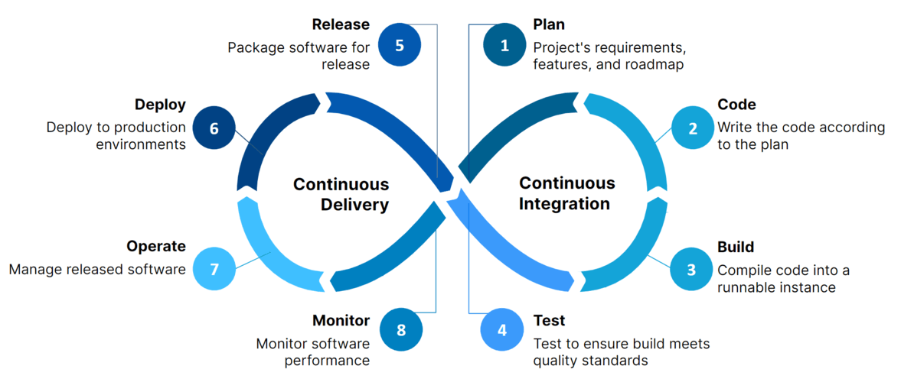
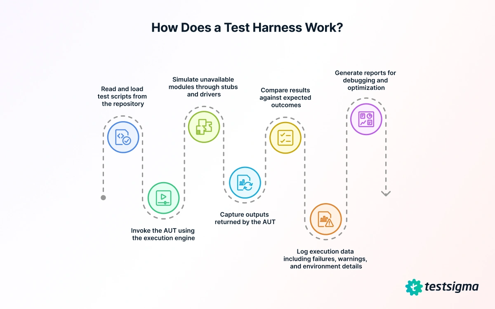
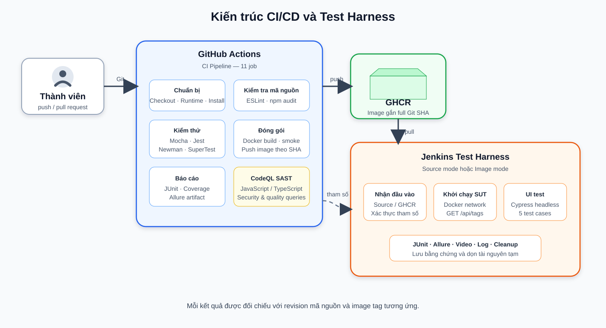
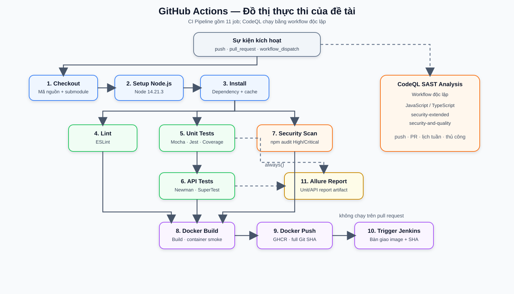
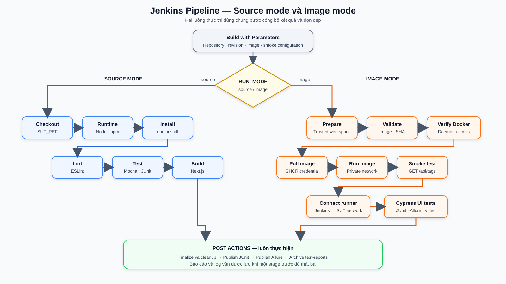
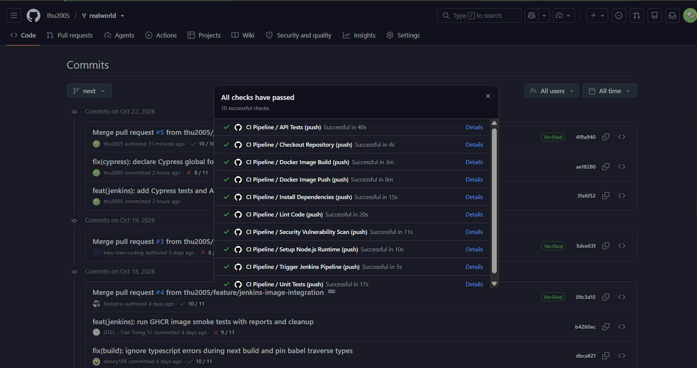
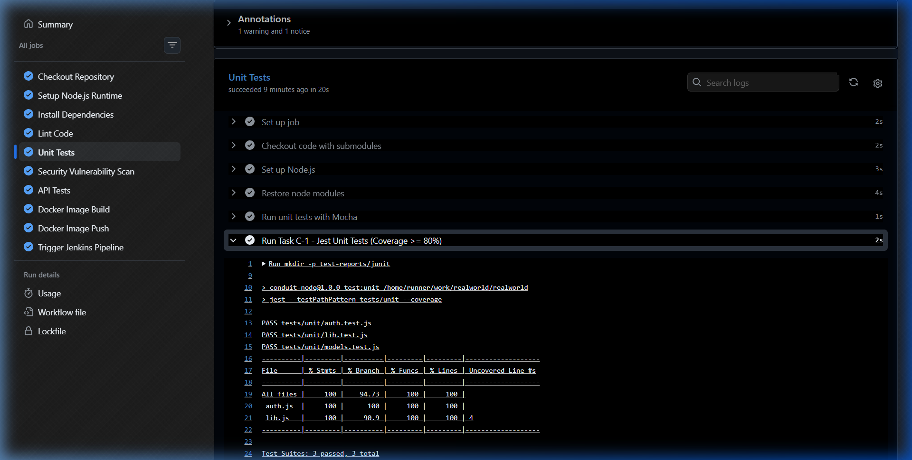
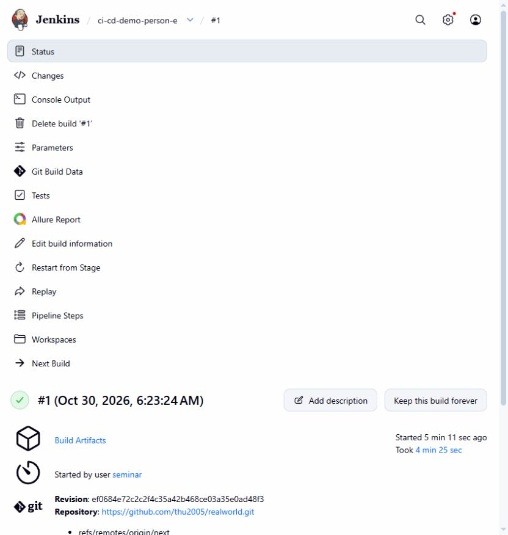
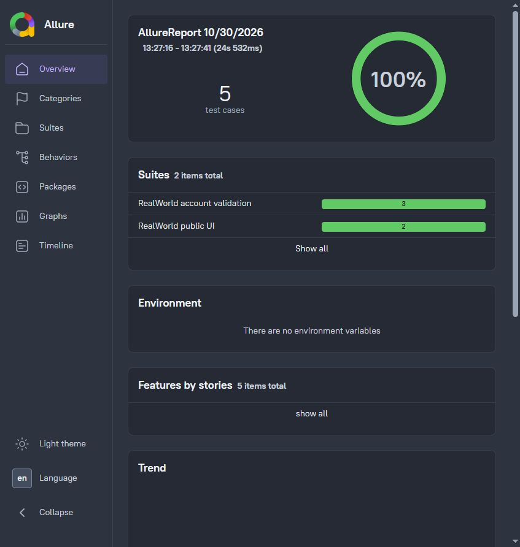
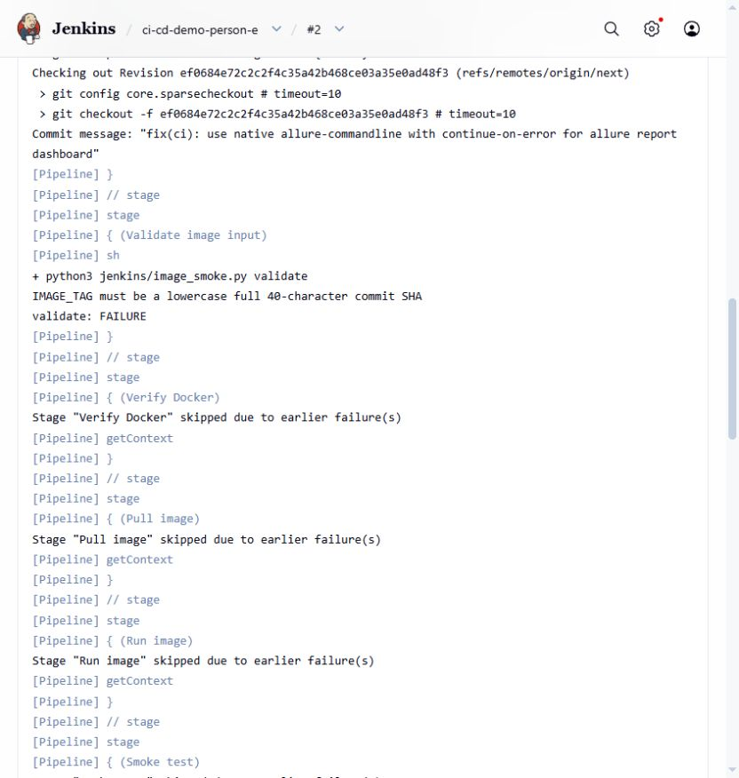

# THÔNG TIN ĐỀ TÀI

**Trường:** Đại học Khoa học Tự nhiên, ĐHQG-HCM  
**Khoa:** Công nghệ Thông tin  
**Học phần:** Kiểm thử phần mềm  
**Đề tài:** Xây dựng Test Harness tự động tích hợp CI/CD cho ứng dụng RealWorld  
**System Under Test:** RealWorld Conduit — Node.js, Express, Next.js, Sequelize và SQLite  
**Repository mã nguồn:** <https://github.com/thu2005/realworld>  
**Các nhánh hiện thực được khảo sát:** `next`, `ci-github-actions`  
**Revision `next` được rà soát:** `38ffa797962d00cdd0f8d81b07102849700b63df`  
**Revision kiểm chứng Jenkins qua SCM và image:** `ef0684e72c2c2f4c35a42b468ce03a35e0ad48f3`  
**Revision `ci-github-actions` được rà soát:** `40da1fea5610f5bbf26ccbc9c191abc693d61cfc`

| Thành viên | MSSV | Trách nhiệm chính trong phần hiện thực |
|---|---:|---|
| Trần Trung Hiếu | 23120044 | Điều phối, quản lý tiến độ và tài liệu |
| Dương Trọng Hòa | 23120127 | GitHub Actions, Docker build/push và kiểm tra chất lượng |
| Nguyễn Lê Hữu Điền | 23120233 | Unit test, API test và báo cáo coverage |
| Nguyễn Đoàn Xuân Thu | 23120170 | Hạ tầng Jenkins, Cypress, Allure và thông tin xác thực |
| Trần Trọng Trí | 20120221 | Vòng đời Docker image trên Jenkins, smoke test và dọn dẹp tài nguyên |


# TÓM TẮT

Báo cáo trình bày quá trình xây dựng một **test harness tự động** và tích hợp nó vào quy trình CI/CD cho ứng dụng mẫu RealWorld Conduit. Mục tiêu của hệ thống là kiểm tra một thay đổi phần mềm qua nhiều lớp: phân tích tĩnh, kiểm thử đơn vị, kiểm thử API, đóng gói container, smoke test và kiểm thử giao diện; đồng thời lưu lại kết quả có thể truy vết theo đúng revision của mã nguồn.

Giải pháp sử dụng GitHub Actions để tự động kiểm tra mã nguồn mỗi khi có thay đổi. Workflow thiết lập đúng phiên bản Node.js, cài dependency, chạy lint, các bộ kiểm thử Mocha, Jest, Newman và SuperTest, kiểm tra lỗ hổng dependency, phân tích mã nguồn bằng CodeQL, sau đó build Docker image và đẩy image lên GitHub Container Registry. Jenkins tiếp nhận mã nguồn hoặc Docker image để thực hiện một vòng kiểm chứng độc lập. Với chế độ kiểm tra image, Jenkins khởi tạo container trong mạng Docker tạm, kiểm tra `GET /api/tags`, chạy Cypress ở chế độ headless, xuất JUnit XML và Allure Report, rồi dọn các tài nguyên tạm.

Kết quả hiện thực gồm 38 ca kiểm thử đơn vị bằng Jest, trong đó có 7 trường hợp tham số hóa bằng `test.each`; 15 ca kiểm thử API bằng SuperTest; bộ API collection chạy bởi Newman; 4 ca Mocha có sẵn và 5 ca Cypress. Trên phạm vi hai mô-đun `lib.js` và `auth.js`, lần chạy có bằng chứng ghi nhận 100% statements, lines và functions, cùng 94,73% branches. Workflow GitHub Actions được mở rộng thành 11 job và một workflow CodeQL độc lập; bằng chứng thực nghiệm trước đó ghi nhận 10 checks của pipeline nền tảng thành công. Jenkins đã kiểm chứng thành công quá trình nhận image từ GHCR, smoke test, 5/5 Cypress tests, 11/11 JUnit checks, xuất Allure Report và dọn dẹp tài nguyên. Hai ca lỗi có chủ đích cũng xác nhận tag không hợp lệ và endpoint smoke sai bị chặn đúng giai đoạn, sau đó pipeline có thể chạy lại thành công. Kết quả cho thấy việc chuẩn hóa runtime, tham số bàn giao, đường dẫn report và quy tắc định danh artifact là điều kiện quan trọng để các công cụ độc lập có thể hợp thành một quy trình kiểm thử có khả năng tái hiện.

**Từ khóa:** CI/CD, Continuous Integration, Test Harness, GitHub Actions, Jenkins, Jest, SuperTest, Cypress, Allure, Docker.

# 1. GIỚI THIỆU

## 1.1. Bối cảnh

Trong một dự án phần mềm, việc có nhiều công cụ kiểm thử chưa đồng nghĩa với việc đã có một quy trình bảo đảm chất lượng nhất quán. Mỗi công cụ thường có cách khởi động, dữ liệu đầu vào, môi trường thực thi và định dạng kết quả riêng. Nếu các bước chỉ được chạy thủ công trên máy cá nhân, kết quả dễ phụ thuộc vào người thực hiện và khó xác định chính xác phiên bản phần mềm đã được kiểm tra.

CI/CD giải quyết một phần vấn đề bằng cách tự động hóa quá trình tích hợp và phân phối phần mềm. Test harness bổ sung cơ chế chuẩn bị môi trường, điều khiển việc thực thi kiểm thử, quan sát kết quả và thu thập bằng chứng. Khi hai thành phần này được kết hợp, mỗi thay đổi có thể đi qua cùng một chuỗi kiểm tra và tạo ra các artifact có thể truy vết.

Seminar chọn RealWorld Conduit làm đối tượng nghiên cứu vì ứng dụng có đầy đủ giao diện web, REST API, xác thực người dùng, tầng truy cập dữ liệu và quy trình build. Đây là phạm vi đủ để minh họa nhiều mức kiểm thử mà không làm bài toán hạ tầng trở nên quá lớn đối với một bài tập môn học.

## 1.2. Mục tiêu

Đề tài hướng đến các mục tiêu sau:

1. Trình bày đúng bản chất của CI, Continuous Delivery, Continuous Deployment và test harness.
2. Thiết kế kiến trúc kiểm thử tự động có sự phối hợp giữa GitHub Actions và Jenkins.
3. Xây dựng các bộ kiểm thử ở mức unit, API và giao diện người dùng.
4. Đóng gói SUT thành Docker image và giữ quan hệ truy vết giữa image với Git commit.
5. Chuẩn hóa test report, log và artifact để có thể phân tích sau mỗi lần chạy.
6. Kiểm chứng giải pháp bằng các lần chạy thực tế và đánh giá kết quả dựa trên bằng chứng.

## 1.3. Phạm vi báo cáo

Báo cáo tập trung vào các thành phần đã được hiện thực: workflow GitHub Actions, kiểm tra bảo mật, Jenkins chạy bằng Docker Compose, hai chế độ pipeline của Jenkins, các bộ kiểm thử hiện có, GHCR, JUnit XML, Allure và cơ chế lưu sản phẩm đầu ra. Phần lý thuyết được dùng để giải thích quyết định thiết kế; phần thực nghiệm trình bày những kết quả đã quan sát được từ hệ thống.

## 1.4. Phương pháp thực hiện

Nhóm tiến hành theo bốn giai đoạn. Đầu tiên, nhóm khảo sát lý thuyết và lựa chọn SUT. Tiếp theo, nhóm thống nhất quy ước chung về runtime, tham số bàn giao và đầu ra. Sau đó, các thành viên hiện thực từng phân hệ kiểm thử và pipeline. Cuối cùng, nhóm chạy thử trên GitHub Actions và Jenkins, rồi thu thập ảnh chụp, report và log để đánh giá.

# 2. CƠ SỞ LÝ THUYẾT

## 2.1. Kiểm thử phần mềm và tự động hóa kiểm thử

Theo thuật ngữ kiểm thử chuẩn, kiểm thử phần mềm là tập hợp các hoạt động nhằm phát hiện khiếm khuyết và đánh giá chất lượng của một đối tượng kiểm thử [1]. Kiểm thử không chỉ là việc chạy một chương trình rồi so sánh đầu ra. Nó bao gồm xác định mục tiêu, thiết kế điều kiện kiểm thử, chuẩn bị dữ liệu và môi trường, thực thi, đánh giá kết quả và lưu bằng chứng.

Tự động hóa kiểm thử sử dụng phần mềm để thực hiện một hoặc nhiều hoạt động nói trên. Tự động hóa giúp tăng khả năng lặp lại và phản hồi nhanh, nhưng không thay thế việc lựa chọn đúng phạm vi và oracle kiểm thử. Một ca kiểm thử tự động chỉ có giá trị khi điều kiện khởi tạo, hành động, kết quả mong đợi và quy tắc pass/fail được xác định rõ.

## 2.2. Continuous Integration

**Continuous Integration (CI)** là một thực hành phát triển trong đó các thành viên tích hợp thay đổi vào một nhánh dùng chung thường xuyên; mỗi lần tích hợp được xác minh bằng build và các kiểm tra tự động để phát hiện lỗi sớm [2]. Hai ý cốt lõi của CI là tần suất tích hợp và khả năng phản hồi tự động. Vì vậy, chỉ có một máy chủ chạy script chưa đủ để khẳng định đã thực hành CI nếu các thay đổi vẫn được gộp sau những khoảng thời gian dài hoặc kết quả kiểm tra không được phản hồi cho nhóm.

Trong đề tài này, GitHub Actions thực hiện vai trò CI chính. Sự kiện `push`, `pull_request` hoặc `workflow_dispatch` tạo một workflow run. Các quality check được thực thi trên cùng revision, giúp nhóm biết thay đổi có đáp ứng các điều kiện lint, test và build hay không.

## 2.3. Continuous Delivery và Continuous Deployment

Hai khái niệm sau thường cùng được viết tắt là CD nhưng có ý nghĩa khác nhau:

- **Continuous Delivery** là khả năng duy trì phần mềm ở trạng thái có thể phát hành thông qua một quy trình build, test và đóng gói đáng tin cậy. Việc đưa bản phát hành lên production vẫn có thể cần một quyết định thủ công hoặc quyết định nghiệp vụ [3].
- **Continuous Deployment** mở rộng Continuous Delivery bằng cách tự động đưa mọi thay đổi đã vượt qua pipeline lên production, không có bước phê duyệt phát hành thủ công [3].



Do đó, một pipeline tạo Docker image và cung cấp image đã kiểm chứng là nền tảng cho Continuous Delivery; nó chưa đương nhiên là Continuous Deployment. Hệ thống seminar dừng ở mức tích hợp liên tục, đóng gói và kiểm chứng artifact. Không có bước tự động phát hành ứng dụng lên môi trường production.

## 2.4. Pipeline và quality gate

Pipeline là mô hình hóa một quy trình phân phối phần mềm thành các bước có thứ tự hoặc quan hệ phụ thuộc. Trong Jenkins, Pipeline được mô tả như code trong `Jenkinsfile`; GitHub Actions mô tả workflow, job và step trong tệp YAML [4], [5].

Một **quality gate** là điều kiện phải đạt trước khi artifact được chuyển sang giai đoạn sau. Ví dụ, nếu unit test trả exit code khác 0 thì job thất bại và Docker image không được build. Các bước không làm thay đổi quyết định pass/fail, chẳng hạn chỉ thu thập dữ liệu chẩn đoán, không nên được gọi là quality gate.

Nguyên tắc *fail-fast* cho phép dừng sớm các nhánh phụ thuộc khi một điều kiện bắt buộc thất bại. Tuy nhiên, bước công bố report và log vẫn nên chạy ở phần hậu xử lý, vì bằng chứng lỗi cần thiết chính trong trường hợp pipeline thất bại.

## 2.5. Test harness

ISO/IEC/IEEE 24765 mô tả test harness như một hệ thống gồm test driver và các công cụ hỗ trợ việc thực thi kiểm thử [6]. Trong thực tế, một harness thường đảm nhiệm bốn nhóm trách nhiệm:

1. **Thiết lập:** chuẩn bị runtime, dependency, database, dữ liệu và cấu hình.
2. **Điều khiển:** khởi động SUT, test runner, driver, stub hoặc probe theo đúng trình tự.
3. **Quan sát:** thu nhận response, assertion, exit code, log, ảnh chụp hoặc video.
4. **Kết thúc:** xuất report và khôi phục môi trường, kể cả khi kiểm thử thất bại.



Test harness không đồng nhất với test suite và cũng không đồng nhất với CI pipeline. Test suite là tập hợp các ca kiểm thử. Test framework cung cấp API và quy ước để viết test. Test runner khám phá và thực thi test. Pipeline điều phối toàn bộ các hoạt động build, test và đóng gói. Harness là phần môi trường và cơ chế giúp các test được chạy, quan sát và lặp lại một cách kiểm soát.

| Khái niệm | Chức năng | Ví dụ trong đề tài |
|---|---|---|
| Test case | Một tập điều kiện, hành động và kết quả mong đợi | API không có token phải trả `401` |
| Test suite | Nhóm các test case liên quan | `tests/api/api.test.js` |
| Test framework/runner | API viết assertion và cơ chế thực thi test | Jest, Mocha, Cypress |
| Test harness | Chuẩn bị SUT, điều khiển runner, thu kết quả và cleanup | Script Jenkins, `image_smoke.py`, cấu hình report |
| CI/CD pipeline | Điều phối build, test, artifact và luồng bàn giao | GitHub Actions và Jenkinsfile |

## 2.6. Các mức kiểm thử

Mức kiểm thử được xác định bởi phạm vi đối tượng và mục tiêu của phép kiểm tra, không chỉ bởi tên công cụ.

- **Component/unit testing** kiểm tra một đơn vị nhỏ trong sự cô lập tương đối. Đề tài dùng Jest cho helper, middleware và hành vi của model.
- **Integration testing** kiểm tra sự tương tác giữa các thành phần. SuperTest gửi HTTP request đến ứng dụng và kiểm tra sự phối hợp giữa route, middleware, model và database.
- **System testing** đánh giá hệ thống đã tích hợp theo hành vi quan sát từ bên ngoài. Cypress điều khiển giao diện web thật và đồng thời quan sát request/response của API.

Mô hình *test automation pyramid* khuyến nghị có nhiều kiểm tra nhỏ, nhanh ở tầng thấp và ít kiểm tra xuyên hệ thống hơn ở tầng cao [7]. Đây là một heuristic về chi phí và tốc độ phản hồi, không phải một tỷ lệ bắt buộc. Cấu trúc 31 unit, 15 API và 5 UI tests của seminar đi theo định hướng này.

**Smoke test** là một tập kiểm tra hẹp nhằm xác nhận các chức năng quan trọng nhất đủ hoạt động để tiếp tục đánh giá sâu hơn. Trong đề tài, `GET /api/tags` được dùng để xác nhận container có thể nhận request và trả JSON đúng cấu trúc trước khi Cypress chạy.

## 2.7. Báo cáo, sản phẩm đầu ra và khả năng truy vết

**Báo cáo kiểm thử (test report)** biểu diễn kết quả thực thi: test nào pass/fail, thời lượng và thông tin lỗi. **Sản phẩm đầu ra (artifact)** là dữ liệu được lưu sau một lần chạy, có thể gồm báo cáo, image, log, video và dữ liệu chẩn đoán. **Khả năng truy vết (traceability)** là khả năng nối kết kết quả với đầu vào đã tạo ra nó.

Đề tài dùng JUnit XML làm định dạng trao đổi kết quả giữa test runner và hệ thống CI; Allure chuyển raw results thành báo cáo HTML có khả năng duyệt theo suite và test case. Docker image được gắn tag bằng full 40-character Git SHA. Nhờ đó, nhóm có thể đối chiếu source revision, image, Jenkins build và report thay vì phụ thuộc vào tag biến đổi như `latest`.

# 3. ĐỐI TƯỢNG VÀ CÔNG NGHỆ NGHIÊN CỨU

## 3.1. System Under Test: RealWorld Conduit

RealWorld là một ứng dụng mạng xã hội dạng blog, còn được gọi là Conduit. Phiên bản được nhóm sử dụng là một ứng dụng monolithic gồm giao diện Next.js/React, REST API Express, ORM Sequelize và SQLite ở cấu hình phát triển. Các chức năng chính gồm đăng ký, đăng nhập, bài viết, bình luận, hồ sơ và tag.

Ứng dụng khai báo Node.js `14.21.3` và npm `6.14.18`. Việc dùng đúng runtime này là yêu cầu quan trọng vì source và một số dependency đã cũ. Repository không có lockfile được commit, vì vậy pipeline dùng `npm install` thay cho `npm ci`.

## 3.2. GitHub Actions

GitHub Actions là nền tảng tự động hóa gắn với repository GitHub. Workflow được định nghĩa bằng YAML trong `.github/workflows/`; mỗi workflow gồm trigger, job và step [5]. Nhóm chọn công cụ này cho tầng CI vì nó nhận trực tiếp sự kiện từ repository, hiển thị check trên commit/pull request, cung cấp runner tạm thời và hỗ trợ artifact cũng như GHCR.

## 3.3. Jenkins

Jenkins là máy chủ tự động hóa có hệ sinh thái plugin và mô hình Pipeline as Code [4]. Trong seminar, Jenkins được đóng gói thành custom Docker image để cố định plugin, Node.js, Docker CLI, Cypress và các thư viện headless. Jenkins đảm nhiệm phần kiểm chứng có trạng thái hơn: nhận tham số bàn giao, kéo image, quản lý vòng đời container, chạy UI tests và công bố Allure Report.

Việc sử dụng cả GitHub Actions và Jenkins không nhằm chạy trùng cùng một tác vụ. GitHub Actions tạo và kiểm tra artifact ở phía repository; Jenkins kiểm chứng artifact đó trong một môi trường riêng và quản lý báo cáo UI.

## 3.4. Công cụ kiểm thử

| Công cụ | Vai trò trong đề tài |
|---|---|
| Mocha | Chạy 4 regression tests có sẵn của ứng dụng |
| Jest | Chạy unit tests, mock dependency và đo coverage |
| SuperTest | Gửi request trực tiếp đến REST API trong bộ Jest API tests |
| Newman | Chạy Postman collection của dự án RealWorld |
| Cypress | Điều khiển trình duyệt headless và kiểm tra luồng UI/API |
| npm audit | Phát hiện lỗ hổng đã biết trong cây dependency và xuất báo cáo theo mức độ |
| CodeQL | Phân tích tĩnh mã nguồn JavaScript/TypeScript theo các mẫu truy vấn bảo mật |
| JUnit XML | Định dạng kết quả để CI đọc và vẽ test trend |
| Allure | Tổng hợp raw result thành báo cáo HTML |

## 3.5. Công nghệ đóng gói và lưu trữ

Docker tạo một image ứng dụng độc lập từ source đã qua kiểm tra. GitHub Container Registry lưu image theo tên `ghcr.io/thu2005/realworld:<commit-sha>`. Docker Compose khởi tạo Jenkins và volume `jenkins_home`, nhờ đó tài khoản, job và lịch sử build được giữ lại khi container Jenkins được tạo lại.

# 4. KIẾN TRÚC GIẢI PHÁP

## 4.1. Yêu cầu thiết kế

Hệ thống được thiết kế theo các yêu cầu sau:

- Mỗi lần chạy phải xác định được revision của source và image.
- Pipeline phải dùng đúng Node.js và npm mà ứng dụng khai báo.
- Các bước lint, test và build bắt buộc phải làm pipeline thất bại khi không đạt.
- Report và log phải được thu thập ngay cả khi kiểm thử thất bại.
- Secret không xuất hiện trong source, log hoặc ảnh chụp.
- Container và network tạm phải được dọn sau build.
- Các thành viên có thể phát triển phân hệ độc lập nhưng phải tuân theo cùng tham số và đường dẫn đầu ra.

## 4.2. Kiến trúc tổng thể



Kiến trúc có hai điểm kiểm soát. Điểm thứ nhất xác nhận source có thể lint, test, build và đóng gói. Điểm thứ hai xác nhận chính image đã đóng gói có thể chạy và phục vụ hành vi bên ngoài. Sự tách này giúp phát hiện cả lỗi source lẫn lỗi chỉ xuất hiện sau containerization.

## 4.3. Thiết kế workflow GitHub Actions

Workflow `CI Pipeline` có 11 job. CodeQL được tách thành một workflow riêng để có thể chạy theo sự kiện push, pull request, lịch hằng tuần hoặc yêu cầu thủ công.



| Thứ tự logic | Job | Đầu ra/điều kiện chính |
|---:|---|---|
| 1 | Checkout Repository | Source và submodule đúng revision |
| 2 | Setup Node.js Runtime | Node `14.21.3` |
| 3 | Install Dependencies | `node_modules` được cache theo `package.json` |
| 4 | Lint Code | ESLint pass |
| 5 | Unit Tests | Mocha XML và Jest coverage |
| 6 | API Tests | Newman XML, server log và SuperTest result |
| 7 | Security Vulnerability Scan | Lưu `security-audit.json` và thống kê theo mức độ; hiện chưa chặn pipeline |
| 8 | Docker Image Build | Image theo SHA và smoke test container pass |
| 9 | Docker Image Push | Image được đẩy lên GHCR đối với sự kiện tin cậy |
| 10 | Trigger Jenkins Pipeline | Bàn giao thông tin image cho Jenkins |
| 11 | Allure Report Dashboard | Tổng hợp report unit/API và lưu báo cáo HTML dưới dạng artifact |

Các job test và scan có thể chạy sau `install`; `docker-build` chỉ chạy sau lint, unit, API và security scan. `docker-push` không chạy trên pull request vì pull request không được phép phát hành package. Job Allure dùng `always() && !cancelled()` để vẫn thu báo cáo khi unit hoặc API test thất bại. Workflow ghim các action bên thứ ba bằng commit SHA và cấp `packages: write` riêng cho job cần đẩy image.

Workflow `CodeQL SAST Analysis` phân tích ngôn ngữ `javascript-typescript` với hai bộ truy vấn `security-extended` và `security-and-quality`. Job chỉ cấp quyền `security-events: write` tại phạm vi cần thiết để gửi kết quả phân tích lên GitHub Code Scanning.

## 4.4. Thiết kế Jenkins Pipeline

Jenkinsfile hỗ trợ hai chế độ.



### 4.4.1. Source mode

`RUN_MODE=source` thực hiện chuỗi:

```text
Checkout -> Verify runtime -> Install -> Lint -> Mocha Test -> Build
```

Chế độ này là baseline độc lập. Jenkins có thể xác minh repository chỉ với `SUT_REPO_URL` và `SUT_REF`, hữu ích khi chưa có Docker image hoặc cần kiểm tra trực tiếp source.

### 4.4.2. Image mode

`RUN_MODE=image` thực hiện chuỗi:

```text
Prepare -> Validate -> Verify Docker -> Pull image -> Run image
        -> Smoke test -> Connect UI runner -> Cypress UI tests
        -> Publish reports and cleanup
```

Image mode từ chối tag rỗng, tag `latest`, SHA sai định dạng hoặc repository khác `ALLOWED_IMAGE_REPO`. Script `jenkins/image_smoke.py` tạo tên container và network theo build, ghi label sở hữu, kiểm tra readiness có timeout và chỉ xóa tài nguyên thuộc lần chạy hiện tại.

SUT không cần publish port ra host. Jenkins container được nối tạm vào mạng riêng chứa SUT và truy cập bằng container name. Cách này tránh xung đột host port và giảm bề mặt truy cập của ứng dụng trong lúc test.

## 4.5. Quy ước tích hợp giữa các thành phần

Bốn tham số tạo thành giao diện bàn giao giữa hai hệ thống:

| Tham số | Ý nghĩa |
|---|---|
| `SUT_REPO_URL` | Repository chứa SUT |
| `SUT_REF` | Branch, tag hoặc commit được kiểm tra ở source mode |
| `IMAGE_REPO` | Repository image, không gồm tag |
| `IMAGE_TAG` | Full 40-character Git commit SHA |

Các đầu ra được chuẩn hóa dưới `test-reports/`:

| Loại đầu ra | Đường dẫn |
|---|---|
| JUnit XML | `test-reports/junit/*.xml` |
| Allure raw results | `test-reports/allure-results/` |
| Cypress screenshots | `test-reports/cypress/screenshots/` |
| Cypress videos | `test-reports/cypress/videos/` |
| Runtime logs | `test-reports/logs/` |

Các quy ước này giảm phụ thuộc giữa người viết test và người viết pipeline: test runner có thể thay đổi nội bộ miễn là giữ command, điều kiện pass/fail và output path đã thống nhất.

## 4.6. Bảo vệ thông tin xác thực

GitHub Actions sử dụng `GITHUB_TOKEN` theo phạm vi job để ghi package. Các giá trị `JENKINS_URL`, `JENKINS_USER` và `JENKINS_TOKEN` được thiết kế để lấy từ GitHub Secrets. Jenkins lưu thông tin GHCR private package bằng credential ID `ghcr-credentials`; token được truyền cho `docker login` qua standard input trong một `DOCKER_CONFIG` tạm.

Mã nguồn chỉ chứa tên credential, không chứa giá trị bí mật. Thư mục cấu hình Docker tạm được xóa sau khi pull, không nằm trong artifact. Đây là ứng dụng của nguyên tắc phân tách cấu hình bí mật khỏi source và cấp quyền tối thiểu theo nhu cầu.

# 5. HIỆN THỰC TEST HARNESS

## 5.1. Cấu trúc hiện thực chính

| Tệp/thư mục | Trách nhiệm |
|---|---|
| `.github/workflows/ci.yml` | Định nghĩa workflow GitHub Actions |
| `.github/workflows/codeql.yml` | Định nghĩa workflow phân tích tĩnh CodeQL |
| `Jenkinsfile` | Định nghĩa source mode, image mode và post actions |
| `Dockerfile` | Đóng gói ứng dụng RealWorld |
| `docker-compose.jenkins.yml` | Khởi tạo Jenkins và volume dữ liệu |
| `jenkins/Dockerfile` | Tạo Jenkins image có Node, Docker CLI và Cypress |
| `jenkins/plugins.txt` | Danh sách plugin Jenkins tối thiểu |
| `jenkins/image_smoke.py` | Quản lý vòng đời SUT container và smoke test |
| `jenkins/trigger_jenkins.py` | Client gọi Jenkins API và theo dõi kết quả |
| `jenkins/demo.py` | Chạy các kịch bản pass/fail phục vụ mini-demo Jenkins |
| `jenkins/test_demo.py` | Kiểm thử hành vi của script demo và API client |
| `tests/unit/` | Jest unit test suites |
| `tests/api/` | SuperTest API integration suite |
| `cypress/e2e/` | Cypress UI/system tests |
| `docs/person-e-handoff.md` | Hướng dẫn chạy lại, kiểm chứng và bàn giao Jenkins |
| `CI_INTEGRATION_CONTRACT.md` | Quy ước tích hợp giữa các phân hệ |

## 5.2. Môi trường Jenkins tái lập bằng Docker

Custom Jenkins image kế thừa `jenkins/jenkins:lts-jdk21`. Image bổ sung:

- Node.js `14.21.3` và npm `6.14.18` cho source pipeline;
- Docker CLI để Jenkins điều khiển container trên Docker daemon của host;
- Python 3 cho các script tích hợp;
- Cypress `9.7.0`, Allure adapter và thư viện Linux cho trình duyệt headless;
- các plugin Pipeline, Git, credentials-binding, JUnit và Allure.

Danh sách plugin được cài trong quá trình build image, không phụ thuộc vào thao tác “Install suggested plugins” trên giao diện. Groovy init script tạo Allure command-line tool tên `allure` nếu cấu hình này chưa tồn tại.

Compose ánh xạ Jenkins tới `127.0.0.1:18080`, gắn named volume vào `/var/jenkins_home` và gắn Docker socket. Việc gắn socket cho phép Jenkins quản lý container nhưng cũng trao quyền lớn đối với Docker host; vì vậy cấu hình này chỉ phù hợp với job tin cậy trong môi trường seminar.

## 5.3. Unit test bằng Jest

Bộ unit test tại revision `40da1fe` gồm 38 ca:

| Suite | Số ca | Nội dung chính |
|---|---:|---|
| `lib.test.js` | 23 | Validate số nguyên/tham số, lỗi validation, client IP, tag và cleanup dữ liệu demo; gồm 7 trường hợp tham số hóa bằng `test.each` |
| `auth.test.js` | 6 | Middleware bắt buộc/tùy chọn, header Token/Bearer và trường hợp thiếu token |
| `models.test.js` | 9 | Hash mật khẩu, JWT, chuẩn hóa user, validation và slug bài viết |

Jest chạy trong môi trường Node và đặt threshold toàn cục 80% cho statements, branches, functions và lines. Tuy nhiên, cấu hình `collectCoverageFrom` chỉ đo `lib.js` và `auth.js`; vì vậy số coverage trong báo cáo phải được hiểu là coverage của hai mô-đun mục tiêu, không phải toàn bộ codebase.

## 5.4. API test bằng SuperTest và Newman

SuperTest suite gồm 15 ca kiểm tra REST API ở mức tích hợp. Các nhóm hành vi chính là:

- `GET /api/tags` và cấu trúc response;
- đăng ký, đăng nhập, JWT và truy cập không xác thực;
- tạo và truy vấn bài viết;
- profile và comment;
- các mã lỗi `401`, `404` và `422`.

API tests chạy tuần tự để tránh dữ liệu dùng chung gây xung đột. Trước Newman, workflow đồng bộ database, khởi động server nền và chờ `GET /api/tags` phản hồi. Newman sau đó chạy collection của submodule `realworld`, xuất kết quả JUnit XML. Hai bộ test bổ sung cho nhau: SuperTest thể hiện các case nhóm chủ động viết, còn Newman tái sử dụng contract collection của dự án RealWorld.

## 5.5. UI test bằng Cypress

Cypress suite hiện có 5 ca trong hai spec:

| Spec | Số ca | Hành vi |
|---|---:|---|
| `public-ui.spec.js` | 2 | Trang chủ và điều hướng đến form đăng nhập |
| `account-validation.spec.js` | 3 | Thiếu mật khẩu, sai thông tin đăng nhập và đăng ký thiếu mật khẩu |

Các case chạy trên trình duyệt headless với viewport `1280x720`. Test dùng DOM assertion để kiểm tra nội dung và điều hướng; các case validation dùng `cy.intercept`/`cy.wait` để xác nhận đồng thời HTTP status `422` và thông báo lỗi trên UI. Video luôn được ghi; screenshot được tạo khi test lỗi. Allure adapter ghi raw results để Jenkins công bố báo cáo.

## 5.6. Container smoke test và cleanup

Sau khi image được kéo về, harness lưu image ID/digest, tạo một network riêng và chạy SUT bằng image ID đã xác định. Một probe container gọi `GET /api/tags` với số lần thử và timeout hữu hạn. Phép kiểm tra chỉ pass khi nhận HTTP `200` và body JSON có mảng `tags`.

Post action thu thập `container.log`, `container-inspect.json`, `smoke-response.json`, `integration-summary.json` và `smoke.xml`. Ở một lần chạy thành công, `smoke.xml` ghi sáu kiểm tra vòng đời gồm validate, pull, start, smoke, connect-agent và finalize. Cuối cùng, Jenkins ngắt kết nối khỏi network rồi xóa app container, probe container và network mang label của build. Cleanup được đặt trong hậu xử lý để vẫn chạy khi validation, smoke test hoặc Cypress thất bại.

## 5.7. Báo cáo kiểm thử và kiểm tra bảo mật trên GitHub Actions

Phần hiện thực GitHub Actions được rà soát tại revision `40da1fe` mở rộng pipeline theo ba hướng.

Thứ nhất, `jest-junit` được cấu hình làm reporter của Jest. Unit tests ghi `jest-unit.xml`, API tests ghi `jest-api.xml`; coverage được xuất ở ba dạng `text`, `lcov` và `json-summary`. Workflow đọc `coverage-summary.json` để tạo bảng statements, branches, functions và lines ngay trong GitHub Actions Job Summary. Các tệp XML và thư mục coverage đồng thời được lưu thành artifact.

Thứ hai, job `security-scan` tạo `security-audit.json`, trình bày số lỗ hổng theo năm mức độ và thực thi `npm audit --audit-level=high`. Trong cấu hình hiện tại, lệnh được nối với `|| true`; do đó bước này cung cấp dữ liệu quan sát và artifact nhưng chưa làm pipeline thất bại khi có lỗ hổng High hoặc Critical.

Thứ ba, workflow `CodeQL SAST Analysis` phân tích tĩnh mã JavaScript/TypeScript bằng các bộ truy vấn mở rộng về bảo mật và chất lượng. Workflow chạy khi có thay đổi mã nguồn, trên pull request, theo lịch hằng tuần và khi được kích hoạt thủ công. Bên cạnh đó, job `allure-report` tải artifact của unit/API tests, tổng hợp dữ liệu đầu vào và tạo artifact `allure-report-dashboard` với thời gian lưu 7 ngày. Job này được đặt `continue-on-error`, nên có vai trò công bố báo cáo theo cơ chế best-effort chứ không phải quality gate. README của nhánh cũng hiển thị trạng thái pipeline và các chỉ số kiểm thử để người xem nhận biết nhanh trạng thái gần nhất.

# 6. TRIỂN KHAI HẠ TẦNG VÀ TÁI HIỆN THỰC NGHIỆM

Chương này mô tả quy trình đã dùng để triển khai môi trường seminar. Các lệnh được chạy trong Linux hoặc WSL2 có Docker Engine/Docker Desktop integration.

## 6.1. Điều kiện môi trường

- Git hỗ trợ submodule;
- Docker Engine và Docker Compose v2;
- tối thiểu khoảng 8 GB RAM để build ứng dụng, Jenkins và Cypress;
- quyền truy cập repository GitHub và GHCR tương ứng;
- cổng host `18080` chưa được sử dụng.

## 6.2. Lấy mã nguồn

```bash
git clone --recurse-submodules https://github.com/thu2005/realworld.git
cd realworld
git checkout next
git submodule update --init --recursive
git rev-parse HEAD
```

Lệnh cuối ghi nhận revision được dùng trong thực nghiệm. Khi tái hiện một kết quả cũ, cần checkout đúng commit thay vì chỉ dựa vào tên branch có thể thay đổi.

## 6.3. Build và khởi động Jenkins

```bash
docker compose -f docker-compose.jenkins.yml config --quiet
docker compose -f docker-compose.jenkins.yml build jenkins
docker compose -f docker-compose.jenkins.yml up -d --no-build jenkins
docker compose -f docker-compose.jenkins.yml ps
```

Giao diện Jenkins được mở tại `http://localhost:18080`. Named volume `jenkins_home` được giữ qua các lần recreate container. Sau khi khởi động, khả năng truy cập Docker và Cypress được xác nhận bằng:

```bash
docker compose -f docker-compose.jenkins.yml exec jenkins docker version
docker compose -f docker-compose.jenkins.yml exec jenkins cypress verify
```

## 6.4. Tạo Pipeline job

Trong Jenkins, nhóm tạo job loại **Pipeline** với tên `ci-cd-demo`, chọn **Pipeline script from SCM**, sau đó cấu hình:

| Thuộc tính | Giá trị |
|---|---|
| SCM | Git |
| Repository URL | `https://github.com/thu2005/realworld.git` |
| Branch Specifier | `*/next` |
| Script Path | `Jenkinsfile` |

Lần chạy đầu tiên nạp Jenkinsfile và tạo danh sách tham số; các lần sau giao diện hiển thị **Build with Parameters**.

## 6.5. Cấu hình credential GHCR

Đối với package private, một credential loại **Username with password** được tạo trong Jenkins:

| Trường | Giá trị |
|---|---|
| ID | `ghcr-credentials` |
| Username | Tài khoản GitHub có quyền đọc package |
| Password | Personal access token có quyền đọc package |

Token chỉ được nhập vào Jenkins Credentials. Pipeline tham chiếu credential qua ID và không ghi token vào `Jenkinsfile`.

## 6.6. Chạy source mode

Các tham số chính:

| Tham số | Giá trị mẫu |
|---|---|
| `RUN_MODE` | `source` |
| `SUT_REPO_URL` | `https://github.com/thu2005/realworld.git` |
| `SUT_REF` | `next` hoặc một full commit SHA |

Sau khi build kết thúc, Stage View phải thể hiện các bước checkout, runtime, install, lint, test và build. `SUT_REF` nên là commit SHA khi cần tái hiện chính xác một kết quả.

## 6.7. Chạy image mode

Các tham số dùng để kiểm chứng GHCR image:

| Tham số | Giá trị |
|---|---|
| `RUN_MODE` | `image` |
| `IMAGE_REPO` | `ghcr.io/thu2005/realworld` |
| `IMAGE_TAG` | full 40-character commit SHA |
| `PULL_IMAGE` | `true` |
| `GHCR_PRIVATE` | `true` khi package private |
| `SMOKE_TIMEOUT_SECONDS` | `120` |
| `SMOKE_PATH` | `/api/tags` |

Tag image phải tương ứng với commit mà GitHub Actions đã dùng để build. Khi pipeline hoàn tất, giao diện Jenkins cung cấp Test Result, Allure Report và Build Artifacts. Không cần mở port của SUT ra host vì các phép kiểm tra chạy trong mạng Docker nội bộ.

## 6.8. Kiểm tra report và trạng thái cleanup

Các bằng chứng quan trọng sau một image-mode build gồm:

- JUnit result của smoke test và Cypress;
- Allure Report;
- Cypress video hoặc screenshot;
- image reference, image ID/digest và source SHA trong integration summary;
- log container;
- kết quả cleanup.

Có thể kiểm tra không còn tài nguyên tạm bằng `docker ps -a` và `docker network ls`. Harness không dùng lệnh prune toàn cục; nó chỉ xóa tài nguyên có nhãn sở hữu của build.

# 7. PHÂN TÍCH BỘ KIỂM THỬ

## 7.1. Phân bố kiểm thử

| Mức/loại kiểm thử | Công cụ | Số ca đếm trực tiếp | Mục tiêu |
|---|---|---:|---|
| Regression có sẵn | Mocha | 4 | Xác nhận hành vi nền của ứng dụng |
| Unit | Jest | 38 | Helper, auth middleware và model; gồm 7 trường hợp dữ liệu tham số hóa |
| API integration | SuperTest | 15 | Các API REST và luồng dữ liệu |
| API contract collection | Newman | Theo collection | Kiểm tra RealWorld API contract |
| UI/system | Cypress | 5 | Điều hướng và validation qua giao diện |

Nếu tính các case do source của repository sinh ra khi chạy, hệ thống có 62 test cases. Trong số này, 7 case của `test.each` dùng chung một thân kiểm thử nhưng được Jest thực thi riêng cho từng hàng dữ liệu. Newman được báo cáo riêng vì số iteration/request do collection và script của submodule quyết định; cộng nó vào một tổng tĩnh dễ tạo số liệu sai.

## 7.2. Mức độ bao phủ hành vi

Bộ unit test tập trung vào logic có thể cô lập và thực thi nhanh. API suite mở rộng sang authentication, bài viết, profile và comment. UI suite kiểm tra đường đi công khai và ba trường hợp validation tài khoản. Cấu trúc này tạo ba lớp phản hồi: lỗi hàm/middleware được phát hiện nhanh ở Jest; lỗi tích hợp route và database được phát hiện ở API; lỗi nối kết giữa browser, UI và backend được phát hiện ở Cypress.

## 7.3. Phân tích coverage

Kết quả Jest trên hai tệp được cấu hình đo coverage:

| Chỉ số | Kết quả | Threshold |
|---|---:|---:|
| Statements | 100% | 80% |
| Branches | 94,73% | 80% |
| Functions | 100% | 80% |
| Lines | 100% | 80% |

Coverage là chỉ báo về phần cấu trúc mã đã được thực thi, không tự chứng minh rằng mọi yêu cầu hay mọi lỗi đều đã được kiểm tra. Giá trị của kết quả trên nằm ở việc hai mô-đun mục tiêu vượt threshold và pipeline có thể tự động phát hiện regression coverage. Nó không được dùng để kết luận toàn bộ RealWorld đạt 100% coverage.

## 7.4. Oracle và khả năng chẩn đoán

Các suite dùng nhiều dạng oracle:

- giá trị trả về và exception đối với unit test;
- HTTP status và JSON body đối với API/smoke test;
- DOM state, URL, HTTP status và thông báo lỗi đối với Cypress;
- exit code để truyền trạng thái pass/fail cho pipeline.

Khi thất bại, JUnit XML xác định test case và message; server/container log cho biết lỗi runtime; Cypress video/screenshot giúp quan sát trạng thái UI; Allure nhóm kết quả theo suite. Việc kết hợp oracle với artifact chẩn đoán làm giảm thời gian xác định lỗi so với chỉ lưu console output.

# 8. THỰC NGHIỆM VÀ KẾT QUẢ

## 8.1. Thiết kế thực nghiệm

Nhóm kiểm chứng bốn câu hỏi:

1. Source có vượt qua các kiểm tra lint, unit, API và build trên CI hay không?
2. Docker image có khởi động và phản hồi API kiểm tra tối thiểu hay không?
3. Jenkins có nhận đúng image theo commit SHA, chạy Cypress và xuất report hay không?
4. Sau build, artifact có được lưu và tài nguyên tạm có được dọn hay không?

Đầu vào chính là nhánh `next`; runner GitHub Actions dùng Ubuntu; Jenkins chạy trong Docker trên môi trường local/WSL2. Kết quả được đánh giá từ trạng thái job, test report, Allure, artifact list và ảnh chụp màn hình.

## 8.2. Kết quả GitHub Actions

Tại merge commit `4f9a9405b2baebc42969d40f638501e8debfd20e`, GitHub hiển thị **10 successful checks**. Các job API Tests, Unit Tests, Lint Code, Docker Image Build, Docker Image Push và Trigger Jenkins Pipeline đều thành công. Kết quả này xác nhận chuỗi từ source đến GHCR image đã chạy hoàn chỉnh trên sự kiện push vào `next`.



## 8.3. Kết quả kiểm tra phần hiện thực GitHub Actions mở rộng

Qua kiểm tra workflow tại revision `40da1fe`, pipeline chính có 11 job và workflow CodeQL có một job phân tích riêng. Các thay đổi có thể đối chiếu trực tiếp trong cấu hình như sau:

| Nội dung | Dấu hiệu trong mã nguồn | Kết quả mong đợi khi chạy |
|---|---|---|
| JUnit cho Jest | Reporter `jest-junit`; `jest-unit.xml`, `jest-api.xml` | GitHub/Jenkins có thể đọc kết quả unit và API theo cùng định dạng |
| Coverage artifact | `text`, `lcov`, `json-summary` | Có báo cáo HTML, JSON summary và bảng trong Job Summary |
| Dependency security report | `npm audit --audit-level=high || true` | Thống kê và lưu artifact; chưa chặn pipeline theo mức độ |
| CodeQL SAST | `codeql.yml`, query `security-extended,security-and-quality` | Kết quả được gửi đến GitHub Code Scanning |
| Allure trên GitHub Actions | Job `allure-report`, artifact `allure-report-dashboard` | Tạo artifact theo cơ chế best-effort; không chặn pipeline nếu bước tạo report lỗi |

## 8.4. Kết quả unit test và coverage

Ảnh bằng chứng của lần chạy trước khi bổ sung `test.each` ghi nhận 31/31 tests thuộc 3/3 Jest suites đều pass. Bảng coverage cho hai mô-đun mục tiêu đạt 100% statements, functions và lines; branch coverage đạt 94,73%, vượt threshold 80%. Revision `40da1fe` bổ sung 7 hàng dữ liệu vào `lib.test.js`, đưa số case hiện có trong source lên 38; báo cáo không dùng ảnh 31 tests để suy diễn trạng thái thực thi của 7 case mới.



## 8.5. Kết quả Jenkins image pipeline

Lần kiểm chứng Week 7 sử dụng job `ci-cd-demo-person-e` loại **Pipeline script from SCM**, lấy `Jenkinsfile`, lifecycle runner và Cypress tests trực tiếp từ nhánh `next`. Build `#1` dùng cùng revision cho SCM và image là `ef0684e72c2c2f4c35a42b468ce03a35e0ad48f3`, sau đó hoàn tất chuỗi validate, pull, start, smoke, kết nối UI runner, Cypress, công bố report và cleanup. Image được đối chiếu thêm bằng digest `sha256:b1afd0dddf5a722f668b851da686ed28ba5e0c942c00476fcfbdb9b45d67f0d2`.



Allure của build thành công ghi nhận 5/5 UI tests, gồm 2 ca `RealWorld public UI` và 3 ca `RealWorld account validation`. Jenkins đồng thời đọc 11/11 JUnit checks: 5 Cypress tests và 6 kiểm tra vòng đời từ `smoke.xml`. Artifact lưu Allure raw data, hai video Cypress, JUnit XML, container log, image inspection, smoke response và integration summary.



Hai ca lỗi có chủ đích xác nhận fail-fast và khả năng chẩn đoán. Build `#2` dùng tag `latest` nên dừng đúng tại **Validate image input** vì pipeline yêu cầu full 40-character SHA. Build `#3` dùng endpoint smoke sai nên thất bại với HTTP 404. Build `#4` chạy lại kịch bản hợp lệ và thành công với 5/5 UI tests, 11/11 JUnit checks. Cả bốn build đều ghi `cleanup_complete=true`, vì vậy hai failure là bằng chứng kiểm thử âm chứ không phải lỗi còn tồn đọng.



Revision `next` hiện tại là `38ffa797962d00cdd0f8d81b07102849700b63df`, bao gồm phần bàn giao và script demo đã merge sau lần kiểm chứng trên. Báo cáo ghi riêng revision thực nghiệm `ef0684e…` để không suy diễn rằng image ở một commit khác đã được chạy.

## 8.6. Tổng hợp kết quả

| Hạng mục | Kết quả quan sát | Đánh giá |
|---|---|---|
| GitHub Actions nền tảng | 10 checks thành công trên lần chạy có bằng chứng | Đạt |
| GitHub Actions mở rộng | Cấu hình 11 job, JUnit, coverage summary và Allure artifact | Đã hiện thực |
| Dependency security report | Thống kê mức độ và lưu `security-audit.json`; chưa chặn theo ngưỡng | Đã hiện thực ở chế độ quan sát |
| CodeQL SAST | Workflow JavaScript/TypeScript với bộ truy vấn mở rộng | Đã hiện thực |
| Jest unit tests | Source hiện có 38 tests; bằng chứng trước đó ghi nhận 31/31 tests, 3 suites pass | Đã hiện thực; 7 case mới chưa có ảnh đối chiếu trong báo cáo |
| Coverage mục tiêu | 100/94,73/100/100, threshold 80% | Đạt |
| SuperTest API | 15 test cases được tích hợp vào CI | Đạt |
| Docker build/smoke | Image build và `/api/tags` pass | Đạt |
| GHCR traceability | Image tag là full Git SHA | Đạt |
| Jenkins image lifecycle | Hai build pass, hai ca lỗi có chủ đích và cleanup hoàn tất | Đạt |
| Cypress hiện tại | 5/5 UI tests; JUnit tổng hợp 5 UI và 6 lifecycle checks | Đạt |
| Allure publication | Jenkins công bố report 5/5 test thành công | Đạt |
| Fail-fast và recovery | Tag `latest` và smoke 404 bị chặn; lượt chạy lại thành công | Đạt |
| Secret handling | Credential lấy qua Jenkins/GitHub secret store | Đạt |

# 9. THẢO LUẬN

## 9.1. Ý nghĩa của kết quả

Kết quả quan trọng nhất không chỉ là số test pass mà là khả năng liên kết các pha thành một chuỗi có thể kiểm chứng. Một Git commit tạo ra một image mang cùng SHA; Jenkins dùng chính SHA này để kéo image; build lưu report và log gắn với lần chạy. Chuỗi liên kết đó làm cho câu hỏi “đã kiểm tra phiên bản nào?” có câu trả lời rõ ràng.

Việc giữ source mode song song với image mode cũng có giá trị chẩn đoán. Source mode cho biết repository có thể lint, test và build trong Jenkins. Image mode cho biết artifact do CI tạo có thể vận hành. Nếu source mode pass nhưng image mode fail, phạm vi điều tra có thể tập trung vào Dockerfile, registry hoặc runtime container.

## 9.2. Vai trò của test harness trong giải pháp

Nếu chỉ có các file test, người dùng vẫn phải tự khởi động server, chọn port, chờ readiness, chạy đúng lệnh và thu report. Harness đã biến các thao tác này thành quy trình xác định: nó tạo môi trường, điều phối container, cung cấp base URL cho Cypress, thu bằng chứng và dọn tài nguyên. Đây là khác biệt thực tế giữa một tập test scripts và một test harness tích hợp.

## 9.3. Đánh đổi thiết kế

Chạy Cypress bên trong custom Jenkins image giúp cấu hình demo đơn giản và report xuất hiện trực tiếp ở Jenkins, nhưng làm Jenkins image lớn hơn. Gắn Docker socket giúp quản lý sibling container thuận tiện, song chỉ an toàn khi Jenkins chạy job đáng tin cậy. Việc dùng hai nền tảng CI tăng giá trị minh họa về handoff và artifact verification, đồng thời làm cấu hình phức tạp hơn một pipeline đơn lẻ.

Nhóm ưu tiên khả năng tái hiện và truy vết hơn việc tối ưu thời gian chạy tuyệt đối. Ví dụ, tag SHA được dùng làm định danh chính dù vẫn có tag `latest` phụ trợ; full SHA dài hơn nhưng không mơ hồ.

# 10. KHÓ KHĂN, GIỚI HẠN VÀ HƯỚNG PHÁT TRIỂN

## 10.1. Khó khăn trong quá trình thực hiện

Ứng dụng dùng Node.js 14 và nhiều dependency cũ, trong khi runner và plugin hiện đại thường giả định runtime mới hơn. Nhóm phải cố định Node/npm và chọn phiên bản Cypress tương thích. Repository không commit lockfile nên việc cài dependency chưa có tính tất định hoàn toàn.

Jenkins chạy trên máy local tại `127.0.0.1:18080`; GitHub-hosted runner không thể truy cập địa chỉ localhost này. Vì vậy, khả năng tự động trigger đã được hiện thực ở mức client và contract, nhưng các lần kiểm chứng local sử dụng **Build with Parameters** sau khi image được push. Việc đưa Jenkins ra Internet chỉ để demo sẽ tạo rủi ro lớn hơn lợi ích.

Quá trình tích hợp qua nhiều nhánh làm revision hiện tại và revision thực nghiệm không phải lúc nào cũng trùng nhau. Các Jenkins build có bằng chứng dùng SCM và image ở `ef0684e…`; nhánh `next` hiện tại ở `38ffa79…` sau khi merge phần bàn giao và script demo. Báo cáo ghi riêng hai mốc để không dùng kết quả của một image nhằm suy diễn cho commit khác.

## 10.2. Giới hạn

- Coverage mới được thu thập có chủ đích cho `lib.js` và `auth.js`, chưa đại diện toàn bộ ứng dụng.
- UI suite tập trung vào public navigation và validation, chưa bao phủ toàn bộ luồng người dùng đã xác thực.
- `npm audit` hiện chạy ở chế độ quan sát vì có `|| true`; pipeline chưa thực thi chính sách chặn theo mức độ High/Critical.
- Phần Allure trên GitHub Actions đã có cấu hình tạo artifact, nhưng báo cáo thực nghiệm hiện có chủ yếu chứng minh Allure trên Jenkins.
- Jenkins chạy test trên controller để đơn giản hóa seminar; mô hình vận hành thực tế nên dùng agent cô lập.
- Kết nối GitHub Actions → Jenkins chưa được chứng minh qua một địa chỉ Jenkins có thể truy cập từ Internet hoặc self-hosted runner trong lần demo local.

## 10.3. Hướng phát triển

Hệ thống có thể được hoàn thiện theo thứ tự ưu tiên sau:

1. Commit lockfile và nâng cấp runtime/dependency trong một nhánh riêng để tăng tính lặp lại và giảm lỗ hổng.
2. Mở rộng coverage có chọn lọc sang route và model quan trọng, đồng thời giữ threshold phù hợp với phạm vi đo.
3. Bổ sung UI tests cho đăng nhập thành công, tạo bài viết, bình luận và đăng xuất bằng dữ liệu kiểm thử cô lập.
4. Dùng self-hosted runner hoặc một địa chỉ Jenkins được bảo vệ để kiểm chứng quá trình kích hoạt tự động từ đầu đến cuối mà không công khai tùy tiện máy local.
5. Chuyển Jenkins workload sang agent tạm thời, giới hạn quyền Docker và tách controller khỏi test execution.
6. Thống nhất ngưỡng chấp nhận lỗ hổng, bỏ `|| true` khi cây dependency đã được xử lý đủ để dùng `npm audit` làm quality gate; đồng thời bổ sung bằng chứng thực nghiệm cho Allure artifact trên GitHub Actions.

# 11. VIDEO DEMO VÀ SLIDE TRÌNH BÀY

Nhóm chuẩn bị ba video và một bộ slide để trình bày nội dung seminar:

| Tài liệu | Nội dung | Liên kết |
|---:|---|---|
| Video 1 | Demo GitHub Actions | [Xem video GitHub Actions](https://drive.google.com/file/d/1OO2DmSEiVwyk-Jcb2RpwqcTHhs9janmp/view?usp=sharing) |
| Video 2 | Demo Jenkins pipeline | [Xem video Jenkins](https://drive.google.com/drive/folders/1sEgVaQWbD3vBH5v1CqjRAnmRobgyLsJD?usp=sharing) |
| Video 3 | Video thuyết trình seminar | [Xem video thuyết trình](https://drive.google.com/file/d/13pjwDisbNMdks_shLDick7uwYZ4-8C1q/view?usp=sharing) |
| Slide | Slide thuyết trình | [Mở slide seminar](../weekly-docs/Week7/PersonA/slideshow.html) |

# 12. KẾT LUẬN

Seminar đã hiện thực một test harness nhiều lớp cho RealWorld và tích hợp nó vào hai nền tảng tự động hóa. GitHub Actions chịu trách nhiệm kiểm tra source và tạo container artifact; Jenkins kiểm chứng artifact đó bằng smoke test và UI tests, sau đó công bố report và dọn môi trường. Các bộ Jest, SuperTest, Newman, Mocha và Cypress cung cấp phản hồi ở các mức khác nhau; JUnit, Allure, log và video tạo bằng chứng để phân tích.

Qua quá trình thực hiện, nhóm nhận thấy giá trị của CI/CD không nằm ở số lượng stage mà ở tính nhất quán của đầu vào, điều kiện pass/fail và artifact đầu ra. Tương tự, test harness không chỉ là tập hợp test scripts mà là toàn bộ cơ chế giúp test được thiết lập, thực thi, quan sát và kết thúc có kiểm soát. Việc dùng full commit SHA, chuẩn hóa report path và lưu kết quả hậu xử lý đã giúp các phân hệ do nhiều thành viên phát triển có thể tích hợp thành một quy trình chung có khả năng tái hiện.

# TÀI LIỆU THAM KHẢO

[1] ISTQB, *Glossary of Testing Terms*, mục “testing”, <https://glossary.istqb.org/>.

[2] Martin Fowler, “Continuous Integration,” 2006, <https://martinfowler.com/articles/continuousIntegration.html>.

[3] Jez Humble và David Farley, *Continuous Delivery: Reliable Software Releases through Build, Test, and Deployment Automation*, Addison-Wesley, 2010.

[4] Jenkins Project, “Pipeline,” *Jenkins User Documentation*, <https://www.jenkins.io/doc/book/pipeline/>.

[5] GitHub, “Understanding GitHub Actions,” *GitHub Docs*, <https://docs.github.com/actions/about-github-actions/understanding-github-actions>.

[6] ISO/IEC/IEEE 24765:2017, *Systems and software engineering — Vocabulary*, International Organization for Standardization, 2017.

[7] Mike Cohn, *Succeeding with Agile: Software Development Using Scrum*, Addison-Wesley, 2009.

[8] Jest, “Jest Documentation,” <https://jestjs.io/docs/getting-started>.

[9] SuperAgent contributors, “SuperTest,” <https://github.com/ladjs/supertest>.

[10] Postman, “Newman Documentation,” <https://learning.postman.com/docs/collections/using-newman-cli/command-line-integration-with-newman/>.

[11] Cypress, “Cypress Documentation,” <https://docs.cypress.io/>.

[12] Allure Report, “Allure Report Documentation,” <https://allurereport.org/docs/>.

[13] Docker, “Docker Build Overview,” <https://docs.docker.com/build/concepts/overview/>.

[14] GitHub, “Working with the Container registry,” <https://docs.github.com/packages/working-with-a-github-packages-registry/working-with-the-container-registry>.

