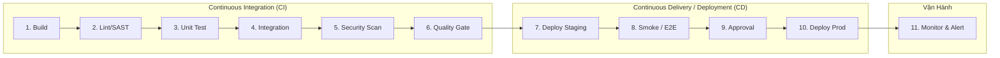
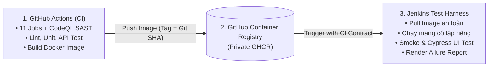

<!-- SLIDE 1: Title -->
<!-- _class: title-slide -->
<!-- _header: "" -->
<!-- _footer: "Nhóm 01 • Lớp 23KTPM3 | 01" -->

### SEMINAR KIỂM THỬ PHẦN MỀM • ĐẠI HỌC KHOA HỌC TỰ NHIÊN, ĐHQG-HCM

# Xây Dựng Test Harness Tự Động Tích Hợp CI/CD Cho Ứng Dụng RealWorld

**Khái niệm nền tảng, cơ chế kiểm thử tự động, và thực nghiệm phối hợp CI GitHub Actions với Test Harness Jenkins trên hệ thống RealWorld Conduit.**

---

**Nhóm 01 • Lớp 23KTPM3** (Tháng 10 năm 2026)
* **Trần Trung Hiếu:** Điều phối dự án, biên tập tài liệu tổng thể
* **Dương Trọng Hòa:** GitHub Actions CI, CodeQL SAST, Docker Build & Push
* **Nguyễn Lê Hữu Điền:** Bộ kiểm thử Unit/API, Coverage Threshold
* **Nguyễn Đoàn Xuân Thu:** Jenkins Test Harness, Cypress UI, Allure Report, Jenkins Credentials
* **Trần Trọng Trí:** Vòng đời SUT, Quản lý Network/Container cô lập, Smoke Test & Dọn dẹp Zero Leak

---

<!-- SLIDE 2: Nền tảng tự động hóa -->
<!-- _footer: "Nhóm 01 | Báo Cáo Seminar KTPM • 02" -->

### NỀN TẢNG TỰ ĐỘNG HÓA
## Ba Mức Độ Tự Động Hóa Trong Phát Triển Phần Mềm

| Mức độ | Bản chất & Hoạt động cốt lõi | Đề tài áp dụng thực tế |
| :--- | :--- | :--- |
| **Continuous Integration (CI)** | • Tích hợp mã nguồn vào nhánh dùng chung thường xuyên.<br>• Tự động Build, Lint, Unit Test, API Test ngay lập tức.<br>• Phát hiện sớm lỗi xung đột và cú pháp (Fail-Fast). | **GitHub Actions** kiểm soát và chặn mã lỗi gộp vào nhánh chính thông qua các Quality Gates tự động. |
| **Continuous Delivery (CD)** | • Duy trì phần mềm ở trạng thái luôn sẵn sàng để phát hành.<br>• Tự động đóng gói Artifact chuẩn hóa (Docker Image).<br>• **Cần phê duyệt thủ công (Manual Gate)** trước khi lên Production. | Đóng gói và lưu trữ Docker Image trên **GHCR** gắn tag Full Git SHA, bàn giao sang Jenkins. |
| **Continuous Deployment** | • Tự động hóa hoàn toàn luồng phát hành đến Production.<br>• Không cần phê duyệt thủ công.<br>• Đòi hỏi hệ thống Test tự động cực kỳ tin cậy và khắt khe. | *Phạm vi đề tài tập trung ở mức CI và Continuous Delivery.* |

---

<!-- SLIDE 2b: Phân Tích CI/CD & Pipeline -->
<!-- _footer: "Nhóm 01 | Báo Cáo Seminar KTPM • 02b" -->

### PHÂN TÍCH LÝ THUYẾT CI/CD
## Pipeline, Quality Gates & Nguyên Tắc Fail-Fast

### 1. Khái niệm Pipeline
* Pipeline là sự **mô hình hóa quy trình phân phối phần mềm** thành các bước tuần tự hoặc có quan hệ phụ thuộc lẫn nhau.
* Chuyển đổi mã nguồn thô thành một sản phẩm có thể triển khai qua chuỗi:  
  $$\text{Chuẩn bị (Source/Dependencies)} \longrightarrow \text{Kiểm tra (Quality/Security)} \longrightarrow \text{Đóng gói (Packaging/Artifact)}$$

### 2. Quality Gate (Cổng Chất Lượng)
* Là **điều kiện bắt buộc phải thỏa mãn** trước khi artifact được chuyển sang giai đoạn kế tiếp.
* Nếu Unit Test, API Test hoặc Security Scan thất bại, Quality Gate lập tức đóng lại, ngăn chặn mã lỗi bị merge vào nhánh chính hoặc deploy.

### 3. Nguyên tắc Fail-Fast trong thiết kế Pipeline
* Cho phép **dừng sớm toàn bộ quy trình** ngay khi một bước bắt buộc thất bại (ví dụ: Lint cú pháp hỏng).
* Giúp tiết kiệm tài nguyên máy chủ CI, đưa phản hồi tức thì cho Developer sửa lỗi (*Fix-forward*) thay vì đợi kiểm thử tốn kém ở các bước sau.

---

<!-- SLIDE 2c: 11 Bước Tiêu Chuẩn -->
<!-- _footer: "Nhóm 01 | Báo Cáo Seminar KTPM • 02c" -->

### PHÂN TÍCH LÝ THUYẾT CI/CD
## Quy Trình 11 Bước Tiêu Chuẩn Của Một Pipeline Phân Phối



* **Giai đoạn CI (Bước 1 – 6):** Build $\rightarrow$ Lint/SAST $\rightarrow$ Unit Test $\rightarrow$ Integration Test $\rightarrow$ Security Scan $\rightarrow$ Quality Gate. Đảm bảo code an toàn và đạt chuẩn trước khi merge.
* **Giai đoạn CD (Bước 7 – 10):** Deploy Staging $\rightarrow$ Smoke/E2E Test $\rightarrow$ Manual Approval $\rightarrow$ Deploy Production. Triển khai phần mềm lên môi trường thực nghiệm và phát hành.
* **Giai đoạn Vận Hành (Bước 11):** Giám sát runtime logs, APM metrics và phát cảnh báo sự cố 24/7.

---

<!-- SLIDE 2d: Xử lý sự cố -->
<!-- _footer: "Nhóm 01 | Báo Cáo Seminar KTPM • 02d" -->

### PHÂN TÍCH LÝ THUYẾT CI/CD
## Tính Kháng Lỗi (Resilience): Kịch Bản Xử Lý Sự Cố

*Pipeline không chỉ phục vụ luồng suôn sẻ (Happy Path) mà quan trọng hơn là cơ chế bảo vệ hệ thống khi phát sinh sự cố.*

| Trường Hợp Sự Cố | Phát Hiện & Tác Động | Chiến Lược Xử Lý Đề Xuất |
| :--- | :--- | :--- |
| **1. Lỗi Code ở pha CI** *(Compile error, Test fail)* | Phát hiện ở bước 1 – 6. Pipeline bị chặn đứng ngay lập tức (*Fail-Fast*). | Ngăn chặn lệnh Merge Pull Request. Thông báo lỗi tức thì; Developer khắc phục trên nhánh phụ rồi đẩy lại commit mới. |
| **2. Lỗi sau khi Merge** *(Lọt qua CI lọt vào main)* | Phát hiện tại môi trường Staging hoặc review hồi tố sau khi code đã vào nhánh `main`. | Sử dụng **`git revert`** để tạo commit đảo ngược an toàn.  <br>*(Tuyệt đối không dùng `git reset` làm biến đổi lịch sử Git chung).* |
| **3. Sự cố trên Production** *(Lỗi runtime, hiệu năng)* | Phát hiện qua hệ thống Monitoring (bước 11) sau khi hệ thống đã Go-Live. | **Rollback khẩn cấp:** Triển khai lại Docker Image phiên bản ổn định trước đó hoặc điều hướng traffic (Blue/Green Deployment). |
| **4. Sự cố Hạ tầng** *(Runner down, Network timeout)* | Sự cố ngoài mã nguồn (mất kết nối Registry, hết hạn token xác thực bên thứ ba). | Áp dụng cơ chế **Auto-Retry** (có giới hạn số lần thử lại). Kích hoạt cảnh báo hệ thống gửi đến đội ngũ Vận hành (Ops). |

---

<!-- SLIDE 3: Test Harness Định nghĩa -->
<!-- _footer: "Nhóm 01 | Báo Cáo Seminar KTPM • 03" -->

### KIỂM THỬ CHUYÊN SÂU
## Test Harness (Theo Chuẩn ISO/IEC/IEEE 24765)

> *"Tập hợp các công cụ, thư viện, dữ liệu kiểm thử và cấu hình được xây dựng để tự động hóa việc chuẩn bị, điều khiển, quan sát và dọn dẹp quá trình thực thi kiểm thử một cách nhất quán."*

### 4 Trách Nhiệm Cốt Lõi Được Hiện Thực Hóa Trong Đề Tài:
1. **Thiết lập (Setup):**  
   Cố định môi trường Node.js 14.21.3, cài đặt dependencies dự án, khởi tạo mạng Docker riêng ảo tách biệt.
2. **Điều khiển (Execution Control):**  
   Khởi chạy SUT RealWorld trong mạng cô lập, polling endpoint `/api/tags` chờ HTTP 200 (Readiness Probe), kích hoạt test runner.
3. **Quan sát (Observation & Telemetry):**  
   Bắt exit code tiến trình, gom log stdout/stderr từ Docker container, chụp ảnh màn hình và ghi hình video khi Cypress test thất bại.
4. **Dọn dẹp (Teardown & Cleanup):**  
   Tổng hợp và render báo cáo Allure/JUnit HTML trực quan; tiêu hủy chính xác container và mạng theo nhãn `build` (*Zero Resource Leak*).

---

<!-- SLIDE 3b: Phân biệt thuật ngữ -->
<!-- _footer: "Nhóm 01 | Báo Cáo Seminar KTPM • 03b" -->

### NỀN TẢNG LÝ THUYẾT
## Phân Biệt Các Thuật Ngữ Kiểm Thử Chuyên Sâu

| Khái Niệm | Chức Năng & Định Nghĩa Cốt Lõi | Ví Dụ Thực Tiễn Trong Đề Tài |
| :--- | :--- | :--- |
| **Test Case & Test Suite** | Tập hợp điều kiện đầu vào, thao tác thực thi và kết quả kỳ vọng để xác minh một chức năng cụ thể. Tập hợp nhiều Test Case tạo thành Test Suite. | File `tests/api/api.test.js` chứa các ca kiểm thử đăng nhập, bài viết, xác thực token. |
| **Test Framework / Runner** | Thư viện cung cấp cú pháp khai báo ca test (assertions, mock, hooks) cùng bộ máy khám phá và thực thi mã test. | **Jest, Mocha, Cypress:**  <br>Cung cấp cấu trúc cú pháp `describe()`, `it()`, `expect()`. |
| **Test Harness** | **Toàn bộ môi trường và cơ sở hạ tầng** bao bọc phục vụ runner: dựng SUT, bơm dữ liệu, điều khiển luồng, thu nhận telemetry và dọn sạch tài nguyên. | Script `jenkins/image_smoke.py`, mạng Docker nội bộ, tiến trình khởi tạo và xuất báo cáo Allure. |
| **CI/CD Pipeline** | Hệ thống điều phối cấp cao quản lý trọn vẹn vòng đời phát triển từ lúc nhận mã nguồn đến lúc bàn giao hoặc phát hành. | **GitHub Actions** (`ci.yml`) và **Jenkins Pipeline** (`Jenkinsfile`). |

---

<!-- SLIDE 3c: Tính chất bắt buộc của Test Harness -->
<!-- _footer: "Nhóm 01 | Báo Cáo Seminar KTPM • 03c" -->

### PHÂN TÍCH LÝ THUYẾT
## Các Tính Chất Cốt Lõi Của Một Test Harness Kiến Trúc Tốt

* **1. Khả Năng Tái Lập (Reproducibility) & Tính Cô Lập (Isolation)**  
  * Một ca test chỉ có giá trị khi trả về cùng một kết quả với cùng một phiên bản mã nguồn ở bất kỳ môi trường nào.
  * Harness bắt buộc phải cung cấp môi trường khép kín (như mạng Docker cô lập riêng theo Job), tránh xung đột cổng hay tài nguyên dùng chung, loại bỏ triệt để hiện tượng **Flaky Tests** (kiểm thử chập chờn).
* **2. Khả Năng Truy Vết (Traceability)**  
  * Tất cả các sản phẩm sinh ra (Test Report, Log, Screenshot, Video, Docker Image) phải gắn chặt với nguyên nhân sinh ra nó.
  * Đề tài sử dụng **Full 40-character Git SHA** làm khóa định danh duy nhất xuyên suốt giữa Git Commit $\longleftrightarrow$ Docker Tag $\longleftrightarrow$ Jenkins Build $\longleftrightarrow$ Allure Report.
* **3. Tôn Trọng Test Oracle (Cơ Chế Phán Quyết)**  
  * Test Harness có vai trò thu thập chứng cứ và điều phối nhưng không thay thế việc lựa chọn Test Oracle chính xác.
  * Đề tài kết hợp đa tầng Oracle: Mã trạng thái HTTP (API SuperTest), Trạng thái DOM & URL (Cypress UI), và Mã thoát Exit Code hệ điều hành.

---

<!-- SLIDE 3d: Shift-Left / Shift-Right -->
<!-- _footer: "Nhóm 01 | Báo Cáo Seminar KTPM • 03d" -->

### CHIẾN LƯỢC KIỂM THỬ
## Xu Hướng Mở Rộng: Shift-Left & Shift-Right Testing

### $\longleftarrow$ Shift-Left Testing (Đẩy Sớm Về Phía Trước)
* Chuyển các hoạt động kiểm thử về các pha sớm nhất của quy trình phát triển, thực thi ngay trên máy Developer nhằm giảm thiểu chi phí phát hiện lỗi.
* **Git Pre-commit Hooks (Husky):** Tự động format, lint và chạy nhanh Unit test chặn commit hỏng ngay trên máy trạm.
* **Fast PR Pipelines:** Luồng CI tinh gọn phản hồi tự động kết quả kiểm thử trong vòng dưới 10 phút.

### Shift-Right Testing (Đẩy Sau Sang Phía Vận Hành) $\longrightarrow$
* Mở rộng kiểm thử và giám sát trực tiếp trên môi trường Production với lưu lượng người dùng thật.
* **Canary Deployment:** Phát hành phiên bản mới cho nhóm nhỏ người dùng (5%) trước khi cập nhật toàn diện.
* **Synthetic Monitoring:** Định kỳ kích hoạt Bot kiểm thử các luồng then chốt 24/7 để đo lường độ khả dụng thực tế.

> **Chiến lược kiểm soát Flaky Test:** (1) Auto-retry 2–3 lần đối với ca E2E; (2) Cách ly (Quarantine) các ca không ổn định; (3) Tuyệt đối tránh hàm `sleep()` tĩnh, thay bằng Polling/Wait chủ động theo trạng thái HTTP/DOM.

---

<!-- SLIDE 4: Đối Tượng SUT & Công Cụ -->
<!-- _footer: "Nhóm 01 | Báo Cáo Seminar KTPM • 04" -->

### ĐỐI TƯỢNG NGHIÊN CỨU
## Hệ Thống SUT RealWorld Conduit & Bộ Công Cụ Kiểm Thử

### Kiến Trúc SUT (System Under Test)
* **RealWorld Conduit:** Ứng dụng Medium Clone full-stack mẫu theo kiến trúc Monolith.
* **Frontend:** Next.js, React.
* **Backend API:** Node.js, Express REST API.
* **Database:** Sequelize ORM kết hợp SQLite (chế độ development).
* **Runtime:** Cố định **Node.js 14.21.3** và **npm 6.14.18**.

### Ma Trận Công Cụ Sử Dụng Trong Dự Án
* **Jest & Mocha:** Thực thi kiểm thử đơn vị (Unit Tests), tạo mock và đo độ bao phủ (Coverage).
* **SuperTest & Newman:** Kiểm thử REST API (cấu trúc JSON, JWT auth token, validation 401/404/422).
* **Cypress:** Kiểm thử giao diện và hành vi hệ thống (Headless E2E/UI Testing), intercept mạng.
* **npm audit & GitHub CodeQL:** Quét mã tĩnh (SAST), chặn mã độc và kiểm toán phụ thuộc mức High/Critical.
* **JUnit XML & Allure Framework:** Chuẩn hóa dữ liệu thô và xuất báo cáo kiểm thử HTML trực quan.

---

<!-- SLIDE 5: Test Pyramid -->
<!-- _footer: "Nhóm 01 | Báo Cáo Seminar KTPM • 05" -->

### CHIẾN LƯỢC PHÂN BỔ
## Kim Tự Tháp Kiểm Thử (Test Pyramid) – 55+ Ca Test Của Dự Án

```
                   ▲
                  / \
                 /   \
                /  5  \      UI / E2E Tests (Cypress)
               / E2E   \     2 Spec Files (public-ui, account-validation)
              /---------\
             /    15     \    API / Integration Tests (SuperTest & Newman)
            / Integration \   Auth, Articles, Comments, Tags, Postman Contract
           /---------------\
          /       35        \  Unit & Component Tests (Jest & Mocha)
         /    Unit Tests     \ 31 Jest (lib, auth, models) + 4 Mocha Legacy
        /---------------------\
```

* **UI / System Tests (5 ca):** Kiểm thử luồng giao diện chính qua Cypress headless, kiểm tra render trang chủ, chuyển trang, biểu mẫu xác thực người dùng và hiển thị lỗi 422.
* **API Integration Tests (15 ca + Newman Contract):** Xác thực endpoint Express, kiểm tra tính toàn vẹn payload JSON, vòng đời bài viết, comment, tag và profile người dùng.
* **Unit Tests (35 ca):** Kiểm thử cô lập các hàm logic nén slug, xử lý chuỗi, mã hóa mật khẩu, kiểm tra client IP, và ký token JWT; đảm bảo đạt Coverage > 80%.

---

<!-- SLIDE 6: Kiến Trúc Phối Hợp & CI Contract -->
<!-- _footer: "Nhóm 01 | Báo Cáo Seminar KTPM • 06" -->

### MÔ HÌNH LAI (HYBRID ARCHITECTURE)
## Kiến Trúc Phối Hợp GitHub Actions + Jenkins & CI Contract



### Bản Hợp Đồng Tích Hợp (CI Contract) Bất Biến Giữa Hai Phân Hệ

| Tham Số Bàn Giao | Ý Nghĩa Kỹ Thuật & Yêu Cầu | Giá Trị Thực Tế Dự Án |
| :--- | :--- | :--- |
| `SUT_REPO_URL` | Đường dẫn kho chứa mã nguồn SUT dùng để đối chiếu | `https://github.com/thu2005/realworld` |
| `SUT_REF` | Tên nhánh hoặc mã Commit SHA cần kiểm thử | `next` hoặc Full Git SHA |
| `IMAGE_TAG` | Mã định danh Docker Image tuyệt đối bàn giao sang Harness | `4f9a9405b2baeb...` *(Không dùng `latest`)* |
| `SMOKE_PATH` | Endpoint kiểm tra độ sẵn sàng (*Readiness Check*) của SUT | `/api/tags` *(Chờ HTTP 200 trước khi chạy UI)* |

---

<!-- SLIDE 7: GitHub Actions -->
<!-- _footer: "Nhóm 01 | Báo Cáo Seminar KTPM • 07" -->

### PHÂN HỆ ĐÁM MÂY
## GitHub Actions Pipeline: 11 Jobs Độc Lập & Quality Gates

```yaml
# Trích đoạn cấu hình luồng ci.yml
name: CI Pipeline
on: [push, pull_request, workflow_dispatch]
jobs:
  unit-test:
    needs: install
    steps: [ run: npm run test:unit ]
  api-test:
    needs: install
    steps: [ run: npm run test:api ]
  security-scan:
    needs: install
    steps: [ run: npm audit --audit-level=high ]
  docker-build:
    needs: [lint, unit-test, api-test, security-scan]
    steps: [ run: docker build -t $IMAGE:${{ github.sha }} . ]
```

### 4 Cổng Kiểm Soát Chất Lượng (Quality Gates) Bắt Buộc
1. **Gate 1 - Unit Test & Coverage:** Toàn bộ test Jest phải Passed; Coverage cục bộ (`lib.js`, `auth.js`) đạt $\ge 80\%$. Đẩy artifact `jest-unit.xml`.
2. **Gate 2 - API Integrity:** SuperTest và Newman xác thực API thành công, lưu artifact `jest-api.xml`.
3. **Gate 3 - Dependency Audit:** Tự động dừng khẩn cấp (*Fail-Fast*) nếu tồn tại lỗ hổng cấp *High* hoặc *Critical*.
4. **Gate 4 - CodeQL SAST Analysis:** Quét bảo mật phân tích tĩnh toàn diện, phát hiện lỗi tiêm mã và bảo mật web.

---

<!-- SLIDE 8: Jenkins (Source vs Image) -->
<!-- _footer: "Nhóm 01 | Báo Cáo Seminar KTPM • 08" -->

### HẠ TẦNG TỰ CHỦ
## Jenkins Test Harness: Custom Node & Hai Chế Độ Vận Hành

### Chế Độ Nguồn: Source Mode (`RUN_MODE=source`)
* Đóng vai trò môi trường đối chứng (*Baseline Check*) trực tiếp trên mã nguồn.
* Checkout kho mã theo `SUT_REF`, cài đặt dependency thô trên agent.
* Chạy Lint, Unit Test cũ (Mocha) và biên dịch Next.js ngay trong workspace.

### Chế Độ Ảnh: Image Mode (`RUN_MODE=image`)
* Mô phỏng chính xác môi trường phát hành: Kéo Docker Image đã đóng gói sẵn từ GHCR qua Secret `ghcr-credentials`.
* Khởi động container trong mạng ảo riêng biệt độc lập cổng Host.
* Thực thi script `image_smoke.py` thăm dò tính sẵn sàng qua `/api/tags`.
* Chạy trọn vẹn 5 ca Cypress Headless UI và thu thập log/artifacts.

> **Cơ chế Custom Agent & Zero Resource Leak:**  
> Jenkins Master/Agent được tùy biến đóng gói sẵn Node 14, Docker CLI, Python 3, Cypress 9.7 và Allure CLI. Khối `post.always` dọn dẹp chính xác tài nguyên có gắn label của phiên build, không gọi `docker system prune` gây ảnh hưởng job chạy song song.

---

<!-- SLIDE 9: Kết quả thực nghiệm -->
<!-- _footer: "Nhóm 01 | Báo Cáo Seminar KTPM • 09" -->

### THỰC TIỄN TRIỂN KHAI
## Kết Quả Thực Nghiệm Của Đề Tài (Nhóm 01)

| Chỉ Số Đánh Giá | Kết Quả Đạt Được | Chi Tiết Kỹ Thuật Ghi Nhận |
| :---: | :---: | :--- |
| **GitHub Actions Pipeline** | **10/10 Checks Passed** | Hoàn thành trọn vẹn tại revision `4f9a9405` & `19c70a9`. Tự động biên dịch và đẩy Docker Image lên GHCR gắn nhãn Git SHA đích danh. CodeQL SAST hoàn tất không cảnh báo nghiêm trọng. |
| **Độ Bao Phủ Mã (Unit Coverage)** | **100% / 94.7%** | Đo lường bởi Jest: Độ bao phủ Statements, Lines, Functions đạt **100%**, Branches đạt **94.73%** trên các mô-đun nghiệp vụ chính (`lib.js`, `auth.js`), vượt xa ngưỡng tối thiểu 80%. |
| **Jenkins Test Harness** | **Build #9 Thành Công** | Ghi nhận Test Trend gồm 6 bài test đạt tiêu chuẩn (1 Smoke Readiness Check + 5 Cypress UI E2E Cases). Không xung đột cổng; xuất báo cáo Allure HTML hoàn chỉnh. |

---

<!-- SLIDE 10: Video Demo -->
<!-- _footer: "Nhóm 01 | Báo Cáo Seminar KTPM • 10" -->

### SẢN PHẨM TRỰC QUAN
## Chuỗi Video Demo Hành Vi & Phân Tích Kỹ Thuật

* **Video 1: Cơ Sở Lý Thuyết & Kiến Trúc Tổng Thể**  
  * Trình bày cơ sở lý thuyết CI/CD, chuẩn ISO/IEC/IEEE 24765 về Test Harness.
  * Phân tích kiến trúc phối hợp Hybrid và hợp đồng tích hợp CI Contract bất biến (`SUT_REF`, `IMAGE_TAG`, `SMOKE_PATH`).
* **Video 2: Thực Nghiệm Phân Hệ GitHub Actions CI Pipeline**  
  * Trực tiếp kiểm chứng 11 Jobs trong `ci.yml` và quy trình CodeQL `codeql.yml`.
  * Demo cơ chế Quality Gate kiểm toán bảo mật `npm audit` chặn lỗi High/Critical, đóng gói Docker Image và push lên GHCR.
* **Video 3: Thực Nghiệm Phân Hệ Jenkins Test Harness**  
  * Thực nghiệm Image Mode điều khiển bằng tham số, kéo ảnh từ Private Registry.
  * Khởi tạo mạng ảo cô lập, kích hoạt Smoke Test thăm dò HTTP 200, chạy Cypress UI Headless, tạo Allure Report và kích hoạt cơ chế dọn dẹp Zero Resource Leak.

---

<!-- SLIDE 11: Đánh Giá & Bài Học Kinh Nghiệm -->
<!-- _class: title-slide -->
<!-- _header: "" -->
<!-- _footer: "Nhóm 01 | Báo Cáo Seminar KTPM • 11" -->

### KẾT LUẬN & ĐỊNH HƯỚNG
# Đánh Đổi Thiết Kế, Khó Khăn & Hướng Phát Triển

### Đánh Đổi Thiết Kế & Thành Công
* **Tính Bất Biến & Truy Vết:** Loại bỏ hoàn toàn tag `latest`, chuyển sang sử dụng Full 40-character Git SHA làm Single Source of Truth cho toàn bộ artifact.
* **Dung Lượng Image vs Tính Độc Lập:** Chấp nhận image Jenkins Agent có dung lượng lớn do tích hợp Cypress/Browsers để triệt tiêu hoàn toàn sự cố xung đột môi trường ("Dependency Hell").
* **An Toàn Container:** Sử dụng Docker socket `/var/run/docker.sock` đáp ứng mô hình Seminar gọn nhẹ; trên thực tế cần chuyển sang Kubernetes dind/ephemeral agents.

### Khó Khăn & Kế Hoạch Tương Lai
* **Mã Nguồn Cũ (Legacy):** Dự án gốc gắn liền Node 14 và thiếu `package-lock.json` dẫn đến tính bất định; nhóm đã khắc phục bằng cách cố định phiên bản runner và image.
* **Mở Rộng Test Suite:** Tiếp tục gia tăng độ bao phủ mã sang toàn bộ các routes/models còn lại và bổ sung ca E2E cho luồng khởi tạo/quản lý bài viết blog sau khi đăng nhập.

---

<!-- SLIDE 12: Lời Cảm Ơn -->
<!-- _class: title-slide -->
<!-- _header: "" -->
<!-- _footer: "Nhóm 01 • Lớp 23KTPM3" -->

<br><br><br>

# Xin Chân Thành Cảm Ơn Thầy Cô Và Các Bạn Đã Theo Dõi!

**Nhóm 01 • Lớp 23KTPM3**  
Seminar Môn Học: Kiểm Thử Phần Mềm  
*Trường Đại học Khoa học Tự nhiên, ĐHQG-HCM*
