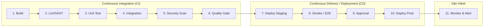

<!-- SLIDE 01: Title -->
<!-- _header: "" -->
<!-- _footer: "Nhóm 01 • Lớp 23KTPM3 • 01 / 21" -->

### <span style="color:#0284c7; font-size:16px; letter-spacing:0.1em;">SEMINAR KIỂM THỬ PHẦN MỀM • ĐẠI HỌC KHOA HỌC TỰ NHIÊN, ĐHQG-HCM</span>

# <span style="font-size:48px; line-height:1.15; color:#0f172a; font-weight:700;">Xây Dựng Test Harness Tự Động Tích Hợp CI/CD Cho Ứng Dụng RealWorld</span>

<span style="color:#334155; font-size:23px; line-height:1.55; font-weight:500;">Khái niệm nền tảng, cơ chế kiểm thử tự động, và thực nghiệm phối hợp CI GitHub Actions với Test Harness Jenkins trên hệ thống RealWorld Conduit.</span>

---

<span style="font-size:20px; font-weight:700;">Nhóm 01 • Lớp 23KTPM3</span> *(Tháng 10 năm 2026)*
* **Trần Trung Hiếu**
* **Dương Trọng Hòa**
* **Nguyễn Lê Hữu Điền**
* **Nguyễn Đoàn Xuân Thu**
* **Trần Trọng Trí**

---

<!-- SLIDE 02: Ba Mức Độ Tự Động Hóa -->
<!-- _footer: "Nhóm 01 | Báo Cáo Seminar KTPM • 02 / 21" -->

### NỀN TẢNG TỰ ĐỘNG HÓA
## Ba Mức Độ Tự Động Hóa Trong Phát Triển Phần Mềm

| Mức độ | Bản chất & Hoạt động cốt lõi | Nhóm áp dụng thực tế |
| :--- | :--- | :--- |
| <b style="font-size:21px; color:#0284c7;">Continuous Integration (CI)</b> | <span style="font-size:20px;">• Tích hợp thay đổi vào nhánh dùng chung thường xuyên.<br>• Tự động Build, Lint, Unit Test, API Test ngay lập tức.<br>• Phát hiện sớm lỗi xung đột và cú pháp (Fail-Fast).</span> | <span style="font-size:20px;">**GitHub Actions** kiểm soát và chặn mã nguồn lỗi gộp vào nhánh chính thông qua các Quality Gates tự động.</span> |
| <b style="font-size:21px; color:#0284c7;">Continuous Delivery (CD)</b> | <span style="font-size:20px;">• Duy trì phần mềm ở trạng thái luôn sẵn sàng để phát hành.<br>• Tự động đóng gói Artifact chuẩn hóa (Docker Image).<br>• **Cần phê duyệt thủ công (Manual Gate)** trước khi lên Production.</span> | <span style="font-size:20px;">Đóng gói và lưu trữ Docker Image trên **GHCR** gắn tag Full Git SHA, bàn giao sang Jenkins.</span> |
| <b style="font-size:21px; color:#475569;">Continuous Deployment</b> | <span style="font-size:20px;">• Tự động hóa hoàn toàn luồng phát hành đến Production.<br>• Không cần phê duyệt thủ công.<br>• Đòi hỏi hệ thống Test tự động cực kỳ tin cậy và khắt khe.</span> | <span style="font-size:20px;">*Phạm vi Pipeline chỉ tập trung ở mức CI và Continuous Delivery.*</span> |

---

<!-- SLIDE 03: Pipeline & Quality Gates & Fail-Fast -->
<!-- _footer: "Nhóm 01 | Báo Cáo Seminar KTPM • 03 / 21" -->

### NỀN TẢNG LÝ THUYẾT CI/CD
## Pipeline, Quality Gates & Nguyên Tắc Fail-Fast

### 1. Khái niệm Pipeline
* <span style="font-size:20px; line-height:1.55;">Pipeline là sự **mô hình hóa quy trình phân phối phần mềm** thành các bước tuần tự hoặc có quan hệ phụ thuộc lẫn nhau.</span>
* <span style="font-size:20px; line-height:1.55;">Chuyển đổi mã nguồn thô thành một sản phẩm có thể triển khai qua chuỗi:  
  **Chuẩn bị (Source/Dependencies) → Kiểm tra (Quality/Security) → Đóng gói (Packaging/Artifact)**</span>

### 2. Quality Gate (Cổng Chất Lượng)
* <span style="font-size:20px; line-height:1.55;">Là **điều kiện bắt buộc phải thỏa mãn** trước khi artifact được chuyển sang giai đoạn kế tiếp.</span>
* <span style="font-size:20px; line-height:1.55;">Nếu Unit Test, API Test hoặc Security Scan thất bại, Quality Gate lập tức đóng lại, ngăn chặn mã nguồn lỗi bị merge vào nhánh chính hoặc deploy.</span>

### 3. Nguyên tắc Fail-Fast trong thiết kế Pipeline
* <span style="font-size:20px; line-height:1.55;">Cho phép **dừng sớm toàn bộ quy trình** ngay khi một bước bắt buộc thất bại (ví dụ: Lint cú pháp hỏng).</span>
* <span style="font-size:20px; line-height:1.55;">Giúp tiết kiệm tài nguyên máy chủ CI, đưa phản hồi tức thì cho Developer sửa lỗi (*Fix-forward*) thay vì đợi kiểm thử tốn kém ở các bước sau.</span>

---

<!-- SLIDE 04: Quy Trình 11 Bước Tiêu Chuẩn -->
<!-- _footer: "Nhóm 01 | Báo Cáo Seminar KTPM • 04 / 21" -->

### PHÂN TÍCH LÝ THUYẾT CI/CD
## Quy Trình 11 Bước Tiêu Chuẩn Của Một Pipeline Phân Phối



* <span style="font-size:23px; line-height:1.55;">**Giai đoạn CI (Bước 1 – 6):** Build → Lint/SAST → Unit Test → Integration Test → Security Scan → Quality Gate. Đảm bảo code an toàn và đạt chuẩn trước khi merge.</span>
* <span style="font-size:23px; line-height:1.55;">**Giai đoạn CD (Bước 7 – 10):** Deploy Staging → Smoke/E2E Test → Manual Approval → Deploy Production. Triển khai phần mềm lên môi trường thực nghiệm và phát hành.</span>
* <span style="font-size:23px; line-height:1.55;">**Giai đoạn Vận Hành (Bước 11):** Giám sát runtime logs, APM metrics và phát cảnh báo sự cố 24/7.</span>

---

<!-- SLIDE 05: Tính Kháng Lỗi (Resilience) -->
<!-- _footer: "Nhóm 01 | Báo Cáo Seminar KTPM • 05 / 21" -->

### PHÂN TÍCH LÝ THUYẾT CI/CD
## Tính Kháng Lỗi (Resilience): Kịch Bản Xử Lý Sự Cố

<span style="font-size:18px; color:#475569;">*Pipeline không chỉ phục vụ luồng suôn sẻ (Happy Path) mà quan trọng hơn là cơ chế bảo vệ hệ thống khi phát sinh sự cố.*</span>

| <span style="font-size:18px;">Trường Hợp Sự Cố</span> | <span style="font-size:18px;">Phát Hiện & Tác Động</span> | <span style="font-size:18px;">Chiến Lược Xử Lý Đề Xuất</span> |
| :--- | :--- | :--- |
| <span style="font-size:17px;"><b style="color:#ef4444;">1. Lỗi Code ở pha CI</b><br>*(Compile error, Test fail)*</span> | <span style="font-size:17px;">Phát hiện ở bước 1 – 6. Pipeline bị chặn đứng ngay lập tức (*Fail-Fast*).</span> | <span style="font-size:17px;">Ngăn chặn lệnh Merge. Thông báo lỗi tức thì; Developer khắc phục trên nhánh phụ rồi đẩy commit mới.</span> |
| <span style="font-size:17px;"><b style="color:#ea580c;">2. Lỗi sau khi Merge</b><br>*(Lọt qua CI lọt vào main)*</span> | <span style="font-size:17px;">Phát hiện tại Staging hoặc review hồi tố sau khi code đã vào nhánh `main`.</span> | <span style="font-size:17px;">Sử dụng **`git revert`** để tạo commit đảo ngược an toàn. *(Tuyệt đối không dùng `git reset` làm biến đổi lịch sử Git chung).*</span> |
| <span style="font-size:17px;"><b style="color:#b91c1c;">3. Sự cố trên Production</b><br>*(Lỗi runtime, hiệu năng)*</span> | <span style="font-size:17px;">Phát hiện qua hệ thống Monitoring (bước 11) sau khi hệ thống đã Go-Live.</span> | <span style="font-size:17px;">**Rollback khẩn cấp:** Triển khai lại Docker Image bản ổn định trước đó hoặc điều hướng traffic (Blue/Green Deployment).</span> |
| <span style="font-size:17px;"><b style="color:#7c3aed;">4. Sự cố Hạ tầng</b><br>*(Runner down, Network timeout)*</span> | <span style="font-size:17px;">Sự cố ngoài mã nguồn (mất kết nối Registry, hết hạn token xác thực bên thứ ba).</span> | <span style="font-size:17px;">Áp dụng cơ chế **Auto-Retry** (có giới hạn số lần thử lại). Kích hoạt cảnh báo gửi đến đội ngũ Vận hành (Ops).</span> |

---

<!-- SLIDE 06: Test Harness Định Nghĩa -->
<!-- _footer: "Nhóm 01 | Báo Cáo Seminar KTPM • 06 / 21" -->

### KIỂM THỬ CHUYÊN SÂU
## Test Harness (Theo Chuẩn ISO/IEC/IEEE 24765)

> *"Tập hợp các công cụ, thư viện, dữ liệu kiểm thử và cấu hình được xây dựng để tự động hóa việc chuẩn bị, điều khiển, quan sát và dọn dẹp quá trình thực thi kiểm thử một cách nhất quán."*

### Từ lý thuyết đó nhóm đã áp dụng :
1. **Thiết lập (Setup):**  
   Cố định môi trường Node.js 14.21.3, cài đặt dependencies dự án, khởi tạo mạng Docker riêng ảo tách biệt.
2. **Điều khiển (Execution Control):**  
   Khởi chạy SUT RealWorld trong mạng cô lập, polling endpoint `/api/tags` chờ HTTP 200 (Readiness Probe), kích hoạt test runner.
3. **Quan sát (Observation & Telemetry):**  
   Bắt exit code tiến trình, gom log stdout/stderr từ Docker container, chụp ảnh màn hình và ghi hình video khi Cypress test thất bại.
4. **Dọn dẹp (Teardown & Cleanup):**  
   Tổng hợp và render báo cáo Allure/JUnit HTML trực quan; tiêu hủy chính xác container và mạng theo nhãn `build` (*Zero Resource Leak*).

---

<!-- SLIDE 07: Phân Biệt Thuật Ngữ Kiểm Thử -->
<!-- _footer: "Nhóm 01 | Báo Cáo Seminar KTPM • 07 / 21" -->
<style scoped>
table { font-size: 18.5px; }
td:first-child { font-size: 20.5px; font-weight: 700; }
</style>

### NỀN TẢNG LÝ THUYẾT
## Phân Biệt Các Thuật Ngữ Kiểm Thử Chuyên Sâu

| Khái Niệm | Chức Năng & Định Nghĩa Cốt Lõi | Hiện Thực Trong Pipeline |
| :--- | :--- | :--- |
| **Test Case & Test Suite** | Tập hợp điều kiện đầu vào, thao tác thực thi và kết quả kỳ vọng để xác minh một chức năng cụ thể. Tập hợp nhiều Test Case tạo thành Test Suite. | File `tests/api/api.test.js` chứa các ca kiểm thử đăng nhập, bài viết, xác thực token. |
| **Test Framework / Runner** | Thư viện cung cấp cú pháp khai báo ca test (assertions, mock, hooks) cùng bộ máy khám phá và thực thi mã test. | **Jest, Mocha, Cypress:**  <br>Cung cấp cấu trúc cú pháp `describe()`, `it()`, `expect()`. |
| **Test Harness** | **Toàn bộ môi trường và cơ sở hạ tầng** bao bọc phục vụ runner: dựng SUT, bơm dữ liệu, điều khiển luồng, thu nhận telemetry và dọn sạch tài nguyên. | Script `jenkins/image_smoke.py`, mạng Docker nội bộ, tiến trình khởi tạo và xuất báo cáo Allure. |
| **CI/CD Pipeline** | Hệ thống điều phối cấp cao quản lý trọn vẹn vòng đời phát triển từ lúc nhận mã nguồn đến lúc bàn giao hoặc phát hành. | **GitHub Actions** (`ci.yml`) và **Jenkins Pipeline** (`Jenkinsfile`). |

---

<!-- SLIDE 08: Tính Chất Cốt Lõi Test Harness -->
<!-- _footer: "Nhóm 01 | Báo Cáo Seminar KTPM • 08 / 21" -->

### PHÂN TÍCH LÝ THUYẾT
## Các Tính Chất Cốt Lõi Của Một Test Harness Kiến Trúc Tốt

* **1. Khả Năng Tái Lập (Reproducibility) & Tính Cô Lập (Isolation)**  
  * Cung cấp **môi trường cô lập** (mạng Docker riêng), đảm bảo cùng một mã nguồn luôn cho kết quả nhất quán và loại bỏ triệt để hiện tượng **Flaky Tests**.
* **2. Khả Năng Truy Vết (Traceability)**  
  * Sử dụng **Full 40-character Git SHA** làm khóa định danh duy nhất, liên kết chặt chẽ mọi artifact (Report, Log, Image) với đúng Commit tương ứng.
* **3. Tôn Trọng Test Oracle (Cơ Chế Phán Quyết)**  
  * Harness chỉ thu thập chứng cứ, không thay thế cơ chế phán quyết Pass/Fail. Pipeline kết hợp **đa tầng Oracle**: HTTP Status (API), DOM State (Cypress) và Exit Code hệ điều hành.

> 💡 **Giải thích thuật ngữ mới:**  
> • **Full 40-character Git SHA:** Chuỗi băm SHA-1 duy nhất (40 ký tự) định danh phiên bản commit tuyệt đối trong Git, chống trùng lặp phiên bản khi bàn giao sang Docker & Harness.  
> • **Test Oracle:** Nguồn tri thức / cơ chế dùng để so sánh hành vi thực tế với kết quả kỳ vọng chuẩn để xác định ca kiểm thử là **Pass** hay **Fail**.

---

<!-- SLIDE 09: Shift-Left & Shift-Right -->
<!-- _footer: "Nhóm 01 | Báo Cáo Seminar KTPM • 09 / 21" -->
<style scoped>
section p, section li { font-size: 20.5px; line-height: 1.5; }
blockquote { font-size: 16px; }
</style>

### CHIẾN LƯỢC KIỂM THỬ
## Xu Hướng Mở Rộng: Shift-Left & Shift-Right Testing

### ← Shift-Left Testing (Đẩy Sớm Về Phía Trước)
* Chuyển các hoạt động kiểm thử về các pha sớm nhất của quy trình phát triển, thực thi ngay trên máy Developer nhằm giảm thiểu chi phí phát hiện lỗi.
* **Git Pre-commit Hooks (Husky):** Tự động format, lint và chạy nhanh Unit test chặn commit hỏng ngay trên máy trạm.
* **Fast PR Pipelines:** Luồng CI tinh gọn phản hồi tự động kết quả kiểm thử trong vòng dưới 10 phút.

### Shift-Right Testing (Đẩy Sau Sang Phía Vận Hành) →
* Mở rộng kiểm thử và giám sát trực tiếp trên môi trường Production với lưu lượng người dùng thật.
* **Canary Deployment:** Phát hành phiên bản mới cho nhóm nhỏ người dùng (5%) trước khi cập nhật toàn diện.
* **Synthetic Monitoring:** Định kỳ kích hoạt Bot kiểm thử các luồng then chốt 24/7 để đo lường độ khả dụng thực tế.

> **Chiến lược xử lý Flaky Tests (Kiểm thử thiếu ổn định):**  
> • **(1) Auto-retry:** Cấu hình chạy lại 2–3 lần đối với ca E2E để loại trừ lỗi mạng/độ trễ tạm thời.  
> • **(2) Cách ly (Quarantine):** Tách các ca không ổn định ra khỏi luồng CI chính để sửa sau, tránh chặn PR.  
> • **(3) Chờ chủ động:** Xóa bỏ hoàn toàn hàm `sleep()` cứng, thay bằng thăm dò HTTP Status / DOM State.

---

<!-- SLIDE 10: Đối Tượng SUT & Công Cụ -->
<!-- _footer: "Nhóm 01 | Báo Cáo Seminar KTPM • 10 / 21" -->
<style scoped>
ul { font-size: 19.5px; }
table { font-size: 15.5px; }
</style>

### ĐỐI TƯỢNG NGHIÊN CỨU
## Hệ Thống SUT RealWorld Conduit & Bộ Công Cụ Kiểm Thử

### Kiến Trúc SUT (System Under Test)
* **RealWorld Conduit:** Ứng dụng Medium Clone full-stack mẫu theo kiến trúc Monolith.
* **Frontend:** Next.js, React.
* **Backend API:** Node.js, Express REST API.
* **Database:** Sequelize ORM kết hợp SQLite (chế độ development).
* **Runtime:** Cố định **Node.js 14.21.3** và **npm 6.14.18**.

### Ánh Xạ Bộ Công Cụ Vào 11 Bước Của Pipeline (Slide 04)

| Công Cụ | Vị Trí Trong Pipeline (Slide 04) | Vai Trò Kỹ Thuật Thực Tiễn |
| :--- | :---: | :--- |
| **npm audit & CodeQL** | `Bước 2 (SAST) & Bước 5 (Audit)` | Quét mã tĩnh, kiểm toán phụ thuộc, chặn lỗi High/Critical. |
| **Jest / Mocha** | `Bước 3: Unit Test` | Kiểm thử hàm cô lập (auth, lib), mock DB, đo coverage &ge; 80%. |
| **SuperTest / Newman** | `Bước 4: Integration / API` | Kiểm tra schema JSON, mã lỗi HTTP (401/404/422), Contract Postman. |
| **Cypress** | `Bước 9: System / E2E Test` | Chạy Headless UI E2E trên container trong mạng cô lập của Harness. |
| **JUnit & Allure** | `Bước 10: Publish Reports` | Tổng hợp file XML thô từ các runner và xuất báo cáo Allure HTML. |

---

<!-- SLIDE 11: Test Pyramid -->
<!-- _footer: "Nhóm 01 | Báo Cáo Seminar KTPM • 11 / 21" -->

### CHIẾN LƯỢC PHÂN BỔ
## Kim Tự Tháp Kiểm Thử (Test Pyramid) – 55+ Ca Test Của Dự Án

```
                   ▲
                  / \
                 /   \
                /  5  \      UI / E2E Tests (Cypress)
               / E2E   \     2 Spec Files (public-ui, account-validation)
              /---------\
             /    15     \    API / Integration Tests (SuperTest & Newman)
            / Integration \   Auth, Articles, Comments, Tags, Postman Contract
           /---------------\
          /       35        \  Unit & Component Tests (Jest & Mocha)
         /    Unit Tests     \ 31 Jest (lib, auth, models) + 4 Mocha Legacy
        /---------------------\
```

* **UI / System Tests (5 ca):** Kiểm thử luồng giao diện chính qua Cypress headless, kiểm tra render trang chủ, chuyển trang, biểu mẫu xác thực người dùng và hiển thị lỗi 422.
* **API Integration Tests (15 ca + Newman Contract):** Xác thực endpoint Express, kiểm tra tính toàn vẹn payload JSON, vòng đời bài viết, comment, tag và profile người dùng.
* **Unit Tests (35 ca):** Kiểm thử cô lập các hàm logic nén slug, xử lý chuỗi, mã hóa mật khẩu, kiểm tra client IP, và ký token JWT; đảm bảo đạt Coverage > 80%.

> 💡 **Lưu ý về nguồn gốc Test Cases:** Trọng tâm cốt lõi của dự án là **xây dựng hạ tầng Test Harness và tự động hóa Pipeline CI/CD** (không tập trung vào thiết kế ca test thủ công), do đó phần lớn các ca kiểm thử trên được **hỗ trợ sinh tự động bởi AI** nhằm phục vụ việc kiểm chứng và đo lường hệ sinh thái tự động hóa.

---

<!-- SLIDE 12: Sơ Đồ Kiến Trúc Hệ Thống (DEDICATED FULL SLIDE) -->
<!-- _footer: "Nhóm 01 | Báo Cáo Seminar KTPM • 12 / 21" -->

### KIẾN TRÚC HỆ THỐNG
## Mô Hình Phối Hợp Hybrid: GitHub Actions & Jenkins


* **Tầng 1 (GitHub Actions CI):** Kiểm tra tĩnh, Unit/API test, CodeQL SAST và đóng gói Docker image lên GHCR.
* **Tầng 2 (Jenkins Test Harness):** Kéo image từ GHCR, chạy isolated network, smoke test và Cypress UI.

---

<!-- SLIDE 13: Bản Hợp Đồng CI Contract (DEDICATED SLIDE) -->
<!-- _footer: "Nhóm 01 | Báo Cáo Seminar KTPM • 13 / 21" -->

### GIAO THỨC BÀN GIAO
## Bản Hợp Đồng Tích Hợp (CI Contract) Bất Biến

*Định nghĩa giao tiếp chuẩn mực giữa 2 hệ thống CI và Test Harness, đảm bảo tính truy vết tuyệt đối:*

| Tham Số Bàn Giao | Ý Nghĩa Kỹ Thuật & Yêu Cầu | Giá Trị Thực Tế Của Nhóm |
| :--- | :--- | :--- |
| `SUT_REPO_URL` | Kho mã nguồn SUT dùng để đối chiếu | `https://github.com/thu2005/realworld.git` |
| `SUT_REF` | Nhánh hoặc commit SHA kiểm chứng | `next` hoặc Full Git SHA |
| `IMAGE_TAG` | Định danh Docker Image tuyệt đối bàn giao | Full 40-character Git SHA *(Tuyệt đối cấm tag `latest`)* |
| `SMOKE_PATH` | Endpoint kiểm tra độ sẵn sàng (Readiness) | `/api/tags` *(Chờ HTTP 200 trước khi chạy Cypress)* |

* **Quy chuẩn Artifacts:** Toàn bộ báo cáo thô gom về `test-reports/junit/*.xml` và `test-reports/allure-results/`.

---

<!-- SLIDE 14: Đồ Thị Thực Thi 11 Jobs (DEDICATED FULL SLIDE) -->
<!-- _footer: "Nhóm 01 | Báo Cáo Seminar KTPM • 14 / 21" -->

### PHÂN HỆ ĐÁM MÂY
## GitHub Actions Pipeline: Đồ Thị Thực Thi 11 Jobs


* **Chuỗi thực thi liên hoàn:** `Checkout` → `Setup Node` → `Install` → `Lint` → `Unit-Test` → `API-Test` → `Security-Scan` → `Docker-Build` → `Docker-Push` → `Trigger-Jenkins` → `Allure-Report`.

---

<!-- SLIDE 15: Bốn Cổng Kiểm Soát Chất Lượng (Quality Gates) -->
<!-- _footer: "Nhóm 01 | Báo Cáo Seminar KTPM • 15 / 21" -->
<style scoped>
ol, p, li { font-size: 20.5px; line-height: 1.5; }
</style>

### PHÂN HỆ ĐÁM MÂY
## Bốn Cổng Kiểm Soát Chất Lượng (Quality Gates)

1. **Gate 1 - Unit Test & Coverage Threshold:**  
   Toàn bộ 38 ca Jest phải vượt qua. Độ bao phủ mã cục bộ (`lib.js`, `auth.js`) bắt buộc đạt **≥ 80%**. Đẩy artifact `jest-unit.xml`.
2. **Gate 2 - API Integrity & Contract:**  
   15 ca SuperTest và Newman Postman collection xác thực API thành công, kiểm tra status code và schema JSON. Đẩy artifact `jest-api.xml`.
3. **Gate 3 - Dependency Security Audit:**  
   Thực thi `npm audit` kiểm toán bảo mật chuỗi cung ứng phụ thuộc, phát hiện và phân loại lỗ hổng theo 5 cấp độ nghiêm trọng.
4. **Gate 4 - CodeQL SAST Analysis:**  
   Workflow phân tích mã tĩnh độc lập với 2 bộ truy vấn `security-extended` và `security-and-quality`.

* **Cơ chế bàn giao:** Job `trigger-jenkins` (Python Script) chỉ chạy khi Docker image đã được đẩy lên GHCR thành công.

---

<!-- SLIDE 16: Sơ Đồ Hai Chế Độ Jenkins (DEDICATED FULL SLIDE) -->
<!-- _footer: "Nhóm 01 | Báo Cáo Seminar KTPM • 16 / 21" -->

### HẠ TẦNG TỰ CHỦ
## Jenkins Test Harness: Sơ Đồ Luồng Hai Chế Độ Vận Hành


* **Nhánh Nguồn (Source Mode):** Kiểm tra trực tiếp mã thô từ Git repository làm chuẩn đối chứng (Baseline).
* **Nhánh Ảnh (Image Mode):** Kiểm chứng artifact container đóng gói từ GHCR trong mạng Docker cô lập.

---

<!-- SLIDE 17: Chi Tiết Hai Chế Độ & Zero Leak (DEDICATED SLIDE) -->
<!-- _footer: "Nhóm 01 | Báo Cáo Seminar KTPM • 17 / 21" -->
<style scoped>
ul, p, li { font-size: 20.5px; line-height: 1.5; }
</style>

### HẠ TẦNG TỰ CHỦ
## Chi Tiết Hai Chế Độ & Cơ Chế Zero Resource Leak

### So Sánh Hai Chế Độ:
* **Source Mode (`RUN_MODE=source`):**  
  Checkout theo `SUT_REF`, cài đặt dependency thô trên agent. Chạy Lint, Mocha Tests và build Next.js trong workspace.
* **Image Mode (`RUN_MODE=image`):**  
  Kéo Docker Image từ GHCR qua Secret `ghcr-credentials`. Tạo container trong mạng riêng ảo, chạy script `image_smoke.py` kiểm tra `/api/tags`, gọi Cypress headless và xuất bản Allure Report HTML.

### Cơ Chế Custom Agent & Dọn Dẹp Zero Resource Leak:
* Custom Jenkins Image nhúng sẵn Node 14, Docker CLI, Python 3, Cypress 9.7 và Allure.
* Khối `post.always` dọn dẹp chính xác container và mạng theo nhãn sở hữu build, tuyệt đối không dùng `prune` gây xung đột job khác.

---

<!-- SLIDE 18: Kết Quả Thực Nghiệm Của Nhóm 01 -->
<!-- _footer: "Nhóm 01 | Báo Cáo Seminar KTPM • 18 / 21" -->

### THỰC TIỄN TRIỂN KHAI
## Kết Quả Thực Nghiệm Trên Pipeline (Nhóm 01)

| Hạng Mục Thực Nghiệm | Chỉ Số Ghi Nhận | Minh Chứng Kỹ Thuật & Khả Năng Vận Hành |
| :--- | :---: | :--- |
| **Happy Path (Tính Đúng Đắn)** | **100% Pass** | **Build #1:** Xác nhận tính đúng đắn toàn chuỗi. Kéo image bằng Git SHA-40, vượt qua Smoke readiness, pass 5/5 Cypress UI & 11/11 JUnit checks, xuất Allure Report hoàn chỉnh. |
| **Độ Bao Phủ Mã (Jest Coverage)** | **94.7% – 100%** | Đạt **100%** Statements, Lines, Functions và **94.73%** Branches trên các mô-đun lõi (`lib.js`, `auth.js`), vượt xa ngưỡng Quality Gate tối thiểu 80%. |
| **Kiểm Thử Âm Có Chủ Đích (Fail-Fast)** | **2 Ca Bị Chặn** | **Build #2:** Chặn đứng tag `latest` tại bước Validate (bắt buộc SHA-40).<br>**Build #3:** Chặn đứng lỗi HTTP 404 ngay tại Smoke readiness trước khi kích hoạt Cypress UI. |
| **Khôi Phục & Dọn Rác (Resilience)** | **4/4 Cleaned** | **Build #4:** Phục hồi kịch bản chuẩn, pass 100% kiểm thử. Toàn bộ 4/4 lượt build đều đạt `cleanup_complete=true`, giải phóng 100% container và cổng mạng. |

---

---

<!-- SLIDE 19: Cấu Trúc Tổng Quát Tệp YAML Pipeline Chính -->
<!-- _footer: "Nhóm 01 | Báo Cáo Seminar KTPM • 19 / 21" -->

### HƯỚNG DẪN THIẾT LẬP WORKFLOW CI/CD
## Cấu Trúc Tổng Quát Tệp YAML Pipeline Chính (CI Workflow)

| Khung Cấu Hình Mẫu (`ci-pipeline-template.yml`) | Lưu Ý Cốt Lõi Khi Viết YAML Pipeline |
| :--- | :--- |
| `name: <Tên_Pipeline_Hiển_Thị>`<br>`on:`<br>&nbsp;&nbsp;`push: { branches: [ "main", "next" ] }`<br>&nbsp;&nbsp;`pull_request: { branches: [ "main" ] }`<br>&nbsp;&nbsp;`workflow_dispatch:`<br>`permissions: { contents: read }`<br>`env: RUNTIME_VERSION: '14.21.3'`<br>`jobs:`<br>&nbsp;&nbsp;`lint-check:`<br>&nbsp;&nbsp;&nbsp;&nbsp;`runs-on: ubuntu-latest`<br>&nbsp;&nbsp;&nbsp;&nbsp;`steps: [ uses: checkout@v4, run: npm run lint ]`<br>&nbsp;&nbsp;`automated-test:`<br>&nbsp;&nbsp;&nbsp;&nbsp;`needs: lint-check` *(Fail-Fast: Chặn nếu Lint lỗi)*<br>&nbsp;&nbsp;&nbsp;&nbsp;`steps:`<br>&nbsp;&nbsp;&nbsp;&nbsp;&nbsp;&nbsp;`- uses: checkout@v4`<br>&nbsp;&nbsp;&nbsp;&nbsp;&nbsp;&nbsp;`- run: npm run test:coverage` *(Gate ≥ 80%)*<br>&nbsp;&nbsp;&nbsp;&nbsp;&nbsp;&nbsp;`- uses: upload-artifact@v4 (if: always())`<br>&nbsp;&nbsp;`build-artifact:`<br>&nbsp;&nbsp;&nbsp;&nbsp;`needs: [lint-check, automated-test]` *(Quality Gate)*<br>&nbsp;&nbsp;&nbsp;&nbsp;`steps: [ run: docker build -t $IMAGE . ]` | **1. Thụt lề (Indentation):**<br>Dùng đúng 2 khoảng trắng; không được dùng phím Tab (gây lỗi parse cú pháp).<br><br>**2. Phân cấp thực thi:**<br>`Workflow` &rarr; `Jobs` (chạy song song) &rarr; `Steps` (chạy tuần tự).<br><br>**3. Cơ chế Fail-Fast:**<br>Dùng `needs:` chặn ngay các job sau nếu Lint/Test lỗi để tiết kiệm runner.<br><br>**4. Thực thi lệnh:**<br>Dùng `uses:` gọi Action có sẵn; dùng `run:` thực thi lệnh shell nội bộ.<br><br>**5. Bằng chứng lỗi:**<br>Luôn đặt `if: always()` khi upload artifact để không bỏ sót báo cáo khi test fail. |

---

<!-- SLIDE 20: Cấu Trúc Tổng Quát Tệp YAML Quét An Ninh CodeQL -->
<!-- _footer: "Nhóm 01 | Báo Cáo Seminar KTPM • 20 / 21" -->

### HƯỚNG DẪN THIẾT LẬP WORKFLOW CI/CD
## Cấu Trúc Tổng Quát Tệp YAML Quét An Ninh (Security SAST)

| Khung Cấu Hình Mẫu (`security-sast-template.yml`) | Hiểu Nhanh Về Quét An Ninh (SAST) & Lưu Ý |
| :--- | :--- |
| `name: <Tên_Quy_Trình_Bảo_Mật_SAST>`<br>`on:`<br>&nbsp;&nbsp;`push: { branches: [ "main", "next" ] }`<br>&nbsp;&nbsp;`schedule: [ - cron: '30 1 * * 1' ]`<br>&nbsp;&nbsp;`workflow_dispatch:`<br>`jobs:`<br>&nbsp;&nbsp;`security-analysis:`<br>&nbsp;&nbsp;&nbsp;&nbsp;`runs-on: ubuntu-latest`<br>&nbsp;&nbsp;&nbsp;&nbsp;`permissions:`<br>&nbsp;&nbsp;&nbsp;&nbsp;&nbsp;&nbsp;`security-events: write` *(Ghi kết quả SARIF)*<br>&nbsp;&nbsp;&nbsp;&nbsp;`strategy:`<br>&nbsp;&nbsp;&nbsp;&nbsp;&nbsp;&nbsp;`fail-fast: false`<br>&nbsp;&nbsp;&nbsp;&nbsp;&nbsp;&nbsp;`matrix: { language: [ 'javascript-typescript' ] }`<br>&nbsp;&nbsp;&nbsp;&nbsp;`steps:`<br>&nbsp;&nbsp;&nbsp;&nbsp;&nbsp;&nbsp;`- uses: actions/checkout@v4`<br>&nbsp;&nbsp;&nbsp;&nbsp;&nbsp;&nbsp;`- uses: github/codeql-action/init@v3`<br>&nbsp;&nbsp;&nbsp;&nbsp;&nbsp;&nbsp;&nbsp;&nbsp;`with: { queries: security-extended }`<br>&nbsp;&nbsp;&nbsp;&nbsp;&nbsp;&nbsp;`- uses: github/codeql-action/analyze@v3` | **1. SAST là gì?**<br>Tự động soát lỗi an ninh trên mã nguồn (lộ mật khẩu, chèn mã độc) mà không cần chạy server.<br><br>**2. Tách biệt Pipeline:**<br>Rà soát code tốn nhiều thời gian; tách riêng để không làm chậm chu trình build/test thường ngày.<br><br>**3. Quét định kỳ (`schedule.cron`):**<br>Hẹn giờ quét tự động hàng tuần để dò lỗ hổng zero-day mới.<br><br>**4. Quyền hiển thị cảnh báo:**<br>Bắt buộc cấp `security-events: write` để CodeQL gắn thẻ cảnh báo trực tiếp lên GitHub.<br><br>**5. Mức độ soi lỗi (`queries`):**<br>Nạp `security-extended` quét sâu nguy cơ CWE Top 25 (SQLi, XSS). |

---

<!-- SLIDE 21: Demo Thực Nghiệm & Mã QR Quét Video -->
<!-- _footer: "Nhóm 01 | Báo Cáo Seminar KTPM • 21 / 21" -->

### SẢN PHẨM TRỰC QUAN
## Chuỗi Video Demo Hành Vi & Mã QR Quét Xem Trực Tiếp

| Video Thực Nghiệm Trực Quan | Mã QR Mobile Quét Nhanh |
| :--- | :---: |
| <span style="font-size:22.5px; font-weight:700;">[Video 1: Cơ Sở Lý Thuyết & Kiến Trúc Tổng Thể](https://drive.google.com/file/d/13pjwDisbNMdks_shLDick7uwYZ4-8C1q/view?usp=sharing)</span> | <br>*Quét xem ngay* |
| <span style="font-size:22.5px; font-weight:700;">[Video 2: Thực Nghiệm Phân Hệ GitHub Actions CI Pipeline](https://drive.google.com/file/d/1OO2DmSEiVwyk-Jcb2RpwqcTHhs9janmp/view?usp=sharing)</span> | <br>*Quét xem ngay* |
| <span style="font-size:22.5px; font-weight:700;">[Video 3: Thực Nghiệm Phân Hệ Jenkins Test Harness](https://drive.google.com/drive/folders/1sEgVaQWbD3vBH5v1CqjRAnmRobgyLsJD?usp=sharing)</span> | <br>*Quét xem ngay* |

<div style="text-align: center; color: #15803d; font-size: 20px; font-weight: bold; margin-top: 16px;">
❤️ Xin Chân Thành Cảm Ơn Thầy Cô Và Các Bạn Đã Theo Dõi!
</div>