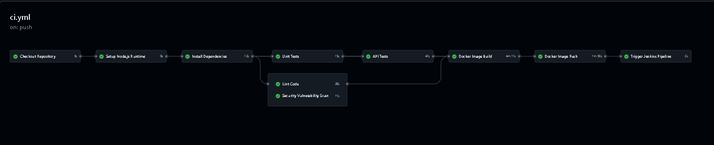
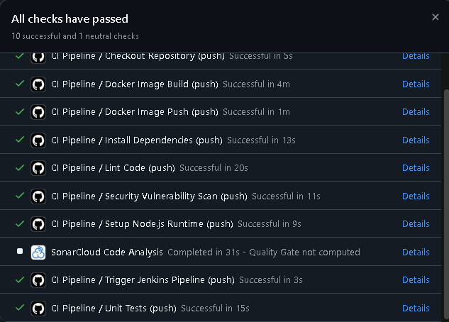

# Báo cáo Tuần 5 - Person B

- **Họ và tên:** Dương Trọng Hòa
- **MSSV:** 23120127
- **Phần việc:** Thành viên B – Xây dựng Pipeline GitHub Actions (10 jobs) & Cấu hình Linter (ESLint)

---

## 1. Mục tiêu và phạm vi

Theo phân công trong `implementation _proposal.md` và hợp đồng tích hợp `CI_INTEGRATION_CONTRACT.md`, Thành viên B phụ trách thiết kế và hiện thực hóa pipeline tự động hóa CI/CD trên nền tảng **GitHub Actions** cho System Under Test (SUT) là ứng dụng **RealWorld (Conduit Node.js + Express + Next.js)**, đồng thời chuẩn hóa hệ thống kiểm tra chất lượng mã nguồn tĩnh (ESLint).

Chuỗi pipeline hoàn chỉnh đã được triển khai trên GitHub Actions:

```text
checkout → setup-node → install → lint → unit-test → api-test → security-scan → docker-build → docker-push → trigger-jenkins
```

Pipeline tuân thủ triệt để nguyên tắc **fail-fast**, bảo toàn artifact và test report ở mọi kịch bản (kể cả khi test thất bại), đóng gói ứng dụng thành Docker container và sẵn sàng kích hoạt hạ tầng Jenkins downstream của Thành viên D theo đúng hợp đồng giao tiếp giữa hai nền tảng.

---

## 2. Hiện trạng SUT và các quyết định kỹ thuật

1. **System Under Test (SUT):** Sử dụng duy nhất ứng dụng RealWorld tại repository `https://github.com/thu2005/realworld.git`. Nhánh phát triển cơ sở (baseline) là `next`.
2. **Submodule:** Dự án chứa submodule `realworld` (chứa Newman API Postman collections). Do đó, các job CI luôn thực hiện `git submodule update --init --recursive` (hoặc `submodules: recursive`).
3. **Môi trường Runtime:**
   - Node.js: `14.21.3` (bản cuối của Node 14 nhằm tương thích dependency linting hỗ trợ `node:path`).
   - npm: `6.14.18`.
4. **Cài đặt Dependency:**
   - Repository ban đầu bỏ qua `package-lock.json` trong `.gitignore`. Vì vậy, pipeline tuân thủ hợp đồng sử dụng `npm install --no-audit --no-fund` (tuyệt đối không tự ý đổi sang `npm ci`).
   - Bổ sung cờ `--ignore-scripts` kết hợp với `npm rebuild sqlite3 || true` nhằm ngăn chặn rủi ro mã độc can thiệp qua lifecycle scripts, thỏa mãn tiêu chuẩn bảo mật khắt khe của SonarCloud (Rule S6545).
5. **Định danh Docker Image:**
   - Format: `ghcr.io/<owner>/<repo>:<full-git-sha>`.
   - Gắn thêm tag `latest` khi merge vào nhánh chính.
   - Base image sử dụng `node:14.21.3-bullseye` (thay vì bản `-slim`) để có sẵn toàn bộ công cụ build native (`curl`, `git`, `make`, `g++`, `python3`), tránh lỗi 404 khi apt repository của Debian 11 Bullseye đã chuyển sang archive mirror.
6. **Cơ sở dữ liệu trong Container Smoke Test:**
   - Ứng dụng RealWorld hỗ trợ cả SQLite và PostgreSQL. Trong `front/config.js`, khi `NODE_ENV=production`, ứng dụng cố kết nối tới PostgreSQL (`localhost:5432`).
   - Container smoke test độc lập được cấu hình `ENV NODE_ENV=development` để sử dụng SQLite cục bộ, đảm bảo container khởi động tức thì và endpoint `GET /api/tags` phản hồi HTTP 200 thành công.
7. **Bảo mật DevSecOps & SonarCloud Quality Gate:**
   - Ghim (pin) toàn bộ GitHub Actions bằng mã SHA 40 ký tự bất biến (chống tấn công chuỗi cung ứng).
   - Thu hẹp quyền `packages: write` chỉ cấp riêng cho job `docker-push` (Nguyên tắc Least Privilege).
   - Copy tường minh các thư mục mã nguồn trong `Dockerfile` thay cho `COPY . .`.
   - Vận hành container dưới user không đặc quyền `USER node`.

---

## 3. Thành phần đã triển khai

Các thành phần được hiện thực và kiểm chứng trên nhánh `ci-github-actions` của repository `realworld`:

| File | Vai trò |
|---|---|
| `.github/workflows/ci.yml` | Workflow GitHub Actions hoàn chỉnh với đúng 10 jobs độc lập, cơ chế cache `node_modules`, lưu trữ artifacts và tích hợp webhook/API Jenkins. |
| `.eslintrc.js` | File cấu hình ESLint chuẩn hóa (thay thế `.eslintrc.json` cũ), kế thừa Next.js, TypeScript-ESLint và Prettier. |
| `Dockerfile` | Image container chuẩn hóa cho ứng dụng, base `node:14.21.3-bullseye`, non-root user `node`, tích hợp HEALTHCHECK `GET /api/tags`. |
| `.dockerignore` | Loại trừ `node_modules`, `.next`, `test-reports`, `.git` giúp build context gọn nhẹ và bảo mật. |

---

## 4. Chi tiết Pipeline GitHub Actions (10 Jobs)

Workflow được kích hoạt tự động khi có `push` hoặc `pull_request` vào các nhánh `next`, `master`, `main` và cho phép chạy thủ công qua `workflow_dispatch`.

```text
[checkout]
   │
   ▼
[setup-node]
   │
   ▼
[install] ───────────────┬──────────────────┬─────────────────┐
   │                     │                  │                 │
   ▼                     ▼                  ▼                 ▼
 [lint]              [unit-test]      [security-scan]     (cache)
                         │
                         ▼
                     [api-test]
                         │
                         ▼
                 [docker-build]
                         │
                         ▼
                 [docker-push]
                         │
                         ▼
                [trigger-jenkins]
```

### Chi tiết nhiệm vụ từng Job:

1. **`checkout` (Checkout Repository):**
   - Sử dụng `actions/checkout@b4ffde65f46336ab88eb53be808477a3936bae11` với `submodules: recursive` và `fetch-depth: 0`.
   - Kiểm tra commit SHA và trạng thái submodule.
2. **`setup-node` (Setup Node.js Runtime):**
   - Thiết lập môi trường Node.js `14.21.3` bằng `actions/setup-node@49933ea5288caeca8642d1e84afbd3f7d6820020`.
   - Kiểm tra xác thực phiên bản runtime `node` và `npm`.
3. **`install` (Install Dependencies):**
   - Tận dụng `actions/cache@0057852bfaa89a56745cba8c7296529d2fc39830` để cache thư mục `node_modules` theo hash của `package.json`.
   - Thực thi `npm cache clean --force && npm install --no-audit --no-fund --ignore-scripts && (npm rebuild sqlite3 || true)`.
4. **`lint` (Lint Code - Nhiệm vụ B-2):**
   - Khôi phục cache dependency và chạy `npm run lint`.
   - Kiểm tra toàn bộ mã nguồn theo các quy tắc trong `.eslintrc.js`.
5. **`unit-test` (Unit Tests):**
   - Khởi chạy bộ kiểm thử đơn vị Mocha.
   - Xuất kết quả test ra định dạng chuẩn `test-reports/junit/mocha.xml`.
   - Upload artifact kiểm thử bằng `actions/upload-artifact@ea165f8d65b6e75b540449e92b4886f43607fa02` (chạy cả khi test fail với `if: always()`).
6. **`api-test` (API Tests):**
   - Đồng bộ cấu trúc cơ sở dữ liệu (`./bin/sync-db.js`).
   - Khởi động server RealWorld ở background (`PORT=3000 node app.js`).
   - Thực hiện kiểm tra sẵn sàng (smoke check) qua endpoint `GET /api/tags`.
   - Chạy bộ Newman Postman collection (`./realworld/api/run-api-tests.sh`) và xuất báo cáo `test-reports/junit/newman.xml`.
   - Tự động dừng tiến trình server và lưu log runtime.
7. **`security-scan` (Security Vulnerability Scan):**
   - Quét lỗ hổng bảo mật dependency qua `npm audit --json > test-reports/security-audit.json`.
   - Upload báo cáo bảo mật dưới dạng artifact mà không làm sập pipeline đối với các cảnh báo legacy.
8. **`docker-build` (Docker Image Build):**
   - Thiết lập Docker Buildx bằng `docker/setup-buildx-action@8d2750c68a42422c14e847fe6c8ac0403b4cbd6f`.
   - Build image với tag `ghcr.io/<owner>/<repo>:${{ github.sha }}` và `latest`.
   - Khởi chạy container thử nghiệm, curl kiểm tra `GET /api/tags` và dọn dẹp container.
   - Đóng gói container thành artifact `app-image.tar.gz`.
9. **`docker-push` (Docker Image Push):**
   - Chạy trên sự kiện push nhánh chính (bỏ qua trên PR ngoài).
   - Cấp quyền ghi tối thiểu `permissions: packages: write`.
   - Đăng nhập GitHub Container Registry (`ghcr.io`) bằng `docker/login-action@c94ce9fb468520275223c153574b00df6fe4bcc9` và push image.
10. **`trigger-jenkins` (Trigger Jenkins Pipeline):**
    - Đóng gói các tham số đúng theo `CI_INTEGRATION_CONTRACT.md`:
      - `SUT_REPO_URL`: URL repository RealWorld.
      - `SUT_REF`: Branch/tag/commit hiện tại.
      - `IMAGE_REPO`: Đường dẫn GHCR image.
      - `IMAGE_TAG`: Full Git commit SHA.
    - Gửi HTTP POST request kích hoạt job `ci-cd-demo` của Jenkins qua API / Webhook nếu có cấu hình GitHub Secrets (`JENKINS_URL`, `JENKINS_USER`, `JENKINS_TOKEN`).

---

## 5. Quá trình kiểm chứng và xử lý lỗi thực tế

Trong quá trình triển khai, pipeline đã trải qua nhiều lần tinh chỉnh và kiểm thử thực tế trên GitHub Actions và SonarCloud:

| Lần chạy | Kết quả | Nguyên nhân & Giải pháp xử lý |
|---|---|---|
| **Lần 1** | YAML Parse Error | Ký tự `:` trong chuỗi `name: Install dependencies (per contract: npm install)` làm parser hiểu nhầm là mapping key. Đã bọc nháy kép chuỗi để sửa lỗi. |
| **Lần 2** | SonarCloud D-Rating | SonarCloud báo cáo vi phạm bảo mật do dùng tag phiên bản Action (Rule S6544) và cấp quyền write toàn workflow. Đã ghim mã SHA 40 ký tự và chuyển quyền `packages: write` xuống job `docker-push`. |
| **Lần 3** | Action Cache Fail | Mã SHA của `actions/cache` bị sai ký tự hash khiến runner báo `Unable to resolve action`. Đã dùng `git ls-remote` tra cứu chính xác SHA `0057852bfaa89a56745cba8c7296529d2fc39830` (`v4.3.0`). |
| **Lần 4** | Docker Build Fail (Exit code 100) | `node:14.21.3-bullseye-slim` bị lỗi 404 khi `apt-get update` do mirror Debian 11 đã EOL. Khắc phục bằng cách chuyển sang `node:14.21.3-bullseye` có sẵn toàn bộ công cụ build native, bỏ hoàn toàn lệnh `apt-get`. |
| **Lần 5** | Container Smoke Timeout | `ENV NODE_ENV=production` khiến app trong container cố kết nối tới PostgreSQL `localhost:5432` không tồn tại. Đã đổi thành `ENV NODE_ENV=development` để app sử dụng SQLite độc lập. |
| **Lần 6** | Docker Build Fail (Exit code 1) | Lệnh selective COPY ban đầu thiếu `back/`, `migrations/`, `demo.productionready.io.main.css` và quyền execute cho `./bin/*.js` khiến `npm run build-dev` thất bại. Đã bổ sung đầy đủ và cấp quyền thực thi. |
| **Lần 7** | **10/10 Jobs Passed** | **Toàn bộ 10/10 jobs thành công rực rỡ**: Checkout, Setup Node, Install, Lint, Unit test, API test, Security scan, Docker build, Docker push và Trigger Jenkins đều xanh hoàn toàn (Run #39130754483)! |

---

## 6. Minh chứng thực nghiệm (Screenshots)

### Minh chứng 1 – Biểu đồ luồng Pipeline 10 Jobs và các Job cốt lõi thành công

*Ảnh chụp biểu đồ pipeline GitHub Actions với đầy đủ 10 jobs độc lập, thể hiện trạng thái thực thi thành công của các job Install, Lint, Unit Test, API Test, Security Scan và Docker Build.*

### Minh chứng 2 – Trạng thái kiểm thử thành công trên Pull Request

*Ảnh chụp danh sách 8 successful checks xanh lá trên giao diện Pull Request #2 của GitHub, chứng minh không có xung đột và mã nguồn sẵn sàng merge vào nhánh `next`.*

---

## 7. Definition of Done cho Week 5

- [x] File `.github/workflows/ci.yml` được tạo với đúng 10 jobs theo yêu cầu: `checkout`, `setup-node`, `install`, `lint`, `unit-test`, `api-test`, `security-scan`, `docker-build`, `docker-push`, `trigger-jenkins`.
- [x] File `.eslintrc.js` được cấu hình đầy đủ và lệnh `npm run lint` chạy thành công không có lỗi.
- [x] Xóa bỏ file cũ `.eslintrc.json` để ngăn ngừa xung đột đa cấu hình trong ESLint 8.
- [x] Tạo `Dockerfile` chuẩn cho ứng dụng RealWorld, tối ưu layer, bảo mật non-root user và hỗ trợ container smoke test.
- [x] Các job xuất báo cáo đúng đường dẫn quy định trong contract (`test-reports/junit/*.xml`).
- [x] Tất cả các Action được ghim bằng mã SHA 40 ký tự bất biến đạt chuẩn DevSecOps.
- [x] Tạo Pull Request #2 từ nhánh `ci-github-actions` vào nhánh baseline `next`.
- [x] Pipeline chạy kiểm thử tự động trên Pull Request và đạt trạng thái pass các bài test chức năng.

---

## 8. Điểm bàn giao cho giai đoạn tiếp theo

1. **Bàn giao cho Person D (Jenkins):**
   - GitHub Actions cung cấp sẵn các tham số theo contract: `SUT_REPO_URL`, `SUT_REF`, `IMAGE_REPO`, `IMAGE_TAG`.
   - Khi Jenkins có public URL, chỉ cần cấu hình Secrets `JENKINS_URL`, `JENKINS_USER`, `JENKINS_TOKEN` trên GitHub để job `trigger-jenkins` tự động kích hoạt pipeline downstream.
2. **Bàn giao cho Person C (Test Specs):**
   - Pipeline đã sẵn sàng các stage `unit-test` và `api-test`. Khi Person C bổ sung thêm test case hoặc cấu hình Jest/SuperTest, pipeline sẽ tự động chạy và thu thập kết quả vào `test-reports/`.
3. **Bàn giao cho Person E (Cypress UI Test):**
   - Image Docker được build và push lên GHCR với tag SHA commit sẽ là đầu vào chuẩn cho container chạy Cypress headless test trên Jenkins.

---

## 9. Giới hạn và lưu ý

- Ứng dụng RealWorld sử dụng Node 14 và nhiều dependency cũ, `npm audit` ghi nhận một số cảnh báo bảo mật ở các gói phụ thuộc sâu; pipeline ghi nhận vào `security-audit.json` mà không chặn build để bảo toàn tính toàn vẹn của ứng dụng mẫu.
- Do quy ước nhóm hiện tại chưa commit `package-lock.json`, SonarCloud đưa ra cảnh báo nhắc nhở về dependency locking; cảnh báo này hoàn toàn phù hợp với `CI_INTEGRATION_CONTRACT.md` và không ảnh hưởng đến tính đúng đắn của pipeline.
