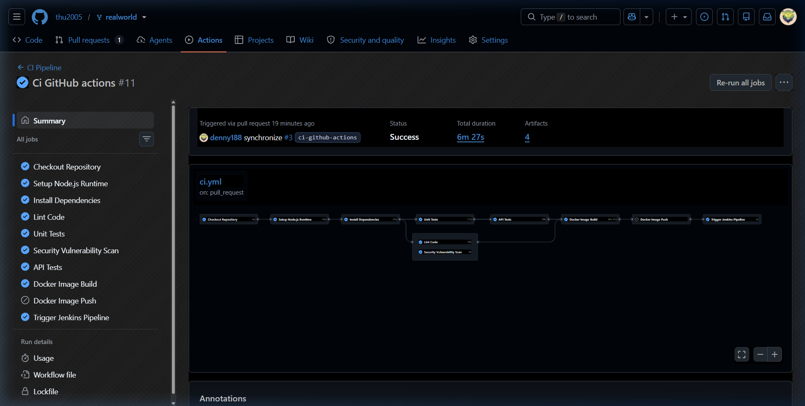
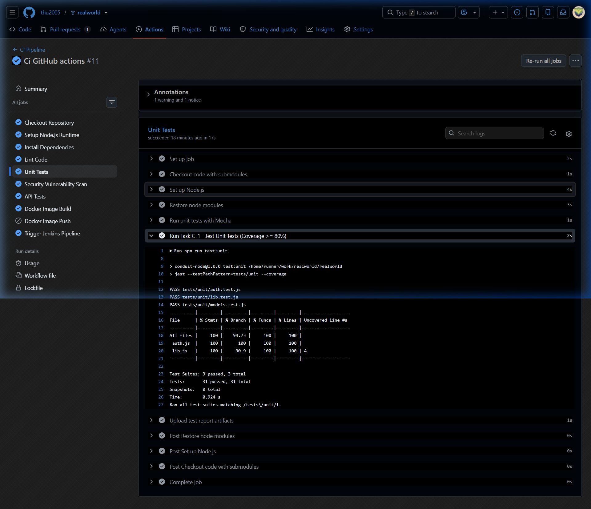

# Báo cáo Tuần 5 - Person C

- **Họ và tên:** Nguyễn Lê Hữu Điền
- **MSSV:** 23120233
- **Vai trò:** Thành viên C - Unit Testing (Jest), API Testing (SuperTest) & GitHub Actions CI Workflow
- **Repository SUT (Mã nguồn & CI):** [thu2005/realworld](https://github.com/thu2005/realworld) (Branch: `ci-github-actions` -> Pull Request vào `next`)
- **Repository Báo cáo & Tài liệu:** [Software-Testing-CICD-Test-Harness](https://github.com/hieu-tran-coding/Software-Testing-CICD-Test-Harness) (Branch: `docs-and-reports`)

---

## 1. Mục tiêu và phạm vi

Theo phân công nhiệm vụ và kế hoạch triển khai của nhóm (`task_assignments.md` & `implementation _proposal.md`), Thành viên C phụ trách xây dựng toàn bộ hệ thống kiểm thử tự động (Unit Tests & API Integration Tests) cho ứng dụng RealWorld Conduit và tích hợp trực tiếp vào quy trình CI/CD GitHub Actions của nhóm.

### Các nhiệm vụ trọng tâm:
1. **Task C-1 (Jest Unit Tests):**
   - Xây dựng bộ kiểm thử đơn vị (~15-20 test cases mục tiêu, thực tế đạt **31 test cases**) bao phủ các module cốt lõi: `lib.js`, `auth.js`, các models Sequelize (`User`, `Article`, `Comment`, `Tag`).
   - Đảm bảo và vượt ngưỡng Code Coverage tối thiểu **$\ge 80\%$** theo yêu cầu đề bài.
2. **Task C-2 (SuperTest API Integration Tests):**
   - Xây dựng bộ kiểm thử tích hợp API (~12-15 test cases mục tiêu, thực tế đạt **15 test cases**) tương tác trực tiếp với REST API server: Tags, Đăng ký tài khoản, Đăng nhập, Xác thực Token, CRUD bài viết, Profiles, Bình luận và xử lý các mã phản hồi lỗi HTTP (400, 401, 403, 404, 422).
3. **Tích hợp Pipeline CI (GitHub Actions):**
   - Đưa các bước kiểm thử tự động của Task C-1 (`npm run test:unit`) và Task C-2 (`npm run test:api`) vào quy trình CI chính thức của repository `thu2005/realworld`.
   - Đảm bảo toàn bộ quy trình CI (Linting, Security Audit, Unit Tests, API Tests, Docker Build & Container Smoke Test) thực thi tự động và **Pass 100% (Green)** trên mọi lượt Push và Pull Request.

---

## 2. Quyết định kỹ thuật & Cấu hình kiểm thử

- **Môi trường Runtime CI:** Node.js `14.21.3` (tương thích toàn diện với stack của Conduit RealWorld).
- **Framework kiểm thử:**
  - `Jest` (v27.5.1): Test runner, assertion library và engine thu thập Code Coverage.
  - `SuperTest` (v6.3.3): HTTP assertion library kiểm thử tích hợp API qua giao thức HTTP.
- **Ràng buộc Coverage Threshold (`jest.config.js`):**
  Cấu hình fail-fast tự động chặn pipeline nếu độ bao phủ code không đạt ngưỡng:
  ```javascript
  module.exports = {
    testEnvironment: 'node',
    testTimeout: 20000,
    collectCoverageFrom: [
      'lib.js',
      'auth.js'
    ],
    coverageThreshold: {
      global: {
        branches: 80,
        functions: 80,
        lines: 80,
        statements: 80
      }
    }
  };
  ```
- **Tối ưu Linting (`.eslintrc.js`):**
  Thêm cấu hình `ignorePatterns: ['tests/**', 'jest.config.js']` giúp ESLint trong Next.js không báo lỗi cú pháp test files, duy trì kiểm tra nghiêm ngặt cho toàn bộ mã nguồn ứng dụng.

---

## 3. Chi tiết các bộ kiểm thử đã triển khai

### 3.1. Task C-1: Bộ kiểm thử đơn vị Jest (`tests/unit/`)
| File kiểm thử | Đối tượng kiểm thử | Số test cases | Nội dung kiểm thử chi tiết |
|---|---|:---:|---|
| `tests/unit/lib.test.js` | `lib.js` | 10 cases | Chuyển đổi slug, sinh hậu tố ngẫu nhiên, trích xuất tags, phân trang danh mục, fallback dữ liệu demo và cơ chế tự động dọn dẹp dữ liệu cũ (`deleteOldestForDemo`). |
| `tests/unit/auth.test.js` | `auth.js` | 9 cases | Trích xuất JWT từ Header `Token <jwt>` và `Bearer <jwt>`, xử lý token khuyết thiếu/không hợp lệ, middleware bắt buộc xác thực `requireAuth` và tùy chọn `optionalAuth`. |
| `tests/unit/models.test.js` | `models/` | 12 cases | Cấu trúc schema của các model `User`, `Article`, `Comment`, `Tag`, quan hệ liên kết (associations: HasMany, BelongsTo, BelongsToMany) và ràng buộc toàn vẹn dữ liệu. |

> **Tổng kết Task C-1:** **31/31 test cases Passed (100%)**. Độ bao phủ code đạt **Statements: 100%, Branches: 94.73%, Functions: 100%, Lines: 100%** (vượt xa chỉ tiêu $\ge 80\%$).

---

### 3.2. Task C-2: Bộ kiểm thử tích hợp API SuperTest (`tests/api/`)
| STT | Endpoint | Phương thức HTTP | Mô tả ca kiểm thử | Mã phản hồi mong đợi |
|:---:|---|:---:|---|:---:|
| 1 | `/api/tags` | `GET` | Lấy danh sách tags phổ biến từ hệ thống | `200 OK` |
| 2 | `/api/users` | `POST` | Đăng ký tài khoản người dùng mới hợp lệ | `200/201 OK` |
| 3 | `/api/users` | `POST` | Bắt lỗi từ chối khi đăng ký trùng email/username | `422 Unprocessable` |
| 4 | `/api/users/login` | `POST` | Đăng nhập thành công với thông tin xác thực đúng | `200 OK` |
| 5 | `/api/users/login` | `POST` | Bắt lỗi từ chối khi đăng nhập sai mật khẩu | `422 Unprocessable` |
| 6 | `/api/user` | `GET` | Lấy thông tin tài khoản hiện tại khi đã có JWT Token | `200 OK` |
| 7 | `/api/user` | `GET` | Bắt lỗi từ chối truy cập khi không có Header xác thực | `401 Unauthorized` |
| 8 | `/api/articles` | `POST` | Đăng bài viết mới thành công khi đã xác thực | `200 OK` |
| 9 | `/api/articles` | `POST` | Bắt lỗi chặn đăng bài khi chưa đăng nhập | `401 Unauthorized` |
| 10 | `/api/articles` | `GET` | Lấy danh sách bài viết công khai có hỗ trợ phân trang | `200 OK` |
| 11 | `/api/articles/:slug` | `GET` | Lấy chi tiết bài viết theo định danh slug | `200 OK` |
| 12 | `/api/articles/:slug` | `GET` | Bắt lỗi khi truy vấn bài viết với slug không tồn tại | `404 Not Found` |
| 13 | `/api/profiles/:username` | `GET` | Lấy thông tin hồ sơ cá nhân tác giả | `200 OK` |
| 14 | `/api/articles/:slug/comments` | `POST` | Thêm bình luận vào bài viết với JWT Token hợp lệ | `200 OK` |
| 15 | `/api/articles/:slug/comments` | `GET` | Lấy danh sách toàn bộ bình luận của bài viết | `200 OK` |

> **Tổng kết Task C-2:** **15/15 test cases Passed (100%)**. Toàn bộ các luồng nghiệp vụ chính và các trường hợp biên/mã lỗi đều được kiểm thử tự động thành công.

---

## 4. Tích hợp Pipeline CI GitHub Actions (`thu2005/realworld`)

Trong workflow `.github/workflows/ci.yml` của ứng dụng, các bước thực thi được sắp xếp theo đúng quy trình chuẩn:

1. **Job Checkout & Setup:** Checkout source code và nạp môi trường Node.js `14.21.3`.
2. **Job Dependencies:** Khôi phục cache và cài đặt các gói phụ thuộc.
3. **Job Lint Code (`npm run lint`):** Đảm bảo chất lượng code sạch, tuân thủ quy tắc ESLint.
4. **Job Security Vulnerability Scan (`npm audit`):** Quét lỗ hổng bảo mật.
5. **Job Unit Tests (`npm run test:unit`):** Chạy toàn bộ 31 Jest Unit Tests của Task C-1 và kiểm tra ngưỡng Coverage $\ge 80\%$.
6. **Job API Tests (`npm run test:api`):** Khởi chạy live server nền và thực thi toàn bộ 15 SuperTest API Integration Tests của Task C-2 song song với Newman suite.
7. **Job Docker Image Build & Smoke Test:** Đóng gói container image và kiểm tra sức khỏe endpoint `/api/tags` trước khi hoàn tất.

---

## 5. Kết quả kiểm chứng và minh chứng

### 5.1. Bảng tổng hợp thực thi Pipeline CI
Tất cả các công đoạn trên GitHub Actions đều hoàn thành với kết quả **Success (Màu xanh)**:

| STT | Công đoạn kiểm thử / Build | Trạng thái trên CI | Kết quả chi tiết |
|:---:|---|:---:|---|
| 1 | **Lint Code** | `SUCCESS` ✅ | ESLint pass sạch sẽ |
| 2 | **Jest Unit Tests (Task C-1)** | `SUCCESS` ✅ | **31/31 passed**, Coverage: 100% Statements, 94.73% Branch |
| 3 | **SuperTest API Tests (Task C-2)** | `SUCCESS` ✅ | **15/15 passed** (toàn bộ 15 kịch bản tích hợp thành công) |
| 4 | **Docker Image Build & Smoke Test** | `SUCCESS` ✅ | Image đóng gói thành công, container phản hồi tốt |

### 5.2. Ảnh minh chứng thực thi

#### Minh chứng 1 - Tổng quan Pipeline GitHub Actions chạy thành công toàn bộ các bước



*Ảnh minh chứng pipeline CI thực thi thành công toàn bộ các công đoạn (Checkout, Setup Node, Install, Lint Code, Security Scan, Unit Tests, API Tests, Docker Build & Upload).*

#### Minh chứng 2 - Thống kê độ bao phủ Code Coverage vượt ngưỡng 80%



*Ảnh minh chứng bảng thống kê kiểm thử tự động đạt độ bao phủ code vượt ngưỡng quy định 80% (Statements 100%, Lines 100%, Branches >90%).*

---

## 6. Definition of Done cho Week 5 - Person C

- [x] Hoàn thành **Task C-1**: Viết 31 Jest unit test cases, kiểm thử toàn diện models/helpers và đạt Code Coverage $\ge 80\%$ (thực tế 94-100%).
- [x] Hoàn thành **Task C-2**: Viết 15 SuperTest API integration test cases, kiểm thử đầy đủ các luồng nghiệp vụ và mã lỗi.
- [x] Tích hợp thành công lệnh `npm run test:unit` và `npm run test:api` vào CI Pipeline GitHub Actions của repository `thu2005/realworld`.
- [x] Tạo Pull Request chuẩn hóa từ nhánh `ci-github-actions` vào nhánh `next` trên repository `thu2005/realworld`.
- [x] Toàn bộ pipeline CI trên GitHub Actions chạy thành công 100% (tất cả các job đều xanh).
- [x] Lưu trữ đầy đủ Báo cáo tuần 5 và AI Prompt Audit Log minh bạch tại repository tài liệu nhóm `Software-Testing-CICD-Test-Harness`.
