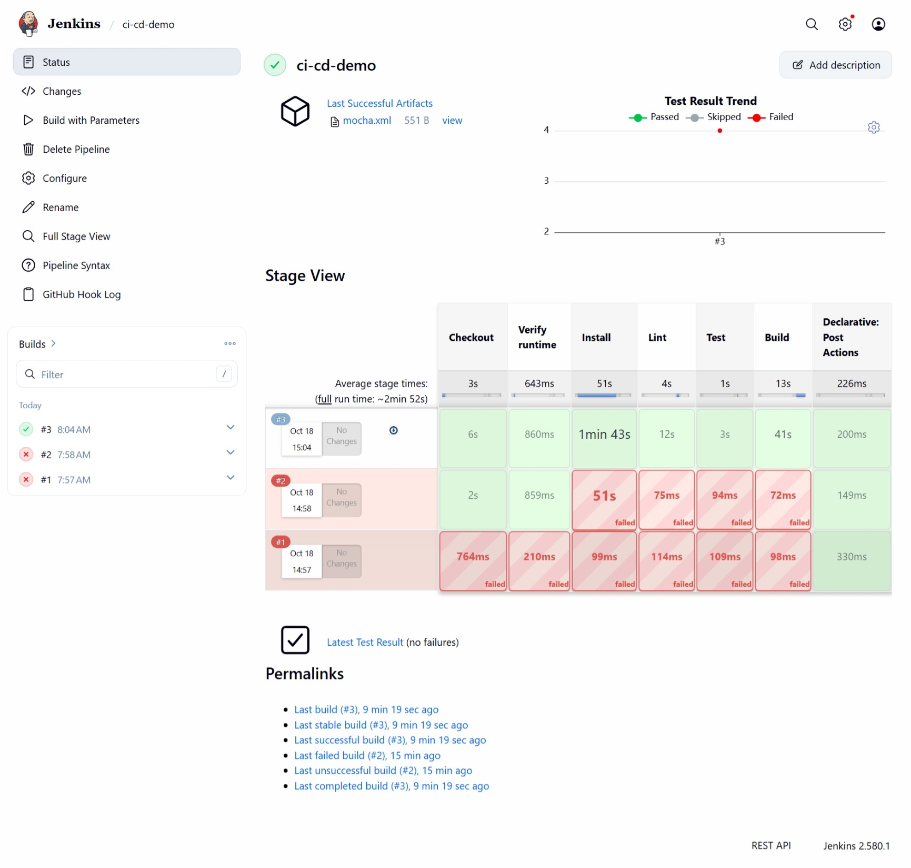
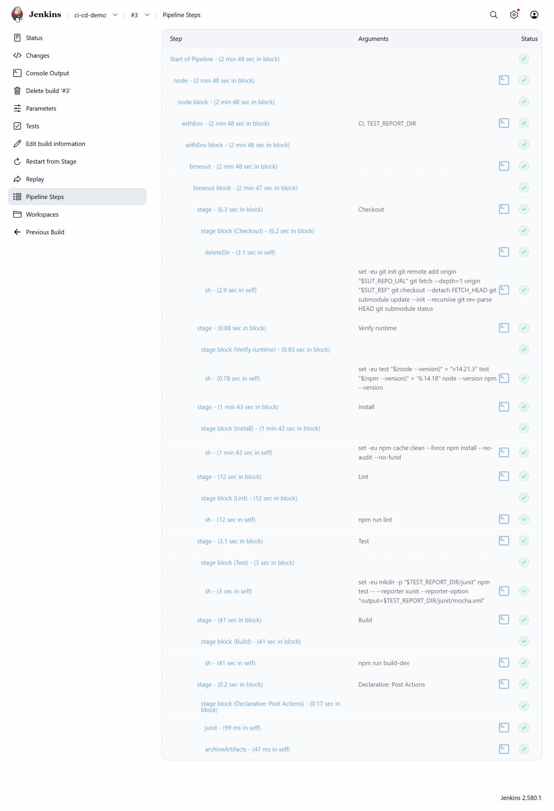

# Báo cáo Tuần 5 - Person D

- **Họ và tên:** Nguyễn Đoàn Xuân Thu
- **MSSV:** 23120170

## 1. Mục tiêu và phạm vi

Theo `implementation _proposal.md`, Person D phụ trách hạ tầng và pipeline Jenkins. Mục tiêu Tuần 5 là tạo một pipeline Jenkins tối thiểu có thể chạy độc lập với ứng dụng RealWorld, chưa phụ thuộc vào Docker image, Cypress hoặc Allure của các thành viên khác.

Chuỗi đã triển khai:

```text
GitHub/source
    ↓
Jenkins checkout source và submodule
    ↓
Verify runtime → Install → Lint → Test → Build
    ↓
Publish JUnit report và archive artifact
```

Webhook, GHCR, Cypress và Allure là các điểm tích hợp tiếp theo. Chúng không được dùng làm điều kiện hoàn thành pipeline cơ bản khi đầu vào tương ứng chưa tồn tại.

## 2. Hiện trạng SUT và quyết định kỹ thuật

- SUT là repository RealWorld `https://github.com/thu2005/realworld.git`; không sử dụng eShop.
- Source chính có submodule `realworld`, vì vậy pipeline luôn chạy `git submodule update --init --recursive` sau khi checkout.
- Runtime được thống nhất là Node.js `14.21.3` và npm `6.14.18`.
- Repository chưa commit `package-lock.json`, do đó pipeline dùng `npm install`, chưa dùng `npm ci`.
- Pipeline chạy trực tiếp từ source để không chờ image GHCR của nhóm GitHub Actions.
- Test baseline dùng Mocha và xuất XUnit XML để Jenkins đọc bằng plugin JUnit.
- Jenkins chạy bằng Docker Compose với named volume để giữ tài khoản, job và lịch sử build.
- Host port mặc định là `18080` để tránh xung đột với các dịch vụ/Jenkins cũ trên máy.
- Chỉ dùng bộ plugin tối thiểu được khai báo trong `jenkins/plugins.txt`; không thêm Blue Ocean hoặc Allure khi chưa cần.

## 3. Thành phần đã triển khai

Các file triển khai nằm trên branch `jenkins` của repository RealWorld:

| File | Vai trò |
|---|---|
| `Jenkinsfile` | Khai báo pipeline, tham số source/ref, các stage và bước publish report. |
| `jenkins/Dockerfile` | Tạo Jenkins LTS Java 21 có Node.js 14.21.3, npm 6.14.18, Git và công cụ build native. |
| `jenkins/plugins.txt` | Cài tự động plugin Pipeline, Stage View, GitHub, Credentials Binding và JUnit khi build image. |
| `docker-compose.jenkins.yml` | Khởi động Jenkins tại host port `18080`, dùng named volume và health check. |
| `docs/jenkins-setup.md` | Hướng dẫn build image, setup Jenkins, tạo job, chạy pipeline và xử lý lỗi port. |
| `CI_INTEGRATION_CONTRACT.md` | Quy định runtime, tham số, report path, image tag và quy tắc secrets cho các thành viên tích hợp sau. |

Để lint chạy được với cấu hình Next.js hiện có, `package.json` đã bổ sung `@typescript-eslint/eslint-plugin` và `@typescript-eslint/parser` phiên bản `5.8.0`. Runtime được nâng trong cùng major từ Node 14.17.0 lên bản cuối Node 14 là 14.21.3 để dependency lint hỗ trợ `node:path`; Dockerfile, `package.json`, contract và tài liệu đã được đồng bộ.

## 4. Pipeline Jenkins

Job `ci-cd-demo` dùng **Pipeline script from SCM** với cấu hình:

```text
Repository URL: https://github.com/thu2005/realworld.git
Credentials:    none (public repository)
Branch:         */jenkins
Script Path:    Jenkinsfile
```

Pipeline nhận hai tham số:

| Parameter | Giá trị khi kiểm chứng | Ý nghĩa |
|---|---|---|
| `SUT_REPO_URL` | `https://github.com/thu2005/realworld.git` | Repository cần kiểm tra. |
| `SUT_REF` | `jenkins` | Branch, tag hoặc commit cần checkout. |

Các stage chạy theo thứ tự fail-fast:

1. **Checkout**: xóa workspace cũ, checkout ref được chọn và lấy submodule.
2. **Verify runtime**: xác nhận chính xác Node `v14.21.3` và npm `6.14.18`.
3. **Install**: làm sạch cache npm 6 rồi chạy `npm install --no-audit --no-fund`.
4. **Lint**: chạy `npm run lint`.
5. **Test**: chạy Mocha với XUnit reporter và ghi `test-reports/junit/mocha.xml`.
6. **Build**: chạy `npm run build-dev`.
7. **Post actions**: luôn publish JUnit và archive `test-reports/**/*`, kể cả khi stage trước thất bại.

Pipeline không dùng `|| true`; lỗi ở lint, test hoặc build vẫn làm job thất bại.

## 5. Quá trình kiểm chứng và xử lý lỗi

Ba lần chạy được giữ lại trên Jenkins để thể hiện quá trình sửa lỗi:

| Build | Kết quả | Nguyên nhân/kết quả xử lý |
|---|---|---|
| `#1` | Fail | Lần chạy đầu chưa có giá trị parameter vì Jenkins mới đọc `Jenkinsfile`; sau lần này nút **Build with Parameters** xuất hiện. |
| `#2` | Fail | Stage Install dừng với `npm ERR! cb() never called!`, là lỗi cache/nội bộ của npm 6. |
| `#3` | Success | Thêm bước làm sạch npm cache; Checkout, runtime, Install, Lint, Test, Build và Post Actions đều pass. |

Kết quả build `#3`:

- Checkout đúng branch `jenkins` và submodule RealWorld.
- Runtime đúng Node `v14.21.3`, npm `6.14.18`.
- `npm install` hoàn tất sau khi làm sạch cache.
- Next.js lint không có warning hoặc error.
- Mocha test thành công và Jenkins hiển thị **Latest Test Result (no failures)**.
- Artifact `mocha.xml` được lưu trong **Last Successful Artifacts**.
- Next.js production build compiled successfully.

### Minh chứng 1 - Lịch sử fail/pass, Stage View và test artifact



Ảnh cho thấy build `#1` và `#2` thất bại, build `#3` thành công, toàn bộ stage của lần chạy cuối có màu xanh, đồng thời Jenkins đã hiển thị test trend và artifact `mocha.xml`.

### Minh chứng 2 - Chi tiết các bước của pipeline thành công



Ảnh cho thấy từng bước của build `#3`, gồm Checkout, Verify runtime, Install, Lint, Test, Build, `junit` và `archiveArtifacts`, đều hoàn thành thành công trên Jenkins `2.580.1`.

## 6. Definition of Done cho Week 5

- [x] Jenkins khởi động được bằng Docker Compose và truy cập tại `http://127.0.0.1:18080`.
- [x] Plugin trong `jenkins/plugins.txt` được cài tự động khi build custom image.
- [x] Job `ci-cd-demo` đọc pipeline từ `Jenkinsfile` trên branch `jenkins`.
- [x] Pipeline nhận `SUT_REPO_URL` và `SUT_REF`, tự checkout public SUT và submodule.
- [x] Các stage Install, Lint, Test và Build có điều kiện pass/fail rõ ràng.
- [x] JUnit XML được publish và lưu làm artifact theo đường dẫn contract.
- [x] Có hướng dẫn setup đủ để thành viên khác chạy lại.
- [x] Có ảnh minh chứng cả lần fail và lần pass.
- [x] Không hard-code token, password hoặc credential vào repository.
- [x] Branch `jenkins` đã push lên GitHub; build thành công dùng đúng commit chứa bản sửa npm cache.

## 7. Điểm bàn giao cho giai đoạn tiếp theo

- Sau khi merge, đổi **Branch Specifier** và `SUT_REF` từ `jenkins` sang `next`; đồng thời đổi default `SUT_REF` trong `Jenkinsfile` ở một commit tích hợp.
- Chỉ cấu hình GitHub webhook `/github-webhook/` khi Jenkins có URL công khai mà GitHub truy cập được. Bản local hiện được kiểm chứng bằng manual trigger; không mở Jenkins ra Internet chỉ để có webhook.
- Khi nhóm GitHub Actions cung cấp image, Jenkins nhận `IMAGE_REPO` và `IMAGE_TAG`, trong đó tag là full Git commit SHA, rồi bổ sung pull/run/smoke-test mà không phá pipeline chạy từ source.
- Khi Person E cung cấp Cypress output, archive screenshots/videos vào các đường dẫn trong `CI_INTEGRATION_CONTRACT.md`.
- Chỉ cài và publish Allure sau khi test harness thực sự sinh `test-reports/allure-results/`.

Các mục trên là công việc tích hợp liên thành viên sau MVP, không phải phần còn thiếu của kết quả Week 5 hiện tại.

## 8. Giới hạn và lưu ý

- Jenkins chạy build trực tiếp trên controller để demo seminar đơn giản; đây không phải mô hình production.
- SUT có nhiều dependency cũ và npm hiển thị cảnh báo deprecated/vulnerability. Pipeline không tự chạy `npm audit fix --force` vì thay đổi dependency hàng loạt có thể làm hỏng ứng dụng mẫu.
- Repository chưa có lockfile được quản lý, nên dependency install chưa hoàn toàn tái lập như `npm ci`.
- Jenkins local chưa nhận webhook từ GitHub vì không có public URL.
- Named volume giữ dữ liệu Jenkins khi chạy `down`/`up`; `docker compose down --volumes` sẽ xóa account, job và lịch sử build của instance seminar.

Kết quả Tuần 5 đã chứng minh được chuỗi tối thiểu:

```text
GitHub/source → Jenkins → lint/test/build → JUnit report + artifact
```
