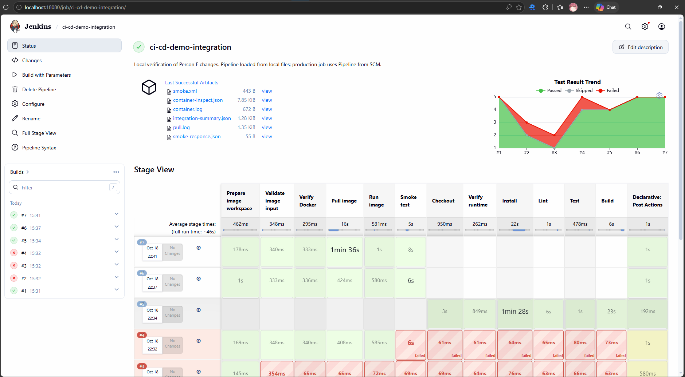
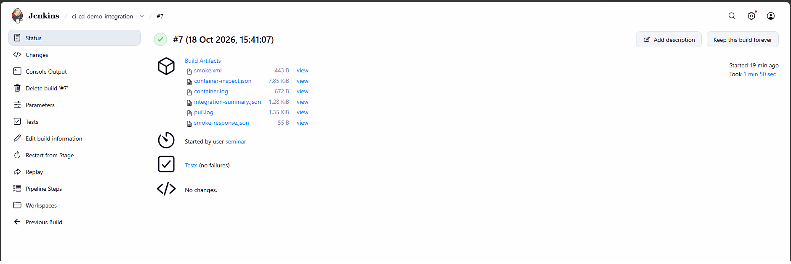
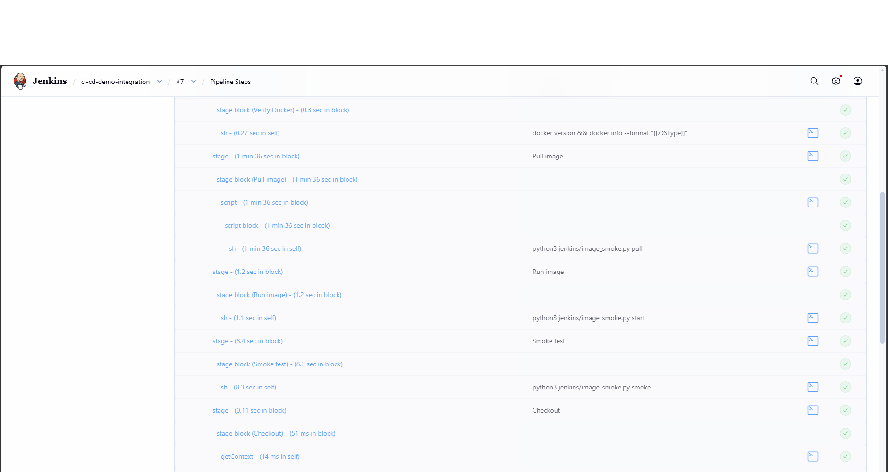
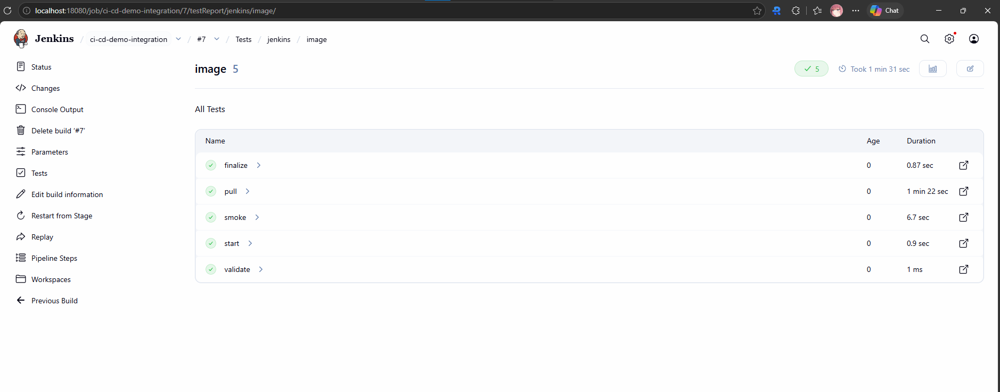
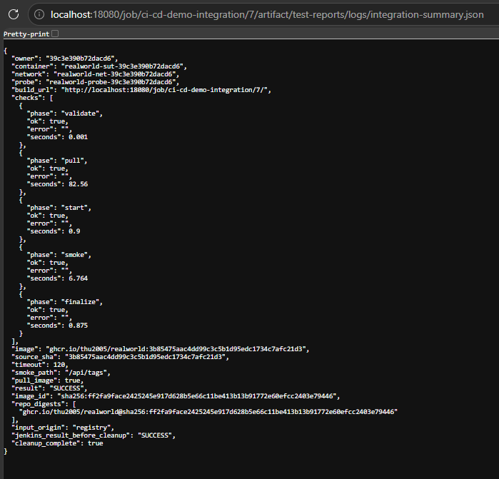
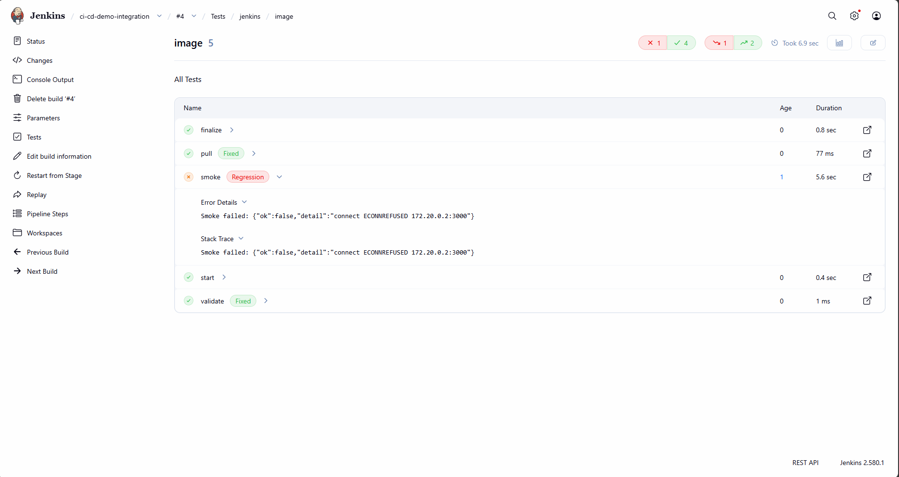

# Báo cáo Tuần 5 - Person E

**Họ và tên:** Trần Trọng Trí  
**MSSV:** 20120221  
**Phần việc:** Hoàn thiện pipeline Jenkins, nhận Docker image từ GHCR, kiểm tra smoke test và xuất báo cáo.  
**Ngày thực hiện:** 18/10/2026.

## 1. Mục tiêu và phạm vi

Trong tuần này, em tiếp tục phần Jenkins đã được thành viên phụ trách Person D thiết lập, bổ sung khả năng nhận image do GitHub Actions đóng gói và đưa lên GitHub Container Registry (GHCR). Ứng dụng mẫu là [RealWorld của nhóm](https://github.com/thu2005/realworld).

Phần việc tập trung vào nhận đúng image, chạy ứng dụng trong container, kiểm tra hoạt động cơ bản qua API, lưu kết quả và dọn tài nguyên sau khi chạy. Mã nguồn ứng dụng, bộ test và workflow GitHub Actions có sẵn được kế thừa từ repository và các thành viên khác.

## 2. Nội dung đã thực hiện

| Thành phần | Nội dung bổ sung |
|---|---|
| `Jenkinsfile` | Thêm chế độ chạy image; giữ chế độ chạy source cũ; khai báo tham số image và các bước kiểm tra, pull, run, smoke test, lưu kết quả. |
| `jenkins/image_smoke.py` | Kiểm tra image tag theo commit SHA, chạy container, gọi API, tạo JUnit/log và cleanup. |
| Môi trường Jenkins | Bổ sung Docker CLI và cấu hình kết nối Docker daemon để Jenkins quản lý container ứng dụng. |
| Báo cáo và tài liệu | Lưu image/SHA, kết quả kiểm tra và log; cập nhật hướng dẫn chạy và quy ước bàn giao với phía Actions. |

Khi dựng môi trường, trình tải plugin Jenkins gặp lỗi kết nối. Em bổ sung phương án tải bằng curl, vẫn kiểm tra SHA-256 theo metadata chính thức. Các script Linux được cấu hình dùng xuống dòng LF để tránh lỗi khi làm việc trên Windows.

Pipeline hỗ trợ hai chế độ:

- **Source:** checkout → cài dependency → lint → Mocha test → build. Chế độ này giữ phần kiểm chứng ban đầu của nhóm.
- **Image:** kiểm tra tham số → kiểm tra Docker → pull image → chạy container → smoke test → lưu báo cáo và cleanup.

Smoke test gọi `GET /api/tags`, yêu cầu HTTP 200 và JSON có trường `tags` dạng mảng. Nếu quá thời gian chờ hoặc không đạt điều kiện, build báo thất bại. Mỗi build có container và network riêng, được dọn sau cả lượt thành công và thất bại.

## 3. Kết quả kiểm chứng

Các lượt chạy được thực hiện trên job [ci-cd-demo-integration](http://localhost:18080/job/ci-cd-demo-integration/) tại Jenkins local.

| Build | Tình huống | Kết quả |
|---|---|---|
| [#1](http://localhost:18080/job/ci-cd-demo-integration/1/) | Chạy image local hợp lệ | Thành công, smoke test và cleanup đạt. |
| [#2](http://localhost:18080/job/ci-cd-demo-integration/2/) | Tag đúng định dạng nhưng không tồn tại | Thất bại tại bước pull, đúng kỳ vọng. |
| [#3](http://localhost:18080/job/ci-cd-demo-integration/3/) | Dùng tag `latest` thay cho full commit SHA | Bị từ chối tại bước kiểm tra tham số, đúng kỳ vọng. |
| [#4](http://localhost:18080/job/ci-cd-demo-integration/4/) | Smoke test với endpoint thử nghiệm và thời gian chờ 5 giây | Thất bại do chưa kết nối được ứng dụng trong thời hạn (`ECONNREFUSED`); vẫn cleanup thành công. |
| [#5](http://localhost:18080/job/ci-cd-demo-integration/5/) | Chạy lại chế độ source trên nhánh `next` | Lint, 4 test Mocha và build Next.js thành công. |
| [#6](http://localhost:18080/job/ci-cd-demo-integration/6/) | Chạy lại image local sau các trường hợp lỗi | Thành công, xác nhận pipeline trở lại trạng thái pass. |
| [#7](http://localhost:18080/job/ci-cd-demo-integration/7/) | Pull và chạy image GHCR thật do Actions publish | Thành công, có JUnit/log và cleanup hoàn tất. |

Image dùng trong build #7:

```text
ghcr.io/thu2005/realworld:3b85475aac4dd99c3c5b1d95edc1734c7afc21d3
```

Image này được publish bởi [Actions run trên nhánh next](https://github.com/thu2005/realworld/actions/runs/39130754483). Jenkins chạy đúng image đã pull và ghi nhận `input_origin=registry`, `pull_image=true`, `cleanup_complete=true`.

## 4. Minh chứng

### 4.1. Tổng quan job và lịch sử các lượt chạy



Ảnh thể hiện lịch sử build #1–#7, các lượt pass/fail và Stage View. Các stage chạy source được bỏ qua trong chế độ image và ngược lại.

### 4.2. Build #7 hoàn thành thành công



Build #7 có trạng thái thành công, mục Tests không có lỗi và lưu các artifact như JUnit XML, container log, kết quả smoke test và thông tin image.



Các bước Pull image, Run image và Smoke test đều hoàn thành. Chi tiết bổ sung: [chuẩn bị môi trường và kiểm tra tham số](./screenshots/jenkins-ghcr-image-success-2.png), [post actions, JUnit và lưu artifact](./screenshots/jenkins-ghcr-image-success-4.png).

### 4.3. Kết quả JUnit và xác nhận image



JUnit ghi nhận 5 kiểm tra `validate`, `pull`, `start`, `smoke`, `finalize` đều pass. Đây là các bước kiểm chứng image, không phải bộ unit/API test chạy lại trong container.



File summary thể hiện image gắn full commit SHA, nguồn image từ registry, kết quả SUCCESS và cleanup đã hoàn tất.

### 4.4. Kiểm chứng tình huống smoke test thất bại



Build #4 ghi nhận lỗi kết nối trong bước smoke test. Bước `finalize` vẫn pass, cho thấy pipeline lưu kết quả và thực hiện cleanup ngay cả khi kiểm tra thất bại. Lượt chạy này xác nhận cơ chế báo lỗi và timeout; chưa chứng minh phản hồi HTTP của endpoint thử nghiệm.

## 5. Phạm vi hoàn thành và công việc tiếp theo

Phía Jenkins đã được kiểm chứng nhận image từ GHCR, chạy ứng dụng, phát hiện lỗi, lưu report và cleanup. Chế độ chạy source cũ cũng hoạt động. Bản thay đổi nằm trên nhánh `feature/jenkins-image-integration`; chưa commit/push tại thời điểm kiểm chứng.

Job kiểm chứng được nạp pipeline từ file local và kích hoạt qua API local. Vì vậy, kết quả hiện tại chứng minh **image do Actions publish → GHCR → Jenkins chạy thành công**, chưa chứng minh Actions tự gọi Jenkins và nhận kết quả downstream.

Việc tiếp theo là đưa thay đổi lên review, cấu hình job đọc Jenkinsfile từ SCM và phối hợp thành viên phía Actions chạy một lượt tự động đầu-cuối. Cypress/Allure chưa thuộc phần triển khai tuần này.

Kết quả chi tiết: [verification_results.json](./evidence/verification_results.json). Hướng dẫn kỹ thuật: [Jenkins image lifecycle](../../../../../realworld/docs/jenkins-image-mode.md) trong repo RealWorld cùng thư mục cha.
