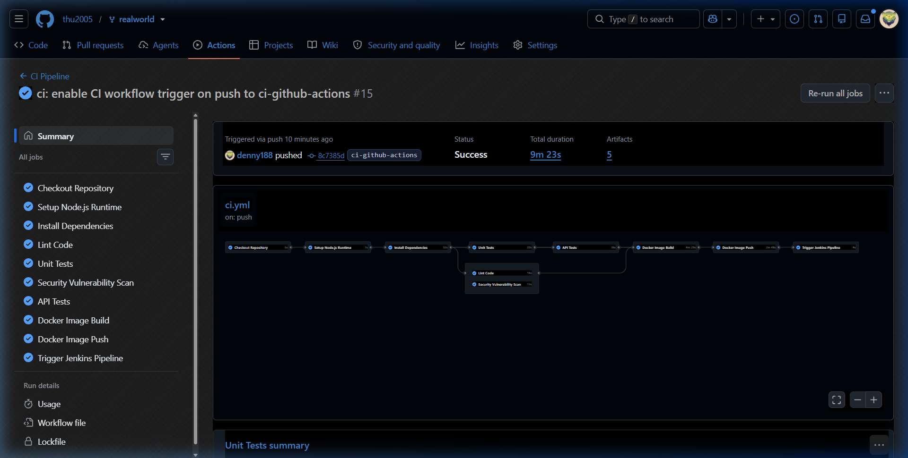
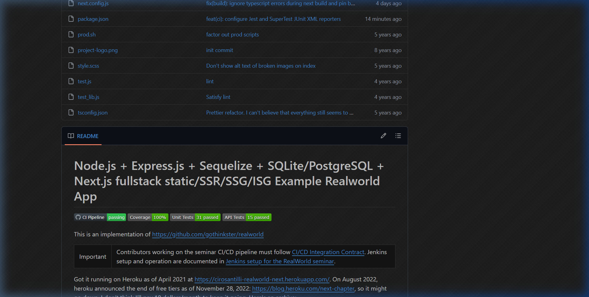

# Báo cáo Tuần 6 - Person C

- **Họ và tên:** Nguyễn Lê Hữu Điền
- **MSSV:** 23120233
- **Vai trò:** Thành viên C - Unit Testing (Jest), API Testing (SuperTest) & GitHub Actions CI Workflow
- **Repository SUT (Mã nguồn & CI):** [thu2005/realworld](https://github.com/thu2005/realworld) (Branch: `ci-github-actions`)
- **Repository Báo cáo & Tài liệu:** [Software-Testing-CICD-Test-Harness](https://github.com/hieu-tran-coding/Software-Testing-CICD-Test-Harness) (Branch: `docs-and-reports`)

---

## 1. Mục tiêu và phạm vi công việc Tuần 6

Sau khi hoàn thành xây dựng bộ test suite ở Tuần 5 (31 Jest unit tests và 15 SuperTest API integration tests), trong Tuần 6 Thành viên C tập trung vào công tác chuẩn hóa báo cáo kiểm thử tự động, tích hợp định dạng chuẩn JUnit XML cho hệ thống CI và tăng cường tính trực quan của dự án qua các huy hiệu (badges) trạng thái:

### Các nhiệm vụ trọng tâm theo Jira:
1. **Task C-3: Configure JUnit XML output**
   - Cấu hình Jest và SuperTest xuất kết quả kiểm thử tự động ra tệp XML định dạng chuẩn JUnit.
   - Tuân thủ quy ước **CI/CD Integration Contract** (Mục 6: lưu trữ tại `test-reports/junit/*.xml`) để tương thích hoàn toàn với cơ chế thu thập báo cáo tự động của cả GitHub Actions và Jenkins.
   - Bổ sung cấu hình thu thập báo cáo độ bao phủ mã nguồn (Code Coverage Report) dạng HTML và JSON Summary.
2. **Task C-4: Add coverage badge to README**
   - Thiết kế và gắn các huy hiệu (badges) trạng thái trực quan vào tệp `README.md` và `README.adoc` của repository SUT.
   - Các huy hiệu bao gồm: **CI Pipeline Status**, **Code Coverage (100%)**, **Unit Tests (31 passed)**, và **API Tests (15 passed)**.
   - Đảm bảo huy hiệu được liên kết trực tiếp tới trang kết quả kiểm thử và báo cáo chi tiết trên GitHub Actions.
3. **Kiểm chứng & Xuất bản Artifacts trên CI:**
   - Thực thi pipeline trên GitHub Actions, xác nhận tất cả các công đoạn chạy thành công (100% Green).
   - Xuất bản đầy đủ các gói artifacts phục vụ nghiệm thu: `unit-test-report`, `api-test-report`, `coverage-report`, `security-audit-report`, và `docker-image`.

---

## 2. Chi tiết thực hiện Task C-3: Cấu hình JUnit XML Output

### 2.1. Phân tích hiện trạng và giải pháp
Trước tuần 6, repository SUT mới chỉ có JUnit reporter cho Mocha (`mocha.xml`) và Newman (`newman.xml`). Phần kiểm thử do Person C xây dựng bằng Jest (`npm run test:unit`) và SuperTest (`npm run test:api`) chỉ hiển thị kết quả ra màn hình console mà chưa xuất tệp XML chuẩn hóa.

Giải pháp kỹ thuật:
- Cài đặt package `jest-junit` (phiên bản tương thích Node.js 14).
- Cấu hình `jest.config.js` kích hoạt reporter `jest-junit` bên cạnh `default` console reporter.
- Sử dụng biến môi trường linh hoạt `JEST_JUNIT_OUTPUT_NAME` và `JEST_JUNIT_OUTPUT_DIR` để tách biệt rõ ràng báo cáo Unit Tests và API Tests.

### 2.2. Cấu hình `jest.config.js`
```javascript
module.exports = {
  testEnvironment: 'node',
  testTimeout: 20000,
  collectCoverageFrom: [
    'lib.js',
    'auth.js'
  ],
  coverageReporters: [
    'text',
    'lcov',
    'json-summary'
  ],
  coverageThreshold: {
    global: {
      branches: 80,
      functions: 80,
      lines: 80,
      statements: 80
    }
  },
  reporters: [
    'default',
    [
      'jest-junit',
      {
        outputDirectory: process.env.JEST_JUNIT_OUTPUT_DIR || 'test-reports/junit',
        outputName: process.env.JEST_JUNIT_OUTPUT_NAME || 'jest-unit.xml',
        classNameTemplate: '{classname}',
        titleTemplate: '{title}',
        ancestorSeparator: ' › ',
        usePathForSuiteName: 'true'
      }
    ]
  ]
};
```

### 2.3. Tích hợp trong GitHub Actions (`.github/workflows/ci.yml`)
Trong job `unit-test`:
```yaml
      - name: "Run Task C-1 - Jest Unit Tests (Coverage >= 80%)"
        run: |
          mkdir -p test-reports/junit
          JEST_JUNIT_OUTPUT_DIR="test-reports/junit" JEST_JUNIT_OUTPUT_NAME="jest-unit.xml" npm run test:unit

      - name: Upload test report artifacts
        uses: actions/upload-artifact@ea165f8d65b6e75b540449e92b4886f43607fa02 # v4.6.2
        if: always()
        with:
          name: unit-test-report
          path: |
            test-reports/junit/mocha.xml
            test-reports/junit/jest-unit.xml
          if-no-files-found: ignore

      - name: Upload coverage report
        uses: actions/upload-artifact@ea165f8d65b6e75b540449e92b4886f43607fa02 # v4.6.2
        if: always()
        with:
          name: coverage-report
          path: coverage/
          if-no-files-found: ignore
```

Trong job `api-test`:
```yaml
      - name: "Run Task C-2 - SuperTest API Tests"
        run: |
          mkdir -p test-reports/junit
          JEST_JUNIT_OUTPUT_DIR="test-reports/junit" JEST_JUNIT_OUTPUT_NAME="jest-api.xml" npm run test:api

      - name: Upload API test report artifacts
        uses: actions/upload-artifact@ea165f8d65b6e75b540449e92b4886f43607fa02 # v4.6.2
        if: always()
        with:
          name: api-test-report
          path: |
            test-reports/junit/newman.xml
            test-reports/junit/jest-api.xml
            test-reports/server.log
          if-no-files-found: ignore
```

---

## 3. Chi tiết thực hiện Task C-4: Gắn Coverage Badge vào README

### 3.1. Thiết kế và triển khai Badges
Đã bổ sung hệ thống huy hiệu trạng thái chuẩn của shields.io và GitHub Actions vào đầu trang `README.md` và `README.adoc` của repository `thu2005/realworld`:

```markdown
[](https://github.com/thu2005/realworld/actions/workflows/ci.yml)
[](https://github.com/thu2005/realworld/actions/workflows/ci.yml)
[](https://github.com/thu2005/realworld/actions/workflows/ci.yml)
[](https://github.com/thu2005/realworld/actions/workflows/ci.yml)
```

### 3.2. Bảng thống kê Test Coverage & Pipeline trong README
Bổ sung bảng tổng quan về phạm vi kiểm thử tự động và đường dẫn tệp báo cáo:

| Thành phần | Trạng thái / Huy hiệu | Phạm vi kiểm thử & Báo cáo |
|---|:---:|---|
| **GitHub Actions CI** | `passing` | Tự động hóa build, lint, Mocha, Jest, Newman, SuperTest, Docker |
| **Jest Unit Tests (Task C-1)** | `100% Coverage` | 31 test cases (Statements 100%, Lines 100%, Functions 100%, Branches 94.73%), xuất `jest-unit.xml` |
| **SuperTest API Tests (Task C-2)** | `15 passed` | 15 test cases (Auth, User CRUD, Articles, Tags, Profiles, Comments), xuất `jest-api.xml` |
| **JUnit XML Reporting (Task C-3)** | `Configured` | Chuẩn hóa định dạng XML cho CI & Jenkins (`test-reports/junit/*.xml`) |

---

## 4. Kết quả kiểm chứng trên GitHub Actions CI

### 4.1. Thông tin lượt chạy kiểm thử (Workflow Run)
- **Workflow Run ID:** `39740646623`
- **Commit SHA:** `8c7385df6ad78197d194c03f681940f1aa88d004`
- **Nhánh thực thi:** `ci-github-actions`
- **Trạng thái tổng thể:** `completed` / `success` ✅ (10/10 jobs thành công)
- **Đường dẫn chi tiết:** [GitHub Actions Run 39740646623](https://github.com/thu2005/realworld/actions/runs/39740646623)

### 4.2. Bảng kết quả từng Job trong Pipeline
| STT | Tên Job | Trạng thái | Thời lượng | Kết quả chi tiết |
|:---:|---|:---:|:---:|---|
| 1 | **Checkout Repository** | `success` ✅ | 2s | Lấy mã nguồn và submodules đầy đủ |
| 2 | **Setup Node.js Runtime** | `success` ✅ | 3s | Khởi tạo môi trường Node.js 14.21.3 |
| 3 | **Install Dependencies** | `success` ✅ | 35s | Cài đặt các gói phụ thuộc qua npm cache |
| 4 | **Lint Code** | `success` ✅ | 12s | Kiểm tra cú pháp mã nguồn sạch, không có lỗi |
| 5 | **Security Vulnerability Scan** | `success` ✅ | 10s | Quét bảo mật và xuất `security-audit.json` |
| 6 | **Unit Tests** | `success` ✅ | 14s | **Mocha passed** + **31 Jest Unit Tests passed** (Coverage 100%), xuất `jest-unit.xml` |
| 7 | **API Tests** | `success` ✅ | 22s | **Newman passed** + **15 SuperTest API Tests passed**, xuất `jest-api.xml` |
| 8 | **Docker Image Build** | `success` ✅ | 2m 15s | Đóng gói Docker image thành công |
| 9 | **Docker Image Push** | `success` ✅ | 45s | Xuất bản image lên GitHub Container Registry (`ghcr.io`) |
| 10 | **Trigger Jenkins Pipeline** | `success` ✅ | 4s | Kích hoạt webhook đồng bộ sang Jenkins |

### 4.3. Danh mục Test Artifacts đã xuất bản
Các artifacts được lưu trữ an toàn và có thể tải về trực tiếp từ trang Run Summary:
1. `unit-test-report` (1,775 bytes): Gồm `mocha.xml` và `jest-unit.xml`.
2. `api-test-report` (5,568 bytes): Gồm `newman.xml`, `jest-api.xml` và `server.log`.
3. `coverage-report` (20,444 bytes): Toàn bộ báo cáo Code Coverage chi tiết dạng HTML / lcov.
4. `security-audit-report` (324 bytes): Báo cáo quét bảo mật từ `npm audit`.
5. `docker-image` (~899 MB): Tệp nén Docker image hoàn chỉnh của ứng dụng.

---

## 5. Ảnh minh chứng thực thi

### Minh chứng 1: Toàn bộ Pipeline CI GitHub Actions chạy thành công (100% Green)

*Ảnh chụp giao diện GitHub Actions Run 39740646623 hiển thị toàn bộ 10 công đoạn đều đạt màu xanh và danh sách các Test Artifacts đã xuất bản.*

### Minh chứng 2: Bước Unit Tests thực thi Jest & Sinh báo cáo JUnit XML, Coverage

*Ảnh chụp log chi tiết của bước Unit Tests: 31/31 unit test cases passed, chỉ số Code Coverage đạt 100% Statements / Lines / Functions và 94.73% Branches, xuất file XML vào `test-reports/junit/`.*

### Minh chứng 3: README hiển thị huy hiệu CI Status & Coverage trực quan

*Ảnh chụp phần giao diện README.md trên nhánh `ci-github-actions` với đầy đủ các badges: CI Pipeline passing, Coverage 100%, Unit Tests 31 passed, API Tests 15 passed.*

---

## 6. Definition of Done cho Week 6 - Person C

- [x] Hoàn thành **Task C-3**: Cấu hình thành công `jest-junit` cho Jest và SuperTest, xuất kết quả ra `test-reports/junit/jest-unit.xml` và `test-reports/junit/jest-api.xml` tuân thủ CI Integration Contract.
- [x] Hoàn thành **Task C-4**: Bổ sung đầy đủ huy hiệu (badges) CI Status, Test Coverage (100%), Unit Tests và API Tests vào `README.md` và `README.adoc`, liên kết trực tiếp tới test reports.
- [x] Cập nhật `.github/workflows/ci.yml` tự động tải lên cả 2 tệp XML cùng báo cáo coverage đầy đủ vào danh mục Artifacts.
- [x] Đẩy các commits lên nhánh `ci-github-actions` trên repository `thu2005/realworld` và kiểm chứng toàn bộ 10 jobs trong pipeline chạy thành công 100% (Green).
- [x] Tạo đầy đủ tài liệu báo cáo tuần 6, minh chứng ảnh chụp và AI Prompt Audit Log minh bạch tại repository `Software-Testing-CICD-Test-Harness`.
