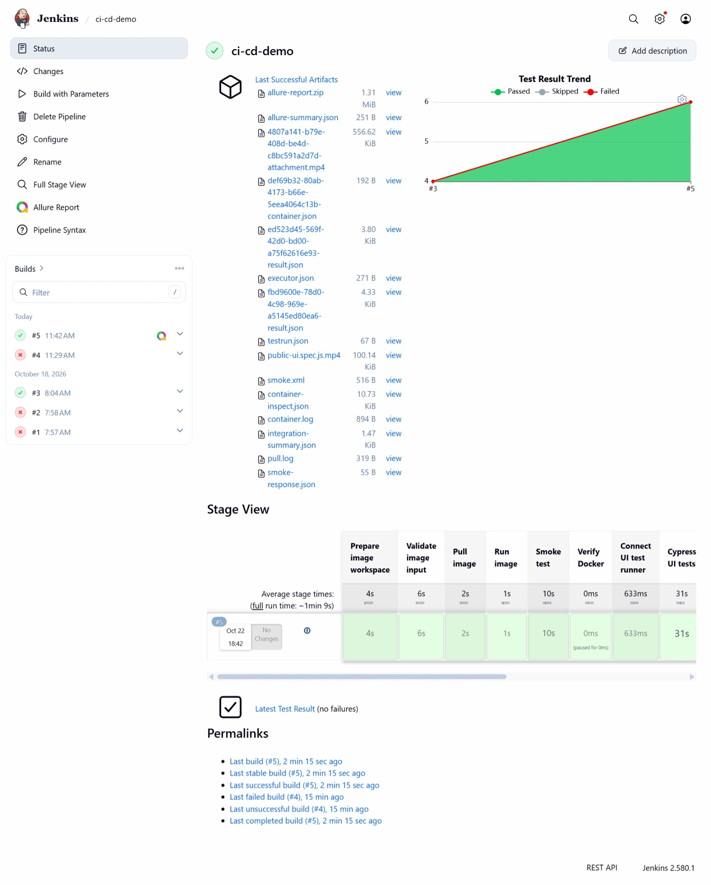
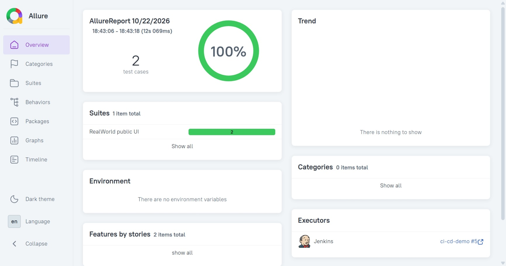
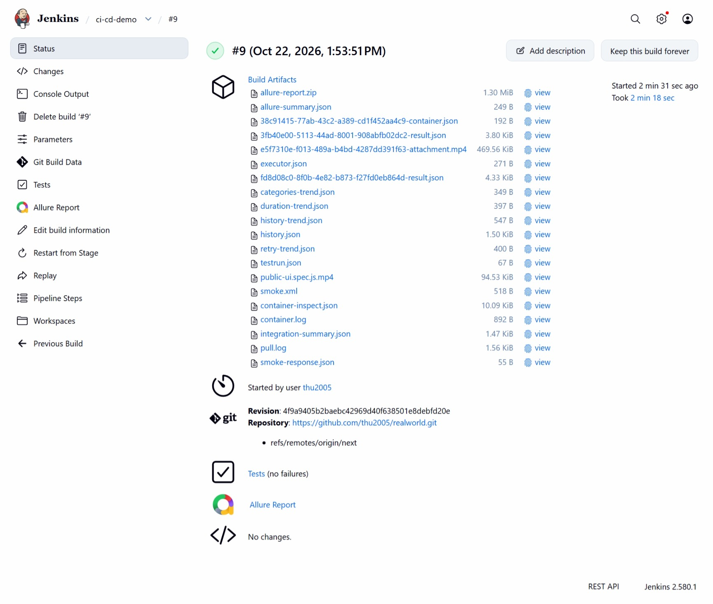
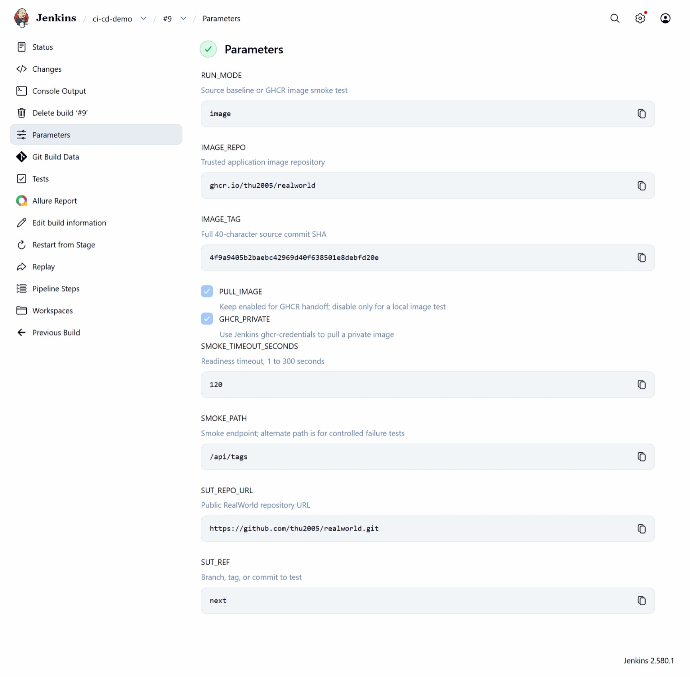

# Báo cáo Tuần 6 - Person D

- **Họ và tên:** Nguyễn Đoàn Xuân Thu
- **MSSV:** 23120170
- **Vai trò:** Jenkins pipeline, Cypress, Allure và quản lý credential
- **Repository SUT:** [thu2005/realworld](https://github.com/thu2005/realworld)

## 1. Mục tiêu và phạm vi

Tuần 6 tiếp tục pipeline Jenkins đã xây dựng ở Tuần 5 và hoàn thành ba task được giao trên Jira:

1. **Install Cypress in Jenkins**: cài Cypress trong custom Jenkins image và chạy UI smoke test đối với ứng dụng RealWorld đã đóng gói.
2. **Configure Allure plugin in Jenkins**: cài plugin, cấu hình Allure command-line và publish báo cáo sau mỗi build.
3. **Add secure credentials**: lưu thông tin đọc GHCR trong Jenkins Credentials và sử dụng qua Credentials Binding, không hard-code token.

Luồng tích hợp được hoàn thiện ở mức phù hợp cho seminar:

```text
Push/merge vào next
        ↓
GitHub Actions: lint/test/security/build → push GHCR theo commit SHA
        ↓
Jenkins image mode: pull → run → smoke test → Cypress
        ↓
Allure report + JUnit + video/log artifacts + cleanup
```

## 2. Nội dung đã triển khai

### 2.1. Cypress trong Jenkins

Custom Jenkins image được bổ sung:

- Cypress `9.7.0`.
- `@shelex/cypress-allure-plugin` `2.22.0`.
- Các thư viện Linux và Xvfb cần cho trình duyệt headless.
- Bước `cypress verify` ngay khi build image để phát hiện lỗi cài đặt sớm.

Phiên bản được pin để tương thích với Node.js `14.21.3` của ứng dụng seminar. Bộ test tại `cypress/e2e/public-ui.spec.js` gồm hai kịch bản không làm thay đổi dữ liệu:

1. Mở trang chủ và kiểm tra menu, tiêu đề, Global Feed và Popular Tags.
2. Mở trang đăng nhập, kiểm tra URL, email/password input và nút Sign in.

Khi chạy image mode, Jenkins tạm kết nối test runner vào Docker network riêng của SUT. Ứng dụng không cần publish cổng ra host.

### 2.2. Allure report

- Thêm `allure-jenkins-plugin` vào `jenkins/plugins.txt` để plugin được cài tự động khi build Jenkins image.
- Thêm init script `jenkins/init.groovy.d/configure-allure.groovy` để tạo Allure command-line tool tên `allure` nếu chưa tồn tại.
- Cypress ghi raw result vào `test-reports/allure-results/`.
- Post action của Jenkins luôn publish Allure, JUnit và archive artifacts, kể cả khi test thất bại.

Các artifact chính:

| Artifact | Đường dẫn |
|---|---|
| Allure raw results | `test-reports/allure-results/` |
| Cypress video | `test-reports/cypress/videos/` |
| Cypress screenshots khi lỗi | `test-reports/cypress/screenshots/` |
| Smoke/JUnit result | `test-reports/junit/` |
| Container diagnostics | `test-reports/logs/` |

### 2.3. Credential an toàn cho GHCR

Jenkins credential được tạo với cấu hình:

| Thuộc tính | Giá trị |
|---|---|
| Kind | Username with password |
| Scope | Global |
| ID | `ghcr-credentials` |
| Quyền token | Chỉ đọc package (`read:packages`) |

Pipeline chỉ lấy credential khi đồng thời có `GHCR_PRIVATE=true` và `PULL_IMAGE=true`. Token được truyền cho `docker login` qua `password-stdin`; shell trace được tắt, Docker config nằm trong thư mục tạm và bị xóa sau khi pull. Token không xuất hiện trong source code, tài liệu, screenshot hoặc console log.

GHCR hiện là public nên pipeline vẫn có thể chạy với `GHCR_PRIVATE=false`. Tuần 6 đã chủ động chạy thêm đường dẫn authenticated để chứng minh Credentials Binding hoạt động.

### 2.4. Handoff từ GitHub Actions sang Jenkins

Workflow `.github/workflows/ci.yml` chỉ push image khi event không phải pull request. Image được gắn tag bằng full commit SHA. Sau khi `docker-push` thành công, job `trigger-jenkins` chuẩn bị các giá trị:

```text
RUN_MODE=image
SUT_REF=<commit SHA>
IMAGE_REPO=ghcr.io/thu2005/realworld
IMAGE_TAG=<commit SHA>
PULL_IMAGE=true
```

Script `jenkins/trigger_jenkins.py` hỗ trợ gọi Jenkins bằng API token, lấy CSRF crumb, theo dõi queue/build và trả failure về GitHub Actions. Do Jenkins của seminar chạy tại localhost, GitHub-hosted runner không thể truy cập trực tiếp; lần kiểm chứng cuối dùng **Build with Parameters** theo manual fallback đã ghi trong tài liệu. Không mở Jenkins ra Internet chỉ để phục vụ demo.

## 3. Các file chính

| File | Vai trò |
|---|---|
| `Jenkinsfile` | Thêm image mode, Cypress UI stage, Allure publication và secure GHCR pull. |
| `jenkins/Dockerfile` | Cài Cypress, Allure adapter và runtime headless vào Jenkins image. |
| `jenkins/plugins.txt` | Cài tự động Allure Jenkins plugin. |
| `jenkins/init.groovy.d/configure-allure.groovy` | Khởi tạo Allure tool tên `allure`. |
| `cypress.json` | Cấu hình base URL, plugins, support file, video và screenshot paths. |
| `cypress/e2e/public-ui.spec.js` | Hai UI smoke test công khai. |
| `jenkins/image_smoke.py` | Quản lý SUT container/network, kết nối test runner và cleanup. |
| `jenkins/trigger_jenkins.py` | Client trigger và theo dõi Jenkins từ GitHub Actions. |
| `.github/workflows/ci.yml` | Push image theo SHA và tạo Jenkins handoff sau khi push thành công. |
| `docs/jenkins-cypress-allure.md` | Hướng dẫn setup, chạy lại, credential và troubleshooting. |

Các thay đổi được merge qua pull request `#5` vào branch `next` tại commit:

```text
4f9a9405b2baebc42969d40f638501e8debfd20e
```

## 4. Kết quả kiểm chứng

### 4.1. GitHub Actions

- Branch: `next`.
- Merge commit: `4f9a9405b2baebc42969d40f638501e8debfd20e`.
- Kết quả: `10/10` checks thành công.
- Docker Image Build và Docker Image Push đều pass.
- GHCR image được publish với tag chính là full merge commit SHA.
- Docker push và Jenkins handoff được skip trên pull request theo thiết kế; chúng chạy sau khi merge/push vào `next`.

### 4.2. Jenkins

Lần kiểm chứng cuối là build `#9`:

| Tham số | Giá trị |
|---|---|
| SCM branch | `next` |
| `RUN_MODE` | `image` |
| `IMAGE_REPO` | `ghcr.io/thu2005/realworld` |
| `IMAGE_TAG` | `4f9a9405b2baebc42969d40f638501e8debfd20e` |
| `PULL_IMAGE` | `true` |
| `GHCR_PRIVATE` | `true` |

Kết quả:

- Jenkins lấy đúng revision `4f9a9405b2baebc42969d40f638501e8debfd20e` từ branch `next`.
- Đăng nhập và pull GHCR qua credential `ghcr-credentials` thành công.
- SUT container khởi động và smoke endpoint `/api/tags` trả kết quả hợp lệ.
- Hai Cypress UI tests chạy thành công.
- Allure hiển thị `2/2` test cases pass (`100%`).
- Video, raw results, smoke XML, container log và integration summary được archive.
- Container và Docker network tạm được cleanup sau build.

## 5. Ảnh minh chứng

### Minh chứng 1 - GitHub Actions trên branch `next`


Ảnh cho thấy merge commit `4f9a940` có 10 checks thành công, bao gồm Docker Image Build, Docker Image Push và Trigger Jenkins Pipeline.

### Minh chứng 2 - Jenkins image pipeline và Cypress



Stage View thể hiện các bước Prepare, Validate, Pull image, Run image, Smoke test, Connect UI test runner và Cypress UI tests đều thành công; Jenkins đồng thời lưu video, Allure result, JUnit và log artifacts.

### Minh chứng 3 - Allure report



Allure report hiển thị suite `RealWorld public UI`, `2` test cases và tỷ lệ pass `100%`.

### Minh chứng 4 - Jenkins build cuối trên `next`



Build `#9` thành công, dùng đúng revision merge trên branch `next`, có Allure link và đầy đủ artifacts.

### Minh chứng 5 - Secure GHCR parameters



Ảnh xác nhận build cuối chạy `RUN_MODE=image`, dùng image tag là merge SHA, bật `PULL_IMAGE` và `GHCR_PRIVATE`; không hiển thị giá trị token.

## 6. Definition of Done - Week 6

- [x] Cypress được cài và verify trong custom Jenkins image.
- [x] Hai Cypress UI smoke tests chạy được với SUT container trong image mode.
- [x] Allure Jenkins plugin và command-line tool được cấu hình tự động.
- [x] Jenkins publish Allure report với 2/2 test pass.
- [x] Video, screenshots khi lỗi, raw results, JUnit và logs được archive đúng contract.
- [x] Credential `ghcr-credentials` được lưu trong Jenkins Credentials, không hard-code.
- [x] Secure GHCR pull được kiểm chứng với `GHCR_PRIVATE=true` và build thành công.
- [x] GitHub Actions push image bằng full commit SHA sau khi merge vào `next`.
- [x] Pull request `#5` đã merge; GitHub Actions 10/10 checks và Jenkins build `#9` đều pass.
- [x] Có tài liệu setup/troubleshooting và ảnh minh chứng không chứa secret.

## 7. Giới hạn và bàn giao

- Jenkins hiện chạy tại `127.0.0.1:18080`. Vì GitHub-hosted runner không truy cập được localhost, lần demo cuối dùng manual trigger sau khi GitHub Actions push image. Khi cần tự động hoàn toàn, nhóm phải dùng Jenkins URL có kiểm soát hoặc self-hosted runner; không nên public Jenkins tùy tiện.
- `SUT_REF` chỉ được checkout trong source mode. Trong image mode, tính truy vết chính dựa trên `IMAGE_TAG` và Jenkins SCM revision; build cuối xác nhận cả hai cùng là merge SHA `4f9a9405…`.
- Credential tạo cho seminar nên dùng quyền tối thiểu, thời hạn ngắn và được thu hồi sau khi hoàn tất môn học.
- Pipeline chạy trên Jenkins controller để demo đơn giản. Mô hình production nên tách agent chuyên dụng.

Kết quả Tuần 6 đã hoàn thiện phần code và tích hợp chính để nhóm chuyển sang viết báo cáo tổng, làm slide và chuẩn bị demo ở tuần tiếp theo.
