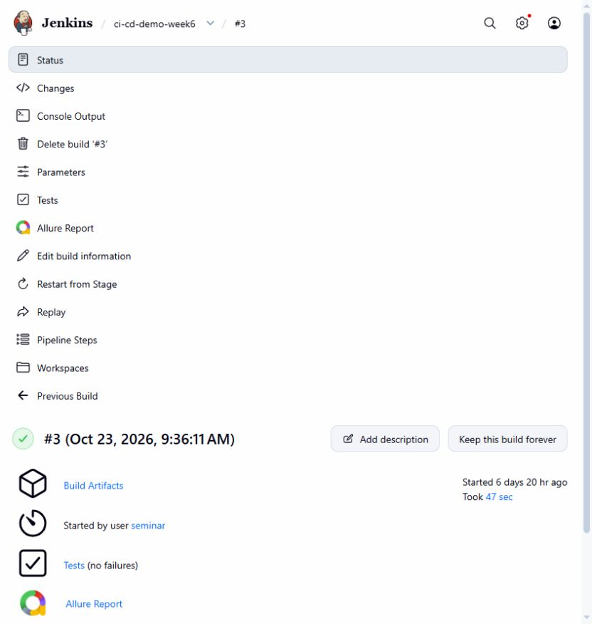
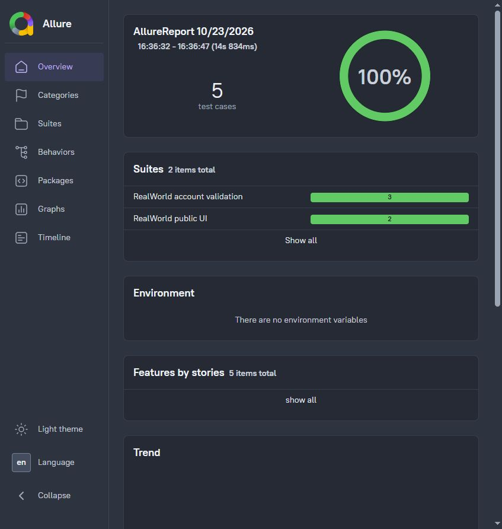

# Báo cáo Tuần 6 — Person E

**Họ và tên:** Trần Trọng Trí  
**MSSV:** 20120221  
**Phần việc:** Bổ sung Cypress UI test, kiểm chứng Jenkins và chuẩn bị demo.  
**Ngày thực hiện:** 23/10/2026.

## 1. Mục tiêu

Tiếp tục phần Jenkins của Week5 trên ứng dụng mẫu RealWorld. Trong Week6,
Person D đã cài Cypress, cấu hình Allure, credentials và viết 2 test public UI.
Em kế thừa phần này để bổ sung test tài khoản, xuất JUnit cho UI và kiểm chứng
kịch bản thành công/thất bại phục vụ demo seminar.

## 2. Nội dung thực hiện

| Thành phần | Đóng góp của Person E |
|---|---|
| Cypress | 3 test: đăng nhập thiếu mật khẩu, sai thông tin đăng nhập, mở đăng ký và gửi thiếu mật khẩu |
| Jenkinsfile | Thêm JUnit reporter cho Cypress, mỗi spec có file riêng để không ghi đè |
| API trigger client | Cho phép truyền cấu hình pull/private image và smoke path/timeout qua biến môi trường, giữ giá trị mặc định cũ |
| Tài liệu | Kế hoạch, hướng dẫn demo pass/fail và bộ evidence Week6 |

Các test theo dõi request đến API thật và kiểm tra cả HTTP 422 lẫn thông báo lỗi
trên giao diện. Không mock response và không tạo tài khoản thành công, nên không
cần xóa dữ liệu sau từng test. Tổng bộ UI gồm 5 test: 2 test của Person D và 3 test mới.
Phạm vi này chưa bao gồm toàn bộ luồng đăng ký thành công, đăng nhập và đăng bài.

## 3. Kết quả kiểm chứng

Job kiểm chứng riêng: [ci-cd-demo-week6](http://localhost:18080/job/ci-cd-demo-week6/).

| Build | Kịch bản | Kết quả thực tế | API client |
|---|---|---|---|
| [#1](http://localhost:18080/job/ci-cd-demo-week6/1/) | Tag `latest` | FAILURE đúng kỳ vọng tại Validate image input | Exit code 1 |
| [#2](http://localhost:18080/job/ci-cd-demo-week6/2/) | Endpoint cố ý sai, timeout 30 giây | FAILURE đúng kỳ vọng; API trả HTTP 404 | Exit code 1 |
| [#3](http://localhost:18080/job/ci-cd-demo-week6/3/) | Image SHA đúng, `/api/tags` | SUCCESS, khoảng 47,7 giây; 5/5 UI test pass | Exit code 0 |

Build #2 và #3 pull image GHCR của commit `next`
`4f9a9405b2baebc42969d40f638501e8debfd20e`, digest
`sha256:c2ccecabf07e307b0e65144d767a573d5632732c18b130f3c1d92149400c5e8d`.

Build #3 xuất Allure **5 passed**, JUnit **11 passed** gồm 5 UI test và 6 kiểm tra
lifecycle; lưu 23 artifacts gồm report, JUnit, log và video Cypress. Cả 3 build
ghi nhận cleanup hoàn tất; sau lượt cuối không còn container/network tạm có nhãn
của runner. Hai build FAILURE là ca demo được tạo chủ đích, không phải lỗi chưa sửa.

Evidence: [kết quả 3 build](evidence/verification_results.json) và
[JUnit của build #3](evidence/build-3/smoke.xml), cùng 2 file JUnit Cypress trong
thư mục `evidence/build-3`. Có thể mở [Allure build #3](http://localhost:18080/job/ci-cd-demo-week6/3/allure/)
để xem trực tiếp. Hai ảnh dưới được chụp lại ngày 30/10 từ chính build lịch sử
Week6 #3 (23/10), không phải build Week7.

Kiểm tra bổ sung: ESLint của dự án cho spec mới, Python compile và Jenkinsfile
validation đều pass. Khi build môi trường, endpoint tải plugin mặc định gặp lỗi
SSL; chuyển sang `https://updates.jenkins.io/download/plugins` với kiểm tra
SHA-256 đã thành công. Dockerfile và cấu hình Cypress/Allure được kế thừa từ Person D.

## 4. Kịch bản trình bày

1. Giới thiệu luồng Actions → GHCR → Jenkins và image tag theo commit SHA.
2. Mở build thành công; xem 5 test trong Allure và JUnit trong mục Tests.
3. Chạy với `IMAGE_TAG=latest`; giải thích Jenkins từ chối tag không phải SHA.
4. Chạy lại bằng SHA đúng, xem artifacts và cleanup.

Hướng dẫn chạy lại và chụp ảnh nằm trong
[`docs/week6-jenkins-demo.md`](https://github.com/thu2005/realworld/blob/next/docs/week6-jenkins-demo.md)
của repository RealWorld. Code Week6 đã được merge qua
[PR #6](https://github.com/thu2005/realworld/pull/6), merge commit `42e263e`.
Kết quả trong bảng trên giữ nguyên theo ngày 23/10; kiểm chứng bằng SCM và image
mới ngày 30/10 được ghi riêng trong [báo cáo Week7](../../Week7/PersonE/20120221_report.md).

## 5. Giới hạn và bàn giao

- Job local nạp Jenkinsfile và các file test từ working tree, thay riêng bước lấy
  source bằng `writeFile` để kiểm chứng code chưa push; các stage chạy giữ nguyên.
- Gọi API trigger từ máy local không chứng minh GitHub-hosted runner truy cập
  được Jenkins localhost. Chưa xác nhận trigger tự động từ Actions qua mạng.
- Cấu hình GHCR credentials được kế thừa từ Person D; không nhận build private
  image của thành viên khác là kết quả kiểm chứng của em.
- Báo cáo này là phần cá nhân phía Jenkins, không kết luận cả nhóm đã đạt 90%
  mốc Week6. Nhóm cần tổng hợp với báo cáo các thành viên và chốt slide chung.
