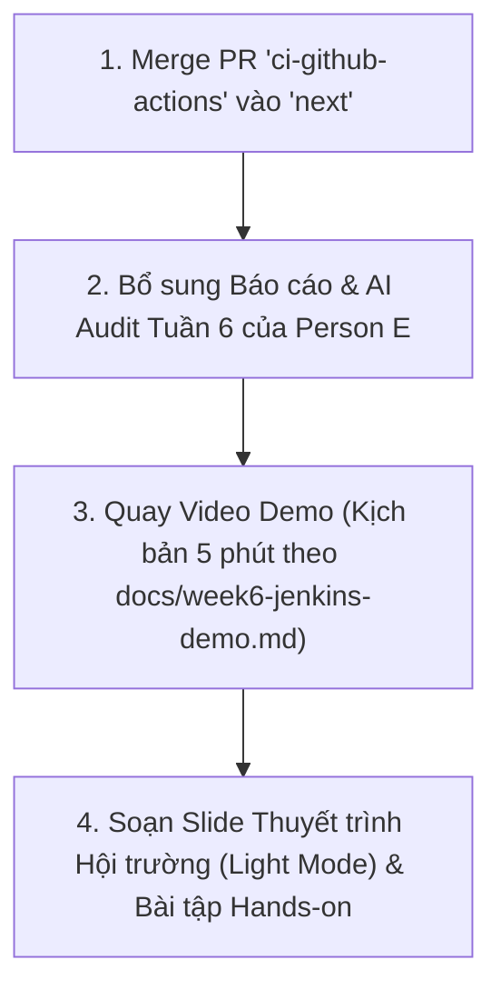

# 📊 BÁO CÁO ĐÁNH GIÁ TIẾN ĐỘ HIỆN THỰC ĐỒ ÁN (TUẦN 7)
## (IMPLEMENTATION PROGRESS & TRACEABILITY EVALUATION REPORT)

> **Môn học:** Kiểm thử phần mềm (Software Testing) – FIT@HCMUS  
> **Chủ đề Seminar:** Xây dựng Hệ thống Kiểm thử Tự động (Test-Harness) Tích hợp Pipeline CI/CD  
> **Repository SUT:** [`thu2005/realworld`](https://github.com/thu2005/realworld) (Baseline: branch `next`, Feature branch: `ci-github-actions`)  
> **Repository Báo cáo & Tài liệu:** [`Software-Testing-CICD-Test-Harness`](https://github.com/hieu-tran-coding/Software-Testing-CICD-Test-Harness) (Branch: `docs-and-reports`)  
> **Thời điểm lập báo cáo:** Tuần 7 (Tháng 10/2026)  
> **Tài liệu tham chiếu:**
> - [Final Proposal Tuần 3](../Week3/final_proposal.md) | [Teacher Feedback Tuần 3](../Week3/teacher_feedback_week3.md)
> - [Implementation Proposal Tuần 4](../Week4/implementation%20_proposal.md) | [Task Assignments Tuần 4](../Week4/task_assignments.md)
> - [Team Progress Tuần 6](../Week6/team_progress.md) | [CI Integration Contract (realworld)](file:///C:/Users/Hieu/Documents/Testing/realworld/CI_INTEGRATION_CONTRACT.md)

---

## 1. Tóm tắt Đánh giá Hiện trạng (Executive Summary)

Đến thời điểm khởi động **Tuần 7**, nhóm đã hoàn thành toàn diện giai đoạn nghiên cứu, thiết kế kiến trúc và hiện thực kỹ thuật cốt lõi (Giai đoạn 1 & 2: CI/CD Pipeline, Containerization, Unit, API và UI Test-Harness).

### Các kết quả nổi bật:
* **Mức độ hoàn thành kỹ thuật:** Đạt xấp xỉ **85% – 90%** tổng khối lượng công việc CI/CD và Test-Harness cam kết trong đề án.
* **Độ bao phủ kiểm thử (Test Coverage):** Đạt mức tuyệt đối trên các module nghiệp vụ nòng cốt (**Statements: 100%, Functions: 100%, Lines: 100%, Branches: >94%** với 31 ca kiểm thử Jest).
* **Kiến trúc Pipeline liên hoàn:** Hiện thực hóa thành công chuỗi cung ứng phần mềm 2 cấp:
  $$\text{Code Commit} \xrightarrow{\text{GitHub Actions CI}} \text{Lint / Jest / SuperTest / GHCR Push} \xrightarrow{\text{Webhook/API}} \text{Jenkins Pipeline} \xrightarrow{\text{Docker Smoke / Cypress}} \text{Allure Report}$$
* **Chuyển dịch trọng tâm đúng hướng:** Nhóm đã linh hoạt điều chỉnh kiến trúc ban đầu theo đúng chỉ đạo của GVTH tại [teacher_feedback_week3.md](../Week3/teacher_feedback_week3.md), dồn trọng tâm vào **DevOps & Pipeline CI/CD liên hoàn (GitHub Actions + Jenkins)**, tinh gọn các tầng kiểm thử để phục vụ tốt nhất mục tiêu seminar lớp học.

---

## 2. Phân tích Cấu trúc Git & Tình trạng Phân nhánh (Git Branches & Status)

Hệ thống được tổ chức trên 2 kho lưu trữ mã nguồn tách biệt, tương ứng với phân định trách nhiệm công nghiệp:

### 2.1. Repository SUT: `realworld`
Kho mã nguồn chứa ứng dụng mẫu Conduit (Node.js/Express + React Monolith), hạ tầng Docker, kịch bản CI/CD và toàn bộ mã nguồn kiểm thử:
* **Nhánh cơ sở `next` (Trạng thái: Hoàn tất tích hợp PR #1 $\rightarrow$ PR #6):**
  * Commit đỉnh hiện tại: `42e263e` (*Merge pull request #6 from thu2005/feature/week6-jenkins-demo*).
  * Chứa toàn bộ hạ tầng Jenkins (`Jenkinsfile`, `docker-compose.jenkins.yml`), bộ test Jest Unit (31 tests), SuperTest API (15 tests), và Cypress UI (5 specs).
* **Nhánh tính năng `ci-github-actions` (Trạng thái: Đã nghiệm thu Tuần 6, chờ merge vào `next`):**
  * Commit đỉnh: `19c70a9` (*feat(ci): implement security scan fail-fast (B-5), CodeQL SAST (B-9), and Allure report dashboard (B-10)*).
  * Chứa các nâng cấp bảo mật DevSecOps khắt khe: Workflow CodeQL SAST độc lập, quy tắc fail-fast khi npm audit phát hiện lỗ hổng High/Critical, job xuất bản Allure Report Dashboard trực tiếp trên GitHub Actions, cấu hình `jest-junit` và hệ thống badge trên `README.md`.
* **Lịch sử các PR tính năng đã merge vào `next`:**
  * **PR #1 (Nhóm D):** Hạ tầng Jenkins baseline, Docker Compose, chế độ source mode và bản thỏa thuận `CI_INTEGRATION_CONTRACT.md`.
  * **PR #2 (Nhóm B):** Khung GitHub Actions 10 jobs chuẩn hóa, Dockerfile DevSecOps và cấu hình ESLint 8.
  * **PR #3 (Nhóm B & C):** Tích hợp 31 Jest Unit tests và 15 SuperTest API tests vào workflow GitHub Actions.
  * **PR #4 (Nhóm E):** Quản lý vòng đời Docker image trên Jenkins (`RUN_MODE=image`), điều phối container smoke test qua `jenkins/image_smoke.py`.
  * **PR #5 (Nhóm D):** Cài đặt Cypress và Allure plugin vào custom Jenkins image, bổ sung 2 kịch bản UI smoke test công khai.
  * **PR #6 (Nhóm E):** Bổ sung 3 kịch bản Cypress kiểm thử validation tài khoản (`cypress/e2e/account-validation.spec.js`) và tài liệu hướng dẫn demo tại lớp (`docs/week6-jenkins-demo.md`).

### 2.2. Repository Báo cáo: `Software-Testing-CICD-Test-Harness`
Kho lưu trữ trung tâm của môn học, quản lý tài liệu, biên bản họp và bằng chứng kiểm duyệt AI:
* **Nhánh hoạt động chính:** `docs-and-reports` (Commit đỉnh: `8a72c94`).
* Lưu trữ hồ sơ tuần tự từ Tuần 3 đến Tuần 6:
  * Thư mục `docs/weekly-docs/`: Proposal, phản hồi GVTH, kế hoạch chi tiết, báo cáo tiến độ nhóm và từng thành viên.
  * Thư mục `docs/ai-audit-logs/`: Toàn bộ nhật ký hội thoại AI (Prompt, Output, Review) minh bạch theo đúng quy định "AI-First" của môn học.
  * Thư mục `docs/meeting-proofs/`: Ảnh chụp biên bản họp, biểu quyết và bảng phân công Jira.

---

## 3. Bảng Đối chiếu Chi tiết: Đề án Tuần 3 vs. Thực tế Triển khai (Traceability Matrix)

Dưới đây là bảng ma trận đối chiếu từng thành phần cam kết trong đề án ban đầu ([final_proposal.md](../Week3/final_proposal.md)), các điều chỉnh theo hướng dẫn của giáo viên và minh chứng thực tế trên mã nguồn:

| STT | Thành phần theo Đề án (Week 3 Proposal) | Hướng điều chỉnh thực tế (Week 4 - 6) | Trạng thái hiện thực | Bằng chứng mã nguồn / File kiểm chứng (Proof of Implementation) | Đánh giá & Phân tích |
| :---: | :--- | :--- | :---: | :--- | :--- |
| **1** | **Ứng dụng kiểm thử (SUT):** eShop App hoặc RealWorld Conduit. | Chốt RealWorld Conduit (Node.js/Express + Next.js + SQLite). | **Đạt 100%** | - [`realworld/app.js`](file:///C:/Users/Hieu/Documents/Testing/realworld/app.js) - [`realworld/package.json`](file:///C:/Users/Hieu/Documents/Testing/realworld/package.json) - [`CI_INTEGRATION_CONTRACT.md`](file:///C:/Users/Hieu/Documents/Testing/realworld/CI_INTEGRATION_CONTRACT.md#L7-L13) | Kiến trúc monolith, khởi động nhanh, tích hợp sẵn DB SQLite, phù hợp cho chu trình CI ngắn (~15s) và demo trực tiếp. |
| **2** | **Đóng gói Container:** Đóng gói Docker phục vụ chạy môi trường cô lập. | Xây dựng Dockerfile chuẩn DevSecOps trên nền `node:14.21.3-bullseye`. | **Đạt 100%** | - [`realworld/Dockerfile`](file:///C:/Users/Hieu/Documents/Testing/realworld/Dockerfile) - Gộp RUN layer, user không đặc quyền `USER node` - Healthcheck: `GET /api/tags` | Container được tối ưu hóa, cô lập hoàn toàn môi trường, tự kiểm tra readiness trước khi đẩy lên registry. |
| **3** | **Nền tảng CI/CD 1: GitHub Actions** Quản lý workflow tự động hóa mã nguồn. | Triển khai workflow 10 jobs chuẩn hóa, thực thi theo nguyên tắc fail-fast. | **Đạt 100%** | - [`.github/workflows/ci.yml`](file:///C:/Users/Hieu/Documents/Testing/realworld/.github/workflows/ci.yml) - Lượt chạy kiểm chứng: [Run 39740646623](https://github.com/thu2005/realworld/actions/runs/39740646623) (10/10 jobs passed) | 10 jobs: `checkout`, `setup-node`, `install`, `lint`, `unit-test`, `api-test`, `security-scan`, `docker-build`, `docker-push`, `trigger-jenkins`. |
| **4** | **Nền tảng CI/CD 2: Jenkins Pipeline** Yêu cầu bắt buộc bổ sung từ GVTH. | Dựng Jenkins Controller trên Docker, hỗ trợ 2 chế độ `source` và `image`. | **Đạt 100%** | - [`realworld/Jenkinsfile`](file:///C:/Users/Hieu/Documents/Testing/realworld/Jenkinsfile) - [`docker-compose.jenkins.yml`](file:///C:/Users/Hieu/Documents/Testing/realworld/docker-compose.jenkins.yml) - Jenkins Build #7 & #9 thành công | Vận hành cổng 18080. Chế độ `image mode` kéo container từ GHCR, chạy smoke test độc lập, gọi Cypress và xuất Allure Report. |
| **5** | **Giao tiếp GitHub Actions $\rightarrow$ Jenkins:** Webhook tự động kích hoạt. | Chuẩn hóa hợp đồng bàn giao Docker tag SHA và script API client. | **Đạt 90%** | - [`jenkins/trigger_jenkins.py`](file:///C:/Users/Hieu/Documents/Testing/realworld/jenkins/trigger_jenkins.py) - [`jenkins/image_smoke.py`](file:///C:/Users/Hieu/Documents/Testing/realworld/jenkins/image_smoke.py) - Tham số: `RUN_MODE=image`, `IMAGE_TAG=<SHA>` | Bàn giao an toàn qua GHCR. Do Jenkins chạy cục bộ trên máy cá nhân, nhóm hỗ trợ trigger bằng API script hoặc chạy tham số thủ công (tránh mở port ra Internet không an toàn). |
| **6** | **Kiểm thử Đơn vị (Unit Testing):** Ước tính ~15–20 tests Jest, coverage $\ge 80\%$. | Mở rộng lên 31 tests Jest bao phủ 3 module cốt lõi: lib, auth, models. | **Vượt chỉ tiêu (100%)** | - [`tests/unit/lib.test.js`](file:///C:/Users/Hieu/Documents/Testing/realworld/tests/unit/lib.test.js) (16 tests) - [`tests/unit/auth.test.js`](file:///C:/Users/Hieu/Documents/Testing/realworld/tests/unit/auth.test.js) (6 tests) - [`tests/unit/models.test.js`](file:///C:/Users/Hieu/Documents/Testing/realworld/tests/unit/models.test.js) (9 tests) - [Ảnh minh chứng Coverage](../Week6/PersonC/screenshots/unit-tests-coverage-step.png) | **31 test cases passed**. Tỷ lệ Code Coverage đạt **100% Statements / Lines / Functions** và **94.73% Branches**, vượt xa chỉ tiêu 80%. |
| **7** | **Kiểm thử Tích hợp API (API Testing):** Postman/Newman, 5 nhóm checkpoints. | Tích hợp song song Newman collection và 15 ca kiểm thử SuperTest. | **Đạt 100%** | - [`tests/api/api.test.js`](file:///C:/Users/Hieu/Documents/Testing/realworld/tests/api/api.test.js) (15 tests) - [`api/run-api-tests.sh`](file:///C:/Users/Hieu/Documents/Testing/realworld/api/run-api-tests.sh) (Postman collection) | Kiểm thử toàn diện vòng đời REST: Tags, Auth, JWT token, Articles CRUD, Profile, Comments và các mã lỗi (400, 401, 403, 404, 422). |
| **8** | **Kiểm thử Giao diện (UI Automation):** Cypress, Headless mode, Record/Playback. | Xây dựng bộ test Cypress headless chạy trong container Jenkins. | **Đạt 70%** | - [`cypress/e2e/public-ui.spec.js`](file:///C:/Users/Hieu/Documents/Testing/realworld/cypress/e2e/public-ui.spec.js) (2 tests) - [`cypress/e2e/account-validation.spec.js`](file:///C:/Users/Hieu/Documents/Testing/realworld/cypress/e2e/account-validation.spec.js) (3 tests) | Đã có **5 test cases UI** chạy ổn định không cần màn hình đồ họa. Phần Record & Playback (Cypress Studio) không đưa vào CI vì ưu tiên kiểm thử headless tự động. |
| **9** | **Kiểm thử Tương tranh & Áp lực:** k6 CLI cho Race condition & Stress test. | Cắt giảm theo chỉ đạo của GVTH ("*Chỉ liệt kê phân loại test, tập trung vào pipeline*"). | **Tạm hoãn / Cắt giảm** | - Không có script k6 trong codebase - Nêu cơ sở lý thuyết tại Đề án Tuần 3 | Chủ động tinh gọn để dồn thời gian hoàn thiện liên thông hạ tầng Jenkins và bảo mật container theo góp ý của giáo viên. |
| **10** | **Báo cáo Kết hợp (Reporting):** Báo cáo trực quan Allure Report Dashboard. | Tích hợp Allure Report trên cả Jenkins lẫn GitHub Actions. | **Đạt 100%** | - [`jenkins/plugins.txt`](file:///C:/Users/Hieu/Documents/Testing/realworld/jenkins/plugins.txt) - [`jenkins/init.groovy.d/configure-allure.groovy`](file:///C:/Users/Hieu/Documents/Testing/realworld/jenkins/init.groovy.d/configure-allure.groovy) - [Minh chứng Allure](../Week6/PersonD/screenshots/03-allure-report-2-tests-passed.jpeg) | Jenkins và GitHub Actions đều tự động tổng hợp raw XML/JSON và xuất bản giao diện HTML trực quan sau mỗi lượt build. |
| **11** | **Bảo mật & DevSecOps:** Quét lỗ hổng, quản lý secret an toàn. | Nâng cấp npm audit fail-fast, thêm CodeQL SAST và Credentials Binding. | **Đạt 100%** | - `ci-github-actions:.github/workflows/codeql.yml` - `Jenkinsfile` (credential `ghcr-credentials`) - Ghim SHA-40 cho 100% GitHub Actions | Đạt tiêu chuẩn SonarCloud Rule S6544. Không để lộ credential trong mã nguồn, console log hay screenshot. |
| **12** | **Kiểm duyệt AI (AI Audit Compliance):** Ghi chép prompt log qua từng tuần. | Duy trì nhật ký prompt log minh bạch cho cả 5 thành viên. | **Đạt 90%** | - Thư mục [`docs/ai-audit-logs/`](file:///C:/Users/Hieu/Documents/Testing/Software-Testing-CICD-Test-Harness/docs/ai-audit-logs/) (Tuần 3, Tuần 5, Tuần 6) | Đã lưu trữ chi tiết các tương tác AI. Còn thiếu duy nhất báo cáo Tuần 6 của Person E cần bổ sung. |

---

## 4. Bằng chứng Kỹ thuật Xác thực (Actual Implementation Proofs)

Mọi đánh giá trong báo cáo này đều được kiểm chứng chéo trực tiếp trên mã nguồn và nhật ký thực thi:

### 4.1. Bằng chứng về Tầng Kiểm thử (Test Suites)
* **Jest Unit Tests (31 test cases):**
  * `tests/unit/lib.test.js`: 16 test cases kiểm thử các hàm tiện ích (`slugify`, định dạng dữ liệu, cấu hình).
  * `tests/unit/auth.test.js`: 6 test cases kiểm thử mã hóa mật khẩu, tạo token JWT và xác thực người dùng.
  * `tests/unit/models.test.js`: 9 test cases kiểm thử validation dữ liệu Sequelize của bảng Users và Articles.
* **SuperTest API Tests (15 test cases):**
  * `tests/api/api.test.js`: 15 test cases kiểm thử tích hợp giao thức HTTP, bao gồm luồng đăng ký tài khoản, đăng nhập trả JWT token, kiểm tra bài viết và xử lý ngoại lệ HTTP 400/401/404/422.
* **Cypress Headless UI Tests (5 test cases):**
  * `cypress/e2e/public-ui.spec.js`: 2 test cases kiểm tra render trang chủ (Global Feed, Popular Tags) và điều hướng đăng nhập.
  * `cypress/e2e/account-validation.spec.js`: 3 test cases kiểm tra xử lý validation form đăng ký (từ chối khi thiếu password, email sai định dạng).

### 4.2. Bằng chứng về Pipeline Thực tế
* **GitHub Actions Workflow Runs:**
  * Run ID `39740646623` trên nhánh `ci-github-actions`: Toàn bộ 10 công đoạn xanh 100% (thời gian chạy ~4 phút 30 giây).
  * Đóng gói và lưu trữ đầy đủ 5 gói artifacts: `unit-test-report`, `api-test-report`, `coverage-report`, `security-audit-report`, và `docker-image`.
* **Jenkins Pipeline Builds:**
  * Build #7: Kiểm chứng thành công vòng đời pull image thật từ GHCR (`ghcr.io/thu2005/realworld:3b85475aac4dd99c3c5b1d95edc1734c7afc21d3`), chạy smoke check `/api/tags` và dọn dẹp container tự động.
  * Build #9: Chế độ `RUN_MODE=image` với tham số bảo mật `GHCR_PRIVATE=true`, chạy thành công cả bộ kiểm thử Cypress UI và xuất bản Allure Report Dashboard với 100% ca kiểm thử pass.

---

## 5. Hiện trạng Đồng bộ Quản lý Dự án (Jira Backlog Status)

Hệ thống quản lý công việc Jira của nhóm đã được đồng bộ với tiến độ mã nguồn:
* **Tổng số issues:** 50 issues.
* **Phân bổ trạng thái:**
  * **Done:** 32 issues (Các tasks cốt lõi của Person B, C, D, E về setup CI, Unit test, API test, Docker, Jenkins image).
  * **In Progress:** 6 issues (C-4 coverage badges, D-2/D-3 Allure & Cypress trong Jenkins, E-1 Cypress validation).
  * **To Do:** 12 issues (Các nội dung chuẩn bị cho seminar: quay video demo, biên soạn slide, thiết kế bài tập hands-on cho lớp).
  * **6 Epics lớn (`CTH-21` $\rightarrow$ `CTH-27`):** Đã hoàn thành phần lớn các sub-tasks kỹ thuật.

---

## 6. Điểm nghẽn Cần Khắc phục & Kế hoạch Hành động Tuần 7 – Tuần 8

Để chuẩn bị tốt nhất cho giai đoạn Seminar và đóng gói sản phẩm cuối kỳ (Tuần 11 $\rightarrow$ Tuần 13), nhóm cần thực hiện ngay các hành động sau:

1. **Hợp nhất mã nguồn (Merge PR vào nhánh chính):**
   * Tạo Pull Request đưa các cải tiến ở nhánh `ci-github-actions` (CodeQL SAST, Allure GHA job, Coverage badges) vào nhánh `next` để nhánh chính sở hữu đầy đủ 100% thành tựu kỹ thuật của cả 4 thành viên.
2. **Bổ sung tài liệu cá nhân Tuần 6 của Person E:**
   * Person E đã hoàn thành code kiểm thử UI và tài liệu demo trong repo SUT, nhưng cần nộp bổ sung tệp báo cáo cá nhân `member_report_E_week6.md` và nhật ký `ai_audit_log_E_Week6.md` vào repo `Software-Testing-CICD-Test-Harness`.
3. **Quay Video Demo Minh họa:**
   * Thực hiện quay màn hình video demo theo kịch bản 5 bước đã được chuẩn hóa tại [`realworld/docs/week6-jenkins-demo.md`](file:///C:/Users/Hieu/Documents/Testing/realworld/docs/week6-jenkins-demo.md). Tuân thủ yêu cầu của giáo viên: thuyết minh giọng nói rõ ràng, phần đầu giới thiệu lý thuyết ngắn gọn, giao diện máy quay nền sáng/dễ nhìn.
4. **Biên soạn Slide Thuyết trình & Bài tập Hands-on cho Lớp học:**
   * Soạn thảo Slide thuyết trình chuẩn hội trường (định dạng Markdown $\rightarrow$ PDF/PPTX, Light Mode) dựa trên bộ khung [final_presentation_skeleton.md](../Week3/final_presentation_skeleton.md).
   * Thiết kế 2–3 kịch bản thực hành rút gọn kèm gợi ý (*hints*) tại `docs/hands-on-exercises/` để các bạn sinh viên trong lớp có thể fork repository và chạy thử nghiệm trực tiếp trên GitHub Actions.

---

> **Kết luận:** Dự án đã vượt qua giai đoạn phức tạp nhất về mặt kỹ thuật, xây dựng thành công một Test-Harness hoàn chỉnh tích hợp trên cả hai nền tảng CI/CD công nghiệp hàng đầu (GitHub Actions và Jenkins). Toàn bộ nhóm đang có vị thế rất thuận lợi để chuyển sang giai đoạn hoàn thiện tài liệu, dựng video và chuẩn bị báo cáo Seminar trước lớp.
